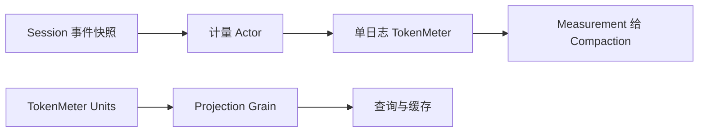

# TokenMeter 模块实现设计

## 职责与架构

TokenMeter 拥有单份追加日志的增量计量状态与固定估算算法。Session 提供事实，Compaction 消费 Measurement；TokenMeter 不选择压缩策略，不修改日志。旧 Plugin 的全局 Session 对象 map、mutex、EventObserver、Factory 和 UnitHandle 退出路径删除。

每个计量对象只处理同一次 Session 创建的日志。业务层不接受 Session.Context、CreationID 或框架引用；输入为事件快照与可选请求头。后续 Actor 按 Session 创建隔离 TokenMeter，框架负责请求调度与回收，不能在不同日志之间复用业务对象。

## 接口和数据

Meter.Measure(ctx, entries, requestHeader) 返回 Measurement；EstimateMessage 接收具名消息参数。TokenMeter 的 fold 保存 consumedEvents、请求头、Surface 节点及 token 合计、当前 step、usage anchor。这些字段是重放业务状态，不是调度状态。Measurement 保持已有 JSON 字段与计量口径。

Measure 复制已有 fold，增量处理新前缀，完成计量后一次安装候选结果；取消、非法事件或估算失败不改变已安装状态。读取早于在线进度的历史前缀时从零计算，返回历史结果而不倒退在线状态。调用方保证同一创建的日志仅追加，不用同长度的另一份日志替换输入。

三个 Projection Unit 保留 tokenUsage、contextPressure、contextBreakdown 的 canonical key、状态版本与算法。Units 返回独立 Unit 集合，组合根通过 Projection Grain 的 Register 请求注册；Registry 拥有注册身份，TokenMeter 不直接操作它。注册回滚与关闭通过具名 Remove 请求完成，不能恢复 UnitHandle。

## 上下游流程

## 迁移与验证

先迁移纯业务计算及投影测试，随后接通 Actor 请求、Unit 注册和 Compaction 消费者。删除旧 Plugin 测试不表示新生命周期通过；Actor 注册回滚、创建隔离与关闭验证仍须补齐。旧 Compaction / assembly 同步 Service 调用允许暂时不编译，不提供兼容工厂。

## Grain 请求实现

每个 SessionID 对应一个长驻计量 Grain，框架名称就是 SessionID。meters 将 CreationID 映射到该次创建的 TokenMeter；存在且为 nil 的项表示已关闭，用来拒绝延迟的计量请求。该关闭记录只在当前激活期间有效；长期停用与重新开放仍由 Session 生命周期授权控制，不能声称本地 map 能跨框架重启保护身份。

Measure 携带 SessionID、CreationID、完整事件快照及可选请求头；Grain 校验目标 Session 后委托纯业务对象，回复 Measured{Value,Err}。EstimateMessage 携带消息值，回复 Estimated{Tokens,Err}，不分配 Session 重放状态。Close 携带准确的创建身份，只释放该创建并保留关闭记录，重复关闭幂等。也接受 Session ClosedNotice，但正式关闭编排仍需请求 Close 并等待 Completion；通知投递成功不是业务关闭确认。

处理器只执行内存计算，直接 Response。调用方通过 RequestGrain 异步收取结果；没有同步 Ask、任务 goroutine、请求队列、mutex 或 callback 字段。事件快照由调用方从 Session 获取，不由计量 Grain 再读 Session；这样计量 cut 与 Compaction 使用的输入保持一致。Grain 不持有 Session、Projection 或 Compaction 对象。
