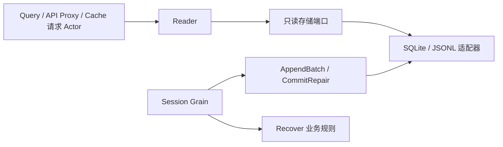

# Session Persistence 模块迁移设计

## 职责与删除边界

Session Grain 已拥有单 Session 的日志初始化、追加写、flush 前缀、实际任务完成与恢复。Persistence 不再通过 Plugin 订阅 Created / EventAppended / FlushRequested / Disposed 建立第二个写入 owner。删除 SessionLogStore、liveWriter、durableSessions、liveWrites、sessionGates、preparedSessions 和 Factory；不保留旧 Persistence Service 兼容接口。

保留消费者定义的窄存储端口、SQLite/sqlc 适配器、数据分页类型、Recover 与中断工具结果修复规则。存储适配器只执行指定 AppendBatch / CommitRepair，不决定恢复策略或业务关闭。Session Grain 直接使用其所需窄存储接口。共享适配器由组合根关闭。

## Reader 对象与接口

Reader 是无运行状态的持久化读取对象，只持有 ReadStorage。ReadStorage 是消费者定义的读取端口，包含 Load、Locate、ReadRaw、分页事件读取和 List；不暴露追加、修复、关闭操作。NewReader 验证端口非空。Reader 不拥有 Session.Context、准备缓存、锁、计时器、goroutine 或框架引用。

Inspect 验证完整持久化事实并返回分离的 Inspection，不补写中断 turn。ReadEventsFrom / ReadEventsBefore 保留页边界、连续性、已知事件类型和格式校验。List / ListSnapshots 保留排序与 cursor 校验。ReadRaw 保留原始格式能力与不存在错误。读取错误区分 NotFound、Corruption、UnsupportedFormat，不通过恢复写入掩盖错误。

Recover 是独立业务函数，返回恢复输入和 LogRepair；Session Grain 在修订校验后执行修复并重新读取。Reader 不调用 Recover，也不获取 Session 创建身份。

## 交互与生命周期

Reader 方法是普通 I/O，最终由请求 Actor 的框架任务调度调用，不能在跨 Actor 路径套同步 Ask。Reader 不关闭适配器。取消传给存储，错误不伪造空列表或不存在。

## 迁移影响与验证

删除旧运行时测试，保留 recovery 与真实 SQLite 测试；把分页校验、错误分类和数据复制迁到 Reader 测试。旧写后缓冲/关闭行为由 Session Actor 的实际阻塞存储、flush、恢复和关闭测试覆盖，不能据此宣称 Query/API Proxy 已切换。

旧 Session Context / MemoryStore 和 Query、Title、API Proxy、Subagent 仍需后续移除或迁移。这一步收拢 Persistence，不代表整个 Session 完成。组合根存储接线及 Reader 请求 Actor 仍待实现，不能恢复旧 Factory。

## 移除无消费者的总接口

旧 SessionLogStore 删除后，没有代码使用 persistence.Backend。该总接口重复 ReadStorage 与 session/actor.Storage、RecoveryStorage，并混入组合根的 Close 和无人调用的 BackendName。删除 Backend 及 SQLite.Adapter.BackendName；不增加接口嵌套来保留旧名字。

读取契约由 Reader 定义；Load / AppendBatch 由 Session Actor 的 Storage 定义；Revision / CommitRepair 由 RecoveryStorage 补充；适配器 Close 由实际拥有它的组合根调用。方法实现保留，但不存在要求每个消费者依赖所有方法的总接口。

## 持久化读取 Actor

`session/persistence/actor.Actor` 是普通 Actor，持有业务 Reader，以固定名字提供持久化读取。构造时接收 ReadStorage，由 Reader 校验并复制返回值；不持有在线 Session、Registry 或 Query 引用。组合根打开适配器，停止读取 Actor 后关闭适配器。

具名请求 Inspect、ListSnapshots、ReadEventsFrom、ReadEventsBefore 分别携带 SessionID 或既有分页值；回复 Inspection、Snapshots、Segment、Window 包含业务结果及 `Err error`。错误保持原类型。调用方使用 Request / RequestActor，I/O 在读取 Actor 的串行邮箱处理期间执行，不增加锁、工作队列或每请求 worker。请求上下文直接传给 Reader；取消是否立即中断 I/O 取决于存储支持，但不能把取消转换为成功结果。

上下游依赖为 Query/Projection 编排 → 持久化读取 Actor → Reader → ReadStorage。写入和恢复继续属于 Session，不经过该 Actor。它不是新的存储服务接口，也不替代 Reader 的业务校验。
