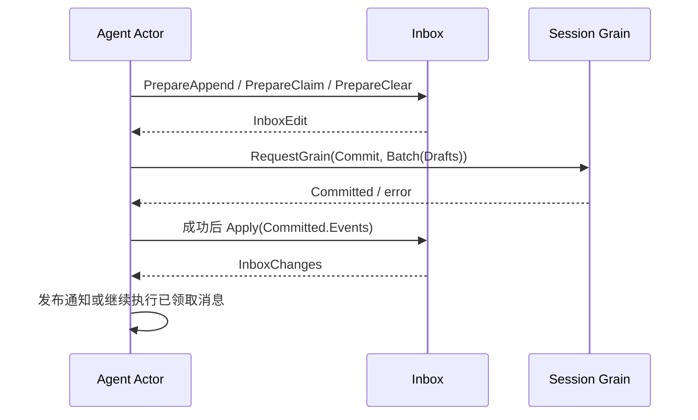

# Agent Inbox 业务迁移

## 职责与边界

Inbox 是 Session 持久化 splice 的业务投影，保存 next-turn / next-step 消息。它不代替 GoAkt 邮箱，不安排执行，也不持有 Session、Agent、通知回调、锁或 goroutine。框架邮箱负责命令串行；Inbox 列表负责可恢复的待处理业务消息。

## 接口与关键数据

Agent.InboxValue 返回 InboxReader，只暴露 NextTurn、NextStep、HasPending。具体 Inbox 由 Agent owner 持有，Prepare 与 Apply 不属于外部查询契约。返回接口不提供并发保护；跨 Actor 查询仍需消息请求。旧 API Proxy 的直接 Replace/Remove 调用需迁移为 Agent 命令，不保留同步写入接口。此变更只调整 Go 契约，不改变持久化 splice 或 wire 字段。

NewInbox(Header, events) 从 SeedLength 后的 splice 恢复状态。PrepareSplice / PrepareAppend / PreparePrepend / PrepareReplace / PrepareRemove 返回 InboxEdit{Drafts,Removed}，不更新在线状态。PrepareClaim 先取完整 next-step，再按需取一个 next-turn；PrepareClear 先取消 next-step 再取消 next-turn。复合变更的草稿通过一次 Session Commit 原子提交。

Apply 接收该 Inbox 尚未应用的已提交事件，原子更新状态并返回 InboxChanges{Inserted,Discarded,Claimed}；结果只有在 Session 提交确认后才可发布。Inbox 不保存请求 ID 或维护通知投递状态；Agent owner 必须按提交顺序且只应用一次，恢复使用完整 Session 快照重建。全局消息 ID 唯一性、normalized splice 范围与严格 JSON 保持原规则。

## 上下游流程

失败提交不调用 Apply，不发布 inserted/discarded/claimed。Apply 在分离候选上执行整批校验，后续非法 splice 不能污染前面的在线状态。Claim 的 turn 信息由 Actor 发布通知时附加，Inbox 不拥有当前 Agent turn。

## 迁移范围

移除 Agent.SessionValue：跨模块访问 Session 必须通过身份和请求，不返回可变 Context。Agent 其他旧 Registry/Scope/Inbox 调用方仍需后续迁移，不恢复包装。旧并发入队/同步通知测试转为业务原子性和恢复测试；真正提交顺序、失败提交与消息通知需要 Actor 集成验证，尚未完成。

## 当前验证

`agent/inbox_test.go` 已覆盖准备阶段无状态变化、取消提交不应用、提交后显式应用、日志恢复、替换取消语义、Claim/Clear 跨两组消息的一次批次提交、跨组重复 ID 拒绝、非法批次应用无部分结果和 SeedLength 边界。旧 Session 测试夹具已使用纯业务 Log。

`go test -race -count=1 ./agent ./session/...` 中 Agent、Session、Session Actor/Registry、Persistence、Projection 和 ProjectionCache 及其 Actor 测试通过；整个命令失败于尚未迁移的 Title 和依赖它的 Query。此结果不证明 AgentLoop 的 Actor 编排已接通。
