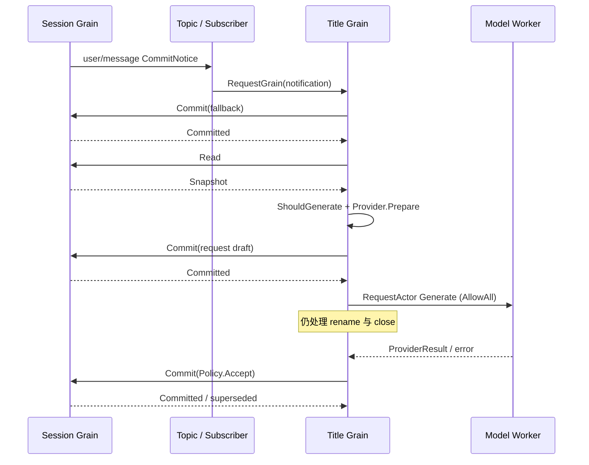

# Session Title 模块设计

## 职责与设计决策

Title 负责根据人工消息生成会话标题、人工重命名及显式刷新。自动生成只由 `user/message` 事件触发，使用独立的标题模型配置；不依赖 Agent 主请求、step 边界或 `request/header`，不维护日志消费游标、路由等待或双入口去重。

这是对旧 LogService 两条触发路径的明确调整：移除等待主请求路由的行为，以响应本轮对标题模块复杂度的修正。配置的 `LLM.provider` 与 `LLM.model` 必须明确给出，不再从 Session 主请求推断。保留 `session/title`、`session/title-llm-request` 的持久化结构、Source discriminant、消息序号和 title ProjectionKey。

## 模块架构与对象职责

| 对象 | 职责 |
| --- | --- |
| `Policy` | 标题规范化、fallback、人工标题锁定、结果来源校验、Session WritePlan |
| `ShouldGenerate` | 无状态判定人工消息是否符合 first-prompt/all-prompts 策略 |
| `Provider` / `Generation` | 准备一次独立模型调用及请求日志草稿，执行并校验结果 |
| `Grain` | 按 SessionID 寻址，处理标题命令与事件，安排异步请求及取消 |
| `binding` | 一个 CreationID 对应的 Session 身份、Header、Policy、Provider、Worker 与当前生成请求 |
| `generation` | 一次未完成请求的输入快照、取消函数和回复身份 |
| `worker` | 执行模型 I/O，利用框架邮箱在前序调用结束后回复 drain |
| `Subscriber` | 过滤一个 Session 创建的 Topic 通知并转交 Grain，不拥有标题业务状态 |
| `Unit` | 为 Projection owner 提供标题折叠算法 |

对象不循环嵌套。业务层不持有 Session、框架对象、回调或锁；Actor 通过 SessionID/CreationID 和 GrainIdentity 交互。CreationID 仅在 Actor 层校验，不进入标题事件。

## 接口与关键数据

`Initialize` 提供同名 Session Grain、已初始化 Header、标题 Config 和可选 Provider。Grain 不创建或关闭 Session。订阅就绪后才能接收新的用户输入。

`Read` 返回已提交标题。`Rename` 提交 user source 标题并取消当前生成。`EnsureFallback` 仅在没有标题时创建 fallback。`Generate` 支持显式模型生成；`Refresh:true` 允许替换发起时的人工标题，没有 Provider 或没有人工消息时执行 fallback 刷新规则。`Close` 取消生成并等待 Worker 实际返回。

`ProviderRequest` 只包含 SessionID 与人工消息。`Provider.Prepare` 返回 `Generation`，其中 Draft 是模型请求日志，Generate 执行独立配置的模型调用。Provider 不读写 Session。

`Policy.Accept` 生成条件写入计划：在 Session 提交时校验原标题事件序号和人工消息快照。生成期间的新人工标题或新人工消息使旧结果返回 `ErrSuperseded`。这项保护针对实际业务竞争，不承担消息去重。

## 自动生成与上下游流程

Subscriber 订阅 `session/event` 与 `session/closed`，按 SessionID 和 CreationID 过滤。人工文本到达时，没有 Provider 则只安排 fallback；有 Provider 则进入生成流程。人工重命名事件取消当前生成，其余 Session 事件不触发生成。

生成先提交 fallback，再读取生成快照。first-prompt 仅接受无 parent、无既有标题的第一条人工文本；all-prompts 接受当前最新人工文本。已有人工作出的标题则不自动生成。旧消息通知晚到时，不用它覆盖当前最新消息对应的标题。

## 调度、失败与关闭

Session 请求默认使用 StashNonReentrant，后续普通消息由框架暂存；模型 Worker 请求单独使用 AllowAll，生成期间可处理重命名和取消。多阶段结果使用 PipeToSelf 的具名消息，异步回调不持有池化 GrainContext。

Provider 准备或执行失败仍保留已提交的 fallback。模型请求日志提交失败则不调用模型。外部超时不表示 Session 提交或模型 I/O 已结束。

Close 先取消当前生成，再向 Worker 请求 drain。Worker 的框架邮箱在前序调用实际结束后才回复，Grain 确认后释放绑定。仅取消 context 或 Kill Worker 不算业务排空。关闭 Title 不关闭 Session；nil 绑定仅拒绝当前 activation 内的旧身份请求，重新激活授权仍需系统级接线。

## 验证与未完成范围

业务与 Actor 测试覆盖规范化、来源校验、无 Provider 刷新、人工锁定、迟到结果拒绝、Provider 失败保留 fallback、请求先记录再调用、生成期间 rename、关闭等待实际调用结束。

Topic 集成测试验证：只提交人工消息、不创建 step 或 request/header，也能通过 Subscriber 生成并提交标题。模型配置测试不再提供主请求路由。

重新激活授权、Provider 配置更新与完整生产组装仍未完成；局部 race 测试不能证明全项目重构完成。详细对象交互见包内 README，不扩散到历史设计文档。

## 空闲 worker 生命周期修复

Title Grain 的 binding 持有 worker 的资源责任，worker 必须使用 GoAkt LongLivedStrategy；普通 Actor 默认的空闲停用会让 binding 保留已消失的地址。关闭仍先取消生成，再等待 drain 回复，最后停止 worker 并释放 binding。不通过忽略 actor-not-found 掩盖丢失的资源责任。接口、Session 事件与持久化形状不变。验收覆盖超过默认空闲期限后再次生成和关闭，以及已有取消和关闭行为。
