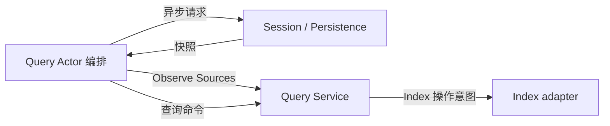

# Session Query 模块设计

## 职责与依赖

Query 负责 live 优先的来源选择、事件/标题/Surface 查询、关系追踪、检索条件和索引更新意图。Actor 从 Session 与 Persistence 获取快照，Query 不直接依赖 LiveStore、Persistence Service 或 Plugin，也不创建查询线程。

## 主要对象与接口

`Service` 持有已观测的来源快照、查询策略和索引实例引用。`New(Index, Config)` 不打开或关闭存储。`Observe([]Source)` 原子替换此次可查询语料：Source 包含完整 LogSnapshot 和 Live/Persisted 可用性。相同 Session 的 live 与 persisted Header 必须一致；live 日志优先。非法或冲突输入不能部分替换旧观测。

这是一个完整观测契约，不是逐条增量更新；Actor 可以复用未变的已读快照，但不得把部分分页结果当作完整语料发布。精确查询和标题批次查询在观测值上执行，不自行进行 I/O。每个标题错误仍单独返回。

索引来源版本由日志内容计算，不使用可变 Session 对象地址或 Actor activation 标识。Search 先根据来源版本构造 Reconciliation，再请求 Index；游标仍绑定 Query 实例与索引 generation。业务方法由 owner 串行调用，移除内部 mutex、goroutine 与持久化检查并发配置。

## 模块内划分

- `service.go`：查询策略、检索、游标与索引协调。
- `service_sources.go`：完整来源观测、live 优先选择、版本与防别名边界。
- `exact.go`：精确查询、标题、Surface 和事件关系。
- `documents.go`：Session 日志到检索文档的纯转换。
- `types.go`：具名业务值和 Index 存储操作契约。
- `sqlite/`：索引存储与 sqlc，不承担来源选择或 Session 业务规则。

## 上下游流程

Index I/O 的 Worker 调度留在 Actor 层；此阶段先完成 Query 业务层和真实 SQLite 索引验证。旧 Factory、Plugin 服务接口和后台检查任务直接移除，不加兼容包装。上游 API/Actor 尚未迁移时允许编译失败。

## 失败与生命周期

来源冲突、非法日志、查询参数与游标失效使用既有 typed query errors。Observe 成功前不替换当前状态，读取结果深拷贝。索引失败不冒充查询成功。存储打开、关闭与请求排空由组合根及 Actor 负责；Service 不持有业务生命周期标识。

## Query Actor 与来源请求链

Query 保持单个普通 Actor，不增加转发 Grain。每次具名查询先取得完整 Sources，再调用 Service.Observe 和查询方法；上游 API 不再先发 Observe，也不承担刷新责任。删除只由测试 Grain 启动的单次 Collector 及其 GrainReply 协议。变更原因是旧查询入口和收集入口分离，生产 API 可以在未刷新时直接查询，且多启动方无法保证观测发布顺序。

`query.Sources.ReadSources(context.Context)` 是来源消费端口，返回完整来源或错误；Service 的 live 优先、Header 冲突和索引规则不变。`actor.Logs` 实现端口，借用 Session Registry 和 persistence.Reader，读取在线列表、带 CreationID 的 Session.Read、持久化分页和离线日志；它是数据获取适配器，不是 Actor 业务 owner。失败不返回可发布的部分集合。

Actor 把原始查询 Stash，并用框架 PipeTo 执行来源读取和 Service 调用；等待时后续查询继续由框架 Stash。完成消息到达后只 Unstash 最早的原始查询，用该请求的 ReceiveContext 回复，随后恢复普通处理并 UnstashAll。GoAkt v4.5.3 Unstash 明确把最早暂存项放到邮箱前端，保持请求与回复对应；不保存 pooled ReceiveContext、不自行维护请求队列或请求 ID。等待、回复由行为切换表达，不增加重复业务状态机。

索引 I/O 与来源读取都在同一个框架任务内串行执行。停止时取消当前任务并等待完成，再由组合根关闭共享索引；请求超时不是索引操作完成的证明。来源获取失败返回当前请求对应类型的 Err，不查询旧观测冒充成功；失败不会调用 Observe。查询请求不承诺全局同一时刻，只查询本次成功获取的完整观测。PubSub 不是正确性的前置条件，未来增量优化不能取代请求前的完整性保证。

验收保留精确查询和真实 SQLite 索引测试；新增真实 Session/持久化分页查询，验证无显式 Observe 也能查询、Session 更新后再查询能看到新日志、来源失败明确返回、恢复后可继续，关闭等待任务退出。API Search 客户端契约不变。
