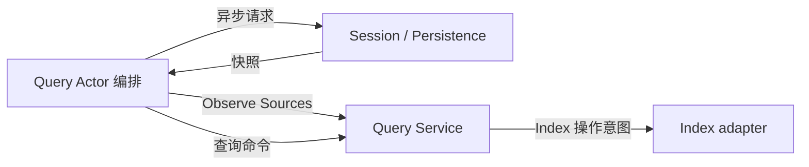

# Session Query 模块设计

## 职责与依赖

Query 负责 live 优先的来源选择、事件/标题/Surface 查询、关系追踪、检索条件和索引更新意图。Actor 从 Session 与 Persistence 获取快照，Query 不直接依赖 LiveStore、Persistence Service 或 Plugin，也不创建查询线程。

## 主要对象与接口

`Service` 持有已观测的来源快照、查询策略和索引实例引用。`New(Index, Config)` 不打开或关闭存储。`Observe([]Source)` 原子替换此次可查询语料：Source 包含完整 LogSnapshot 和 Live/Persisted 可用性。相同 Session 的 live 与 persisted Header 必须一致；live 日志优先。非法或冲突输入不能部分替换旧观测。

这是一个完整观测契约，不是逐条增量更新；Actor 可以复用未变的已读快照，但不得把部分分页结果当作完整语料发布。精确查询和标题批次查询在观测值上执行，不自行进行 I/O。每个标题错误仍单独返回。

索引来源版本由日志内容计算，不使用可变 Session 对象地址或 Actor activation 标识。Search 先根据来源版本构造 Reconciliation，再请求 Index；游标仍绑定 Query 实例与索引 generation。业务方法由 owner 串行调用，移除内部 mutex、goroutine 与持久化检查并发配置。

## 模块内划分

- `service.go`：查询策略、检索、游标与索引协调。
- `service_sources.go`：完整来源观测、live 优先选择、版本与防别名边界。
- `exact.go`：精确查询、标题、Surface 和事件关系。
- `documents.go`：Session 日志到检索文档的纯转换。
- `types.go`：具名业务值和 Index 存储操作契约。
- `sqlite/`：索引存储与 sqlc，不承担来源选择或 Session 业务规则。

## 上下游流程

Index I/O 的 Worker 调度留在 Actor 层；此阶段先完成 Query 业务层和真实 SQLite 索引验证。旧 Factory、Plugin 服务接口和后台检查任务直接移除，不加兼容包装。上游 API/Actor 尚未迁移时允许编译失败。

## 失败与生命周期

来源冲突、非法日志、查询参数与游标失效使用既有 typed query errors。Observe 成功前不替换当前状态，读取结果深拷贝。索引失败不冒充查询成功。存储打开、关闭与请求排空由组合根及 Actor 负责；Service 不持有业务生命周期标识。

## Query Actor 实现

`session/query/actor.Actor` 是普通 GoAkt Actor，持有一个 Query Service。Query 是已组装索引的单个查询 owner，不需要按 Session 虚拟激活；使用固定 Actor 名字寻址即可，无需额外 Grain 转发层。

构造函数接收配置及已经打开的 Index。Receive 处理具名 Observe、列表/过滤、标题、Surface、事件追踪与全文搜索消息，返回具名数据和 `Err error`。Index I/O 在该 Actor 上执行，普通 Actor 调用方使用 Request/RequestName、Grain 调用方使用 RequestActor 等待异步回复；Actor 的框架邮箱串行化 Source 更新、索引协调与查询。没有锁、goroutine、回调任务队列或运行状态字段。

Actor 停止不关闭由组合根拥有的共享适配器。来源快照收集仍属于上游 Actor 编排，完整 Observe 必须在它成功后发送；本步骤不把来源失败转换为空集合。

Query Actor 已通过真实 GoAkt 请求和 SQLite 集成测试，验证来源、精确读取、批次标题错误、Surface、关系与全文检索；停止 Actor 不关闭组合根索引。来源收集和生产 API 接线仍待完成。

## 来源收集实现

一次性 `Collector` 普通 Actor 负责一次完整来源收集和发布；其上游 Grain 提供独立的 GrainReply，使用 DeferResponse 等待最终 Completion。Collector 不保留 ReceiveContext，不建立第二个 Query Grain。上游对同一个 Query 串行发起收集，完成前不能开启下一次，避免不同轮次倒序发布。框架 Spawn 必须开启 AllowAll 请求重入；失败由启动方回复，成功后 Collector 负责回复并退出。

构造字段 Registry、Persistence、Target 分别是在线目录 Grain、持久化读取 Actor、Query Actor 的框架身份，Reply 是本次调用的回复句柄。私有字段仅保存本次 live 列表、已读 Sources、持久化当前页和页内位置；不保存跨轮次缓存、update ID 或业务状态机。

流程：ListSessions → 逐个 Session.Read(CreationID) → 持久化 ListSnapshots 分页 → 对离线项 Inspect → Query.Observe → Completion。在线项只采用持久化 Header 确认身份与存在性，不额外读取可能较短的耐久日志；live 优先和 Header 冲突仍由 Query.Service 判断。持久化列表不提供跨页事务快照；结果是成功读取的观测，不承诺全局同一时刻。

任何请求、类型或业务错误都会结束收集且不发送 Observe。全部来源成功后只发送一次 Observe；其失败也明确返回。Collector 停止但尚未回复时返回失败，不关闭三个独立 owner。框架停止与完成发布之间可能存在不确定结果，失败方重试前必须等待旧收集 Actor 已停止；不能把超时当作未发布证明。生产调用链与关闭排空仍须接入。
