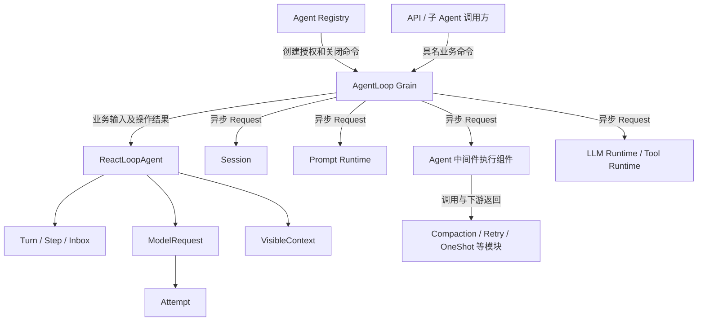
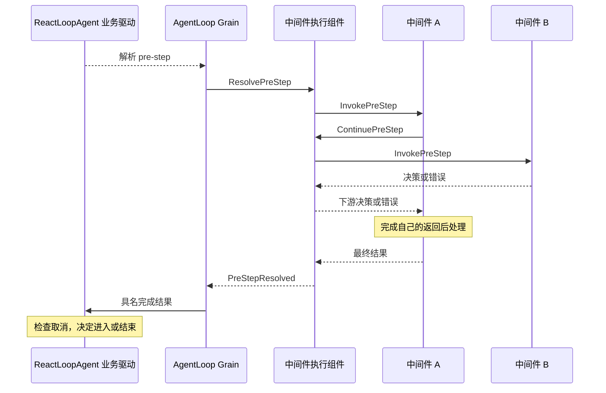
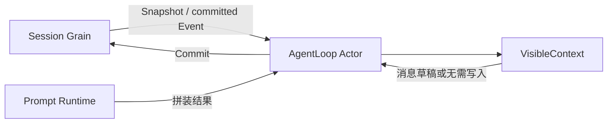

# AgentLoop 需求与实现方案

状态：业务接口、状态机和部分 Actor 驱动已实现并通过包级验证；完整模型/工具主驱动及生产执行链未完成。本文保留设计演进记录，当前实现以末尾的状态机、直接编排与领取恢复章节及模块 README 为准。

本文首先规定完整业务行为与边界，后面的实现片段不能替代需求。已对提交快照中的 agent、agentloop、systemprompt 子包及 session 根包执行非缓存 race 测试、vet 和 build；包级验证不能用于宣称完整重构完成。

## 需求依据及适用范围

AgentLoop 的源码依据是 [固定兼容基线](../01-porting-scope-and-baseline.md) 中的 `47f943859bef60e4160492346772ded9b24f765a`；本次通过 `git show` 读取该提交，未使用参考仓库当前 HEAD。Compaction 消费者采用该文档明确准入的 `b150a55` 专项基线。

用户已经明确的架构变更优先于旧 Plugin 设计：移除 Plugin/Scope；Agent Registry 管身份和父子生命周期，AgentLoop 管单 Agent 执行；子 Agent 创建时复制父配置并覆盖；组件初始化使用异步 Request；工具配置更新等待前序完整用户消息结束；业务与 GoAkt 隔离。它们不意味着删除旧扩展点的业务能力。

源码依据：

- [ReactLoopAgent：send、wakeDriver、preStep、turn、step、buildRequest](https://github.com/deepseek-ai/deepseek-harness/blob/47f943859bef60e4160492346772ded9b24f765a/packages/core/agent-loop/src/agent.ts)。
- [Agent 接口和扩展契约](https://github.com/deepseek-ai/deepseek-harness/blob/47f943859bef60e4160492346772ded9b24f765a/packages/core/agent/src/runtime-types.ts)、[emit/serial/waterfall 的职责](https://github.com/deepseek-ai/deepseek-harness/blob/47f943859bef60e4160492346772ded9b24f765a/packages/core/agent/src/dispatch.ts)。
- [前置拦截用例](https://github.com/deepseek-ai/deepseek-harness/blob/47f943859bef60e4160492346772ded9b24f765a/packages/core/agent-loop/tests/interception.spec.ts)、[请求恢复用例](https://github.com/deepseek-ai/deepseek-harness/blob/47f943859bef60e4160492346772ded9b24f765a/packages/core/agent-loop/tests/request-error.spec.ts)、[边界回归用例](https://github.com/deepseek-ai/deepseek-harness/blob/47f943859bef60e4160492346772ded9b24f765a/packages/core/agent-loop/tests/contract-regressions.spec.ts)。
- [模型请求重建检查](https://github.com/deepseek-ai/deepseek-harness/blob/47f943859bef60e4160492346772ded9b24f765a/packages/core/agent-loop/src/invariant.ts)、[工具批次调度](https://github.com/deepseek-ai/deepseek-harness/blob/47f943859bef60e4160492346772ded9b24f765a/packages/core/agent-loop/src/tool-calls.ts)。

## 完整执行需求

### 接纳、初始化和唤醒

初始化必须在业务消息执行前完成必要组件接线与基线读取。未完成全部所需依赖时只能报告当前初始化段完成，不能报告生产 Agent 已就绪。模型选择检查必须区分部署配置校验和最终请求校验：源码允许 `agent/request` 给无默认模型的 Agent 提供模型，不能在该中间件运行前永久拒绝这种 Agent。

Followup 进入 next-turn 并唤醒；Steer 进入 next-step 并唤醒；Inject 进入 next-step 但不唤醒。已经取消的执行不能接走后来需要唤醒的新消息，源码将此类输入归入下一 Turn。取消后的唤醒、维护期间的唤醒、关闭期间不启动新工作需要显式业务规则，不能简单等同于 Inbox 非空。

特别是源码 wakeDriver 允许一次已成立的空闲唤醒在消息随后被清除时仍形成无 Step 的 Turn。当前 PrepareTurn 只检查 HasPending，尚未覆盖这个区别，必须先建模接纳与执行的关系。

### Turn 与 Step

先提交 turn/start，再领取输入。首 Step 领取所有 next-step 加至多一个 next-turn；后续 Step 只领取 next-step。领取只能在持久化变更确认后生效，不能取消相邻未领取输入。

按本轮确认的顺序，领取后先运行完整 agent/pre-step，再读取新 Session、组装 Prompt 和运行上下文。源码原顺序在钩子之前派生上下文；此处明确调整，以免压缩改变 Surface 后仍使用旧上下文去重结果。钩子的输入与默认决策分别克隆领取消息，运行上下文在钩子完成后追加。

拒绝产生 blocked 的无 Step Turn；首 Step 进入结果为空产生 completed 的无 Step Turn；已有终结结论且后续进入结果为空时不再开 Step。只有确认 step/start 后，才逐条提交进入消息并执行模型。已开 Step 必须进入 step/end 收尾；step/start 未提交成功不能伪造 step/end。

### 模型请求与重试

每次尝试重新经过 agent/request 获取最终配置，再准备同一 Adapter 注册绑定的调用。只有最终配置解析完成后检查 provider/model。请求头保留 initial/resume/change 语义和适配器默认值来源；上下文窗口变化写 request/context。

模型可见历史从已提交 Session Surface 派生。前置中间件可能压缩或修改日志，因此历史读取必须在这些修改完成之后。发送前校验请求与可见历史、折叠 Header 一致；即使 llm/stream 中间件直接提供缓存或替代流，这项检查仍须执行。

源码允许没有已登记 Adapter 时由 llm/stream 中间件提供流；不能把所有请求都强制改为必须存在 PreparedLlmCall。真实 Adapter 终端派发仍要求有效注册。这一兼容需求尚未在当前 actor 请求入口中覆盖。

原始块先写 assistant/chunk 再组装；只公布已经提交的 assistant/message，保留块序号、usage 和 replay 信息。finish 的 error/aborted 进入 agent/request-error；只有明确重试决定才启动下一尝试，默认终止。中间件自身抛错不进入模型恢复；取消优先于重试决定；提供者的 aborted finish 与业务取消不是同一含义。

### 工具批次

Tool Runtime 拥有前置策略、审批、最终执行限制、执行中间件和后置处理；AgentLoop 不复制这些规则。批次需要保留并发上限、独占边界、按模型顺序提交、已开始调用的取消收尾及未开始调用的取消结果。additionalContexts 必须保持工具结果与调用关联，不抢占当前尚未完成的工具结果处理。concludesTurn 不丢弃已经进入 next-step 的上下文或 Steer。

用户确认的工具更新屏障位于前序完整用户消息结束后，属于相对源动态注册行为的明确变化。运行中的工具定义、实例与 Prompt 版本必须一致，配置通知到达不代表更新已经应用。具体协议归 [工具实现](./08-tools-implementation.md) 和 [Prompt 模块](./17-prompt-module.md)。

### 停止、维护与关闭

有终结结论且没有 next-step 输入时，按序等待 agent/turn-stopping。钩子可 Steer，完成后重新读取 Inbox：有输入继续同一 Turn，无输入才结束。停止钩子错误形成 Turn 错误，不能当作普通通知吞掉。

Turn 的 max-tokens 结论不能被后续正常完成降级；取消和错误按相应结论收尾。当前 Goren 明确要求 turn/end 后 Session flush，只有所需前缀持久化完成才关闭本轮业务执行。whenIdle 需要覆盖后继执行收敛，而不是一条请求的回复。

维护与模型执行互斥；维护期间收到的唤醒输入在维护结束后处理。旧 runMaintenance 的任意回调接口不直接跨 actor 搬运，但维护这一业务能力不能因删除 Agent interface 而消失。父子关闭由 Agent Registry 协调，各 AgentLoop 自行释放资源；技术停用不等于业务关闭。

## 前置检查与中间件职责

| 边界 | 返回内容 | Owner |
| --- | --- | --- |
| 输入接纳 | 接纳、目标 Inbox、是否唤醒 | AgentLoop |
| agent/pre-step | enter/messages 或 reject | Agent 中间件 |
| agent/request | 最终 CallConfig | Agent 中间件、LLM |
| 请求重建检查 | 允许发送或明确错误 | AgentLoop |
| agent/request-error | retry 或终止 | Agent 中间件 |
| tools/pre-execute | allow、deny、ask 及后续执行限制 | Tool Runtime |
| llm/stream | 原始、包装或替代流 | LLM Runtime |
| agent/turn-stopping | 有序完成或错误 | Agent 中间件，ReactLoopAgent 复查 Inbox |
| 状态及 Inbox 通知 | 不返回业务决策 | 事件 owner |

不能用统一的布尔前置检查取代上述契约，也不能用 PubSub 代替需要返回结果的决策或串行钩子。Compaction 的压力处理失败默认记录后继续 next，是该消费者自己的策略，不是所有 pre-step 错误都应被吞掉。

## 中间件异步设计的约束

以下是已由源码确定的语义要求，不是尚未验证的 Go 接口声明：

1. 支持执行下游之前的异步工作、等待下游、处理其结果或错误，以及不调用下游直接返回。
2. 输入与返回值采用具名业务类型。中间件不能通过可变输入别名改写已经记录的消息，也不能持有 AgentLoop/Session 活对象。
3. 保留有效注册顺序和 prepend 能力；不能凭猜测规定所有全局中间件都先于 Agent 局部中间件。
4. 每次调用明确采用哪些定义；变更不能把执行到一半的链拼成新旧混合。定义的发布、移除及在途调用结束需要同一生命周期契约。
5. 每个扩展点保留自己的默认终端结果及错误传播，不建立任意事件名加 any 参数的总入口。
6. 不跨 actor 传可执行 next 函数；后续调用与结果回传通过异步请求接续。不能通过在 Grain 邮箱里同步等待别的 actor 来模拟 await。
7. next 的调用次数以已核对的实际契约为准。当前 Go waterfallStep.Execute 明确只允许一次，重复调用返回 ErrWaterfallAlreadyExecuted；actor 迁移保留这一现有 Go 契约。尚未核对固定版 Cordis 对全部用法的实现，不据此宣称完整 TypeScript 兼容。

建议的执行形式是每 Agent 的中间件调用协调：业务对象维护调用顺序和返回路径，框架适配器调度所属能力。前置工作、下游调用、返回后的工作都通过具名接续表达。中间件定义、每次调用状态、注册生命周期是不同职责，不能都塞入 ReactLoopAgent。

下节将这些约束落实到 Agent 扩展点的接续协议；不据此生成跨所有能力的通用执行器。协议首先覆盖以下四个真实消费者：

- Compaction：请求能力并完成后才进入下游；失败按原消费者策略处理。
- Time Context：等待下游结果，拒绝时不改写，否则附加消息。
- 直接拒绝：不调用默认终端，不产生 Step 和模型调用。
- Turn-stopping：钩子请求 Steer 并等待提交确认，然后结束钩子；ReactLoopAgent 继续本轮。

最后一例约束重入：等待中间件时必须允许其所需的输入和取消命令进入 AgentLoop，但不能开始第二个执行。若整个等待使用 StashNonReentrant，钩子等待 Steer、ReactLoopAgent 等待钩子会形成互等。允许重入不代表允许配置更新绕过业务屏障。

## Agent 中间件的异步接续协议

本节是 Go actor 实现设计，不声称已获得行为测试证明。原有范围、事件名、输入与返回语义不变；传输和调用表示从 next 函数改为具名异步请求。LLM 流和 Tool 执行中间件分别归其 owner，不强行共用本节的数据类型。

### 对象及数据归属

Agent 的中间件执行组件负责一次链调用，关联指定 Agent 的有效定义顺序。定义保存稳定注册身份、扩展点及先后关系；框架路由存在适配层，不进入业务定义。每次开始调用捕获有序定义集合，后续的下游请求沿同一集合继续，不重新查询最新注册表。

业务调用对象拥有原始输入、默认结果、下游位置和返回路径。它不持有 GrainContext、GrainReply、PID、Context 或 AgentLoop 对象。框架适配层将这些业务请求映射到注册模块的 actor 路由，管理请求回复。

中间件自身的业务状态归对应模块。例如 Compaction 的次数和压力策略不进入链执行组件；Time Context 的刷新判断不进入 ReactLoopAgent。无异步工作的策略可以是普通具名业务对象，不因存在一个注册项就机械创建一个 actor；有异步能力依赖时由其模块的 actor 适配层编排。

### 具名请求

以下名字说明接口职责，尚不是已加入生产代码的声明：

| 请求 | 方向 | 结果 |
| --- | --- | --- |
| ResolvePreStep | AgentLoop → 链执行组件 | PreStepResolved |
| InvokePreStep | 链执行组件 → 注册模块 | PreStepResolved |
| ContinuePreStep | 注册模块 → 链执行组件 | 下游的 PreStepResolved |
| ResolveRequest | AgentLoop → 链执行组件 | RequestResolved |
| InvokeRequest / ContinueRequest | 链执行组件与注册模块之间 | RequestResolved |
| ResolveRequestError | AgentLoop → 链执行组件 | RequestErrorResolved |
| InvokeRequestError / ContinueRequestError | 链执行组件与注册模块之间 | RequestErrorResolved |
| RunTurnStopping | AgentLoop → 串行钩子执行 | 完成或 error |

ResolvePreStep 携带 agent.PreStepInput 和默认 PreStepDecision，二者分开：输入是领取的原始消息；默认决策是领取消息的独立副本；运行上下文在钩子完成后准备。ResolveRequest 携带 agent.RequestInput 和默认 CallConfig；ResolveRequestError 携带 agent.RequestFailure，默认不重试。结果分别封装该扩展点的业务值和 error，不使用总的 Result{Value any}。

Invoke 请求在 actor 信封中携带本次调用关联信息及 Continue 的技术路由。Continue 只标识所属调用，不允许注册模块自行提供“跳到第几个中间件”的索引；后续位置由链业务对象记录。关联信息不进入持久化事件，不充当 AgentID、CreationID 或新的业务配置身份。

### 下游调用与返回

A 收到 InvokePreStep 后，有两条基本路径：

- 直接回复 PreStepResolved：构成短路，后续处理和默认终端不执行。
- 发出异步 ContinuePreStep：链执行组件调用 B 或返回默认终端；A 收到下游结果后，可以保留、修改或处理错误，再回复原 InvokePreStep。

因此 A、B 的前后处理顺序为 A 前置 → B 前置 → 默认结果 → B 返回处理 → A 返回处理。Continue 不是通知，不用 Tell 代替需要结果的请求；不把函数塞入消息。

返回路径以调用关联表达，不让 A 对象持有 B 对象、B 再引用 A。中间件业务对象通过具名操作描述“继续下游”或“返回结果”，actor 适配层负责 Request 和回复。错误也沿原返回路径传递，让上游中间件保留处理下游错误的机会；链执行组件不能统一吞掉错误或统一变成模型重试。

当前迁移保留旧 Go 已有的单次 next 契约：同一 Invoke 调用只接受第一次 Continue，再次 Continue 明确返回重复继续错误，不再次执行下游，也不复用首次结果冒充新执行。该约束对应 plugin/waterfall.go 的 waterfallStep.Execute 及 waterfall_test.go 的重复执行用例。前版提出多次或并发 Continue 支持没有对应的当前生产需求，已撤回，不作为此次实现前提。若以后纳入确实需要多次 next 的源消费者，再单独评估兼容影响。

调用结束后不再接纳新 Continue；已开始的下游操作须按其 owner 的取消和收尾契约结束，不能向已完成的上游重复回复。上述是本次调用生命周期的设计规则，不能用永久调用记录代替实际资源回收。

### 四条源码行为的具体走查

**Compaction 前置处理。** 固定专项基线 [compaction-basic](https://github.com/deepseek-ai/deepseek-harness/blob/b150a55/packages/compaction/compaction-basic/src/index.ts) 的 pre-step 先等待 compactIfNeeded，再调用 next。对应的业务调用先请求 Compaction 能力；能力完成后按该策略决定报告错误并继续，随后 ContinuePreStep；下游完成后返回结果。不能在发出压缩请求后立即继续，也不能由 Grain 硬编码“压缩失败一律继续”。取消原因继续传递，外层 ReactLoopAgent 在进入 Step 前检查取消。

**Time Context 返回处理。** 固定 [time-context](https://github.com/deepseek-ai/deepseek-harness/blob/47f943859bef60e4160492346772ded9b24f765a/packages/context/time-context/src/index.ts) 使用 prepend 并先 await next。对应调用先 ContinuePreStep；下游拒绝则原样返回；否则根据该模块读取的时间和上下文判断是否生成附加消息，再返回 enter。该模块所需读操作也通过异步能力边界完成，时间策略不放到链执行组件。默认结果与返回值使用分离消息，不改写已经持久化的输入。

**直接拒绝。** 固定 interception.spec.ts 的 reject 用例不调用 next。对应注册模块直接返回 reject；链执行组件原路返回该值，ReactLoopAgent 写 blocked 的 turn/end，不产生 step/start 和模型调用。已领取批次和相邻未领取输入仍按 Inbox 契约区分。

**Turn-stopping Steer。** 固定 contract-regressions.spec.ts 的停止监听器 Steer 后，模型在同一 Turn 再请求一次。Go 方案中 RunTurnStopping 按有效顺序 Invoke 各钩子；钩子通过 Agent 输入命令提交 Steer，并等待 Changed 后才回复完成；最后 ReactLoopAgent 重新检查 Inbox。此处无 around/default-next 结果，不能复用 ContinuePreStep。源码中 Steer 为同步入队，改成异步提交后等待确认是保持可观察顺序所需的映射。

### 重入、取消和定义生命周期

链执行组件等待 Invoke 期间必须能处理 Continue；注册模块等待外部能力或下游时必须能接收相应完成与取消；AgentLoop 等待链期间必须能处理钩子所需的 Steer/Inject。否则形成 AgentLoop 等钩子、钩子等输入回复的循环等待。使用逐请求的重入配置，业务执行是否允许推进仍由业务调用状态决定，不以 AllowAll 代替业务判断。

在途调用采用其开始时的定义集合。移除定义先阻止后续调用选中该定义；已经选中的调用及其模块资源按所属生命周期收尾，不能仅删 map 后立即失效。用户已确认的工具更新屏障继续按完整用户消息执行；是否将所有中间件动态重配置统一放在相同边界，需要随注册能力实现明确，不将这一扩展规则伪称为已确认要求。

取消关闭调用接纳，并传递给已开始的模块工作；框架取消等待不等于模块已退出。模型恢复链收到 retry 时，ReactLoopAgent 仍检查本轮取消事实。定义变化、取消、正常完成三类原因必须分别保留，不新增业务状态字段去复制 GoAkt 的投递与激活状态。

### 实施前仍需补齐的契约

具名请求与返回路径已经足以走查上面四个消费者，但不能据此声明所有中间件已覆盖。下一步必须检查：纳入模块的完整清单与最终注册顺序；每模块异步能力输入及取消回复；重复 Continue 的明确拒绝；移除定义期间的资源释放；LLM 替代流与 Tool around 中间件的独立协议。生产代码迁移必须跟随实际消费者完成，不新建空的通用中间件框架占位。

## Goren 实际消费者与注册顺序核对

本节依据当前工作区的旧实现和组合代码恢复迁移范围，不代表这些旧模块现在能编译或默认服务器可以启动。源码参考消费者、Goren 已有消费者和新设计中的示例必须区分。

| 消费者 | 扩展点 | 当前接入证据 |
| --- | --- | --- |
| LLM Retry | agent/request-error | [Recovery](../../llm/retry/recovery.go) 的恢复决策与 [Grain](../../llm/retry/actor/grain.go) 的异步编排 |
| Compaction Basic | agent/pre-step、agent/request-error | [plugin.go](../../compaction/basic/plugin.go) 的 Manifest，受 automaticEnabled 控制 |
| OneShot 描述信息 | Agent 局部 pre-step | [descriptor_middleware.go](../../subagent/internal/oneshot/descriptor_middleware.go)、[setup.go](../../subagent/internal/oneshot/setup.go) |
| API 模型选择 | Agent 局部请求配置 | [model_selection_setup.go](../../apiproxy/session/model_selection_setup.go) 仍调用已删除的 Agent setup 契约 |
| Time Context | pre-step 返回处理 | 固定 TS 源的语义参考；本次未在 Go 默认组合及独立模块中找到对应接入 |

### 默认组合的有效相对顺序

[DefaultSpecs](../../internal/assembly/catalog.go) 中 LLM Retry 先于 Compaction Basic。旧 [waterfallRegistry.add / appendWaterfallScope](../../plugin/waterfall.go) 按注册 ordinal 排序，并按父 Scope 到子 Scope 选择；`agentScope.ResolvePreStep / ResolveRequest / ResolveRequestError`（已移除的旧实现） 将 Agent 局部链作为默认终端交给外层链。

对这两个已登记的 request-error 消费者，已有组合的目标顺序是 Retry 在外、启用时的 Compaction Overflow 在内，再到不重试的默认终端。不是从“全局总是先于局部”猜出的规则，而是上述旧实现与组合顺序共同得出的迁移依据。移除 Scope 后应在组件初始化时明确提供这个有序业务定义集合，不继续依赖父 Scope 遍历。

Compaction 的自动注册由 policyCatalog.settings.Auto 决定。不能因为 DefaultSpecs 中存在 Compaction Basic 就断言压力和溢出中间件始终开启。Tool Result Pruner 是压缩协作能力，不能根据它的装配位置把它捏造成第三个 Agent request-error 中间件。

### Retry 与 Compaction 的返回关系

LLM Retry 的 Normal 策略先判断失败是否可重试、次数与等待规则；不处理时继续下游。Always 策略先等待下游恢复结果：下游已经返回 retry 则直接采用；下游不恢复或报错时按已有策略决定是否记录错误并安排退避。取消在这些边界优先结束。

这说明 request-error 也必须有返回后的处理，不能写成“依次遍历直到某个处理器返回 true”。Retry 的 scheduled/started 持久化事实、定时等待和取消都归 Retry 模块；等待定时器由 actor 调度，不能让 ReactLoopAgent 自己管理退避计数和定时器。Compaction 成功修改 Surface 后的恢复证明继续归 Compaction 模块。

对应的异步实现应保留：Retry Invoke → 可选 ContinueRequestError → Compaction 能力完成 → 下游结果返回 Retry → 可选提交 scheduled → 等待 → 提交 started → 返回 retry。ReactLoopAgent 只接收最终 RequestErrorResolved 并检查本轮取消，不吸收这条模块内部流程。

### OneShot 的后置持久化

现有 descriptorAppender 首先调用下游。只有结果为 enter 且没有下游错误时，才构造并提交 OneShot descriptor；提交成功后记录已经追加，随后返回原进入决策。它比 Time Context 更能代表 Goren 已有的“下游结果之后还要等待 I/O”需求。

迁移对应：InvokePreStep → ContinuePreStep → 检查返回决策 → 异步 Session.Commit descriptor → 确认成功 → 回复 PreStepResolved。拒绝不写 descriptor；提交失败不能提前把已追加状态置为真，也不能让 ReactLoopAgent 先开 Step。该状态归子 Agent 的 OneShot 业务调用，不放到 AgentLoop 或公共链执行组件中，不保留原来的 mutex 与 Session 活对象引用。

### 模型选择接入缺口

API 的 selectionSetup 仍依赖 agent.NewModelSelectionSetup、agent.Agent 和 ScopeEditor；相关 Agent 契约已经删除。因此当前仅有 ResolveModelSelection 数据解析不能证明 API 选择已应用到后续模型请求。

目标是 API 选择产生业务配置变更，在已经确定的更新边界进入请求配置解析；最终请求必须采用该选择并保留已提交来源。不得因此恢复 Scope，也不得顺带恢复用户未要求的模型变量注入 Prompt。下一步需给出 API 变更到 request 配置的实际调用链和失败回复，再删除旧 selectionSetup。

### 由此确定的实现优先级

优先使用 Goren 已有消费者作为迁移验证对象：直接拒绝与默认进入验证最小链；OneShot 验证返回后的 Session 提交；Retry/Compaction 验证下游错误处理、外部能力和定时等待；模型选择验证 API 到下一次请求的配置应用；停止钩子验证反向提交 Steer 的重入路径。Time Context 保留为源码语义参考，不在没有单独范围要求时新增该产品模块。

## AgentLoop 目标实现方案

本节是待实现的模块方案。按用户最新范围，只完成设计，不要求本次连接真实消费者或生产调用链。下面的接口名称用于确定实现职责，不表示已经声明、编译或验证。已有局部实现只能按本节评估复用，不能反过来限制目标设计。

### 模块边界与对象职责

AgentLoop 是单个 Agent 的执行 owner，身份使用 SessionID。Agent Registry 负责创建授权、身份及父子关系；AgentLoop 不创建第二份父子表，不直接保存 parent/child ReactLoopAgent 引用。Session 独立持有日志；Prompt Runtime 独立组装提示词；Tool Runtime 独立管理该 Agent 的工具实例。组件路由由创建协调提供，组件配置和资源由 AgentLoop 初始化时异步请求，不提前注入已构建的业务实例。

| 对象 | 唯一职责 | 不持有 |
| --- | --- | --- |
| ReactLoopAgent | 输入接纳、唤醒、完整执行推进及关闭准入 | GrainContext、PID、Session 实例 |
| Inbox | 已提交输入及领取规则 | 执行调度、模型调用 |
| Turn | 一轮的编号、结论及开始/结束事实 | ReactLoopAgent 反向引用 |
| Step | 一步的编号、进入及结束不变量 | Turn 或 ReactLoopAgent 活对象 |
| ModelRequest | 一步内的模型尝试及恢复流程 | Retry/Compaction 策略 |
| Attempt | 一次模型调用的请求事实、流块与消息确认 | provider、流句柄、actor 路由 |
| VisibleContext | 从已提交 Session 派生上下文消息 | Prompt 配置所有权 |
| 中间件调用对象 | 本次有序调用与下游返回关系 | 具体压缩、退避或审批策略 |
| Grain | 请求映射、回复关联、框架取消和资源句柄 | 第二套 Turn/Step/模型业务阶段 |

ReactLoopAgent 组合 Turn、Step 和当前 ModelRequest；ModelRequest 组合当前 Attempt。子对象不引用父对象，返回业务结果供父对象推进。中间件调用对象由 Agent 中间件执行组件管理，ReactLoopAgent 仅请求并消费最终决策，不嵌入具体消费者。以上都不是“一对象一 actor”：业务对象留在同一执行 owner 内，框架隔离实际能力边界。

图中箭头是依赖或消息方向，不是双向对象持有。Session、Prompt、LLM、Tools 不依赖 ReactLoopAgent 实现。业务包不得导入 actor 子包；框架适配层依赖业务契约。保留 Agent 的对外能力语义，通过消费者需要的窄接口表达，不恢复带 Scope、Plugin 和 Session 活对象的旧总接口。

### 业务驱动与框架接口

ReactLoopAgent 必须提供能推进完整用例的业务入口。现有 PrepareTurn、ConfirmStep 等方法可以作为内部不变量操作，但不能要求 Grain 按业务知识逐个拼接它们。

驱动采用“输入 → 业务决定下一操作 → 框架执行 → 具名完成结果 → 继续业务”的方式。业务方法自身立即返回数据，不等待外部能力；模块之间仍使用异步 Request。这与在 actor 中同步调用其他组件不同。

| 业务入口 | 输入 | 结果及责任 |
| --- | --- | --- |
| Restore / Initialize | 已分离 Session 基线、有效组件配置 | 验证并建立就绪条件 |
| Submit | 消息、Followup/Steer/Inject 模式 | 输入提交提案及提交后唤醒规则 |
| ConfirmInput | 本次提交的 Inbox 变更事实 | 更新 Inbox，决定是否需要启动驱动 |
| Advance | 当前驱动所请求操作的具名完成结果 | 更新业务事实并返回下一操作 |
| Cancel | 取消原因及 KeepInbox | 固定取消事实，产生必要输入编辑和取消指令 |
| PrepareClose | 关闭准入命令 | 拒绝新输入，判断现有工作是否结束 |
| Inspect | 无 | 分离的执行状态和 Inbox 视图 |

Submit/ConfirmInput 是目标入口，用于合并现有 Append/Apply 周围缺失的接纳和唤醒规则；并非在现有入口外增加第二套接纳层。配置、维护、关闭也有各自具名入口，不通过任意字符串事件分发。

主驱动的 Operation 和 Completion 使用包内封闭 interface，具体成员具有业务含义：提交 Session 事实、读取 Snapshot、组装 Prompt、解析 pre-step、解析请求配置、执行模型尝试、执行工具批次、运行停止钩子、flush、完成本轮。每个成员携带具名输入或结果及 error；不采用 Value any、可执行 next 或任意 callback。

驱动一次只等待一个能够改变主流程的结果。异步 Inbox 输入另走 ConfirmInput，不把它当作模型/钩子的完成结果。Grain 根据发出的具体操作映射回对应结果，校验技术关联；ReactLoopAgent 校验业务位置、Session 身份和已提交事实。旧请求的回复不能推进新的调用。技术关联留在适配层，不进入 Session 事件或业务配置。

框架负责邮箱、请求超时、回复保存和任务唤醒；业务负责“是否已领取输入”“是否已确认 step/start”“本轮是否取消”等事实。不能用删除所有状态来代替业务建模，也不维护复制框架激活、投递、等待队列的状态。

### 关键数据与状态归属

ReactLoopAgent 保留身份、Inbox、当前 Turn/Step、当前 ModelRequest、有效配置和关闭准入。执行模式区分尚未就绪、空闲、执行、维护；关闭准入单独表示，因为停止接收新输入后，仍可能需要执行完已接纳工作。目标应合并现有分散的判断，不同时保留两个相互推导的阶段表。

唤醒事实独立于 Inbox 非空：Followup/Steer 可建立执行意图，Inject 不建立；唤醒成立后消息被清除仍可能形成无 Step Turn。维护和取消后的新输入按已核对源规则保留后续唤醒。这个事实属于业务行为，不是待处理消息队列的复制。

一次已领取输入保留消息列表、Turn/Step 位置及对应 PromptAssembly，直到这些消息提交或本次进入被拒绝。中间件输入是领取消息，默认进入结果可以附加 VisibleContext，二者必须分离。副本不可被中间件通过别名修改。

Session 的 WriteResult/WriteBarrier 是“已提交/已持久化”的事实依据；Turn/Step 编号不能在草稿产生时递增。CreationID、InstanceID、GrainIdentity 只存在初始化授权、技术关联和关闭消息中，不成为模型输入、日志语义或业务对象互相查找的键。

### 前置检查的准确位置

前置检查不做成统一的 CheckAll。不同检查依赖的数据不同，过早执行会误拒绝合法请求，过晚执行会留下错误日志或外部副作用。

1. **输入接纳前**：检查初始化、关闭准入、输入合法性；决定目标 Inbox 与是否唤醒。持久化失败不返回接纳成功。
2. **开启 Turn 前**：检查有效执行意图、维护互斥及取消；先确认 turn/start，再领取输入。
3. **进入 Step 前**：领取确认 → Prompt 组装 → 取消检查 → pre-step 中间件 → 再检查取消及进入决策。reject 不创建 Step；enter 空消息按首步和当前结论处理。
4. **发送模型前**：agent/request 完成后才验证最终 provider/model；重新读取已提交 Surface，核对当前 Step、请求 Header 和发送参数一致。LLM 替代流也不能绕过请求一致性检查。
5. **执行工具前**：AgentLoop 验证模型响应已提交；Tool Runtime 执行 allow/deny/ask、审批与最终执行限制。ReactLoopAgent 不重复工具策略。
6. **结束或关闭前**：确认已开始的模型/工具工作已收尾、Step/Turn 边界已提交、需要的日志前缀已 flush。技术停用或取消等待不能代替这些确认。

### 中间件与串行钩子模型

AgentLoop 使用三个 around 决策入口：pre-step、request、request-error。单次调用捕获有效定义顺序；模块可短路，或通过一次 Continue 等待下游后修改结果、执行后置 I/O、处理错误。接口及真实消费者依据见前面的“Agent 中间件的异步接续协议”和“Goren 实际消费者与注册顺序核对”。

turn-stopping 是按序等待的钩子，不是 waterfall；状态通知是 observer 事件，不返回决策。llm/stream 和 tools/execute 各自保留流与工具的 around 能力，由 LLM/Tools owner 设计，不挤进 Agent pre-step 数据结构。

Grain 只执行 ReactLoopAgent 返回的 ResolvePreStep 等操作。它不知道 Compaction 应不应该运行、Retry 应等待多久，也不在 switch 中实现 OneShot 描述信息提交。需要异步能力的中间件由其模块处理；无 I/O 的策略可用普通业务对象，不机械分配 actor。

### 完整业务推进

正常路径为：确认输入 → turn/start → 领取 → Prompt → pre-step → step/start → 逐条 user/message → request 配置 → 请求历史/一致性检查 → 模型流与 assistant/message → 可选工具批次 → step/end。

有下一步工作则继续领取 next-step；已有终结结论且无 next-step 时，等待 turn-stopping，再检查 Inbox。钩子提交 Steer 并收到成功回复后才返回，因而新输入可以留在同一 Turn。结束时固定结论，提交 turn/end 并 flush，随后处理下一轮或进入空闲。max-tokens 结论不能被后续普通完成降级。

模型错误恢复是 ModelRequest 的子流程：接收失败事实 → request-error → 检查取消 → 明确 retry 时重新解析配置和读取历史 → 新 Attempt。一次失败的 Attempt 已开始的流必须先收尾。普通中间件错误结束本次业务流程，不进入提供者错误恢复；提供者 aborted finish 不自动等同于用户取消。

只有确认过 start 的边界才产生相应 end。输入或 header 提交失败不能继续发送模型；chunk 提交失败不能把未提交块作为已接受响应；flush 失败不能宣布 Turn 已释放。失败后保留重试收尾所需的业务事实和技术资源，不能重跑整轮来冒充清理。

### 重入与回复语义

等待模型、工具和中间件期间，Grain 允许必要的输入、取消和查询消息进入；不允许启动第二个主驱动。特别是等待 turn-stopping 时不能阻止 Steer，否则形成互等。等待影响 Inbox 基线的短暂 Session 提交时，由框架请求策略串行化，不能另外增加手写输入队列。

Followup/Steer/Inject 的回复说明输入已提交，不说明 Turn 完成。Cancel 的回复说明取消已记录/传递及请求的 Inbox 编辑结果，不说明流或工具已退出。等待空闲的回复必须在后继唤醒收敛且所需 flush 完成后发送，不绑定单次模型请求。跨 actor 的等待全部采用异步 Request；PubSub 只发布已发生的状态和配置通知。

等待空闲的技术回复句柄由适配层或框架请求设施保存；ReactLoopAgent 只提供是否收敛的业务事实。不得因此在 ReactLoopAgent 加入 GrainReply、channel 或 waiter 列表。当前框架适配的具体实现待编码时按 GoAkt 实际 API 验证，本方案不声称已有现成框架能力自动完成业务空闲判断。

### 上下游契约

| 上下游 | AgentLoop 发出 | 完成条件 |
| --- | --- | --- |
| Agent Registry | 初始化授权检查、关闭结果 | 当前创建身份有效；资源关闭成功才释放身份 |
| Session | Read、Commit、Flush、经 Registry 关闭 | 分离 Snapshot、已提交事件、目标前缀持久化 |
| Prompt Runtime | 初始化、组装、关闭 | 返回该 Agent 的有效 PromptAssembly |
| Agent 中间件 | pre-step/request/request-error/turn-stopping | 返回该扩展点结果或 error |
| LLM Runtime | 准备请求、打开/读取/关闭流 | 能处理正常 Adapter 及中间件替代流 |
| Tool Runtime | 执行已提交响应中的工具批次、关闭 | 已启动调用收尾，返回有序业务结果 |
| 配置 owner | 初始化读取、消费更新通知 | 工具更新在已确认的用户消息边界生效 |

AgentLoop 消费 Prompt；Prompt 消费其所需配置和工具定义。ReactLoopAgent 不替 Prompt 拼装工具定义，也不以 Prompt 文本反向决定 Tool Runtime 应创建哪些实例。工具有效定义来源与实例配置由其 Registry/Runtime 契约确定。

工具与 Prompt 的一致性是主驱动的启动条件：更新通知不等于生效。到达已确认边界后完成工具与 Prompt 对应更新，再开始下一条用户消息。全量中间件动态更新是否使用同一边界，仍是原方案的开放项，不在本次默认扩展为全系统事务。

### 文件职责与实施单元

沿用现有能力目录，不新增通用 runtime/engine/manager 层。`agentloop` 承载完整业务驱动，`turn`、`step`、`modelrequest`、`visiblecontext` 保持各自业务职责；`agentloop/actor` 是唯一 GoAkt 适配层。Agent 中间件的输入和决策契约归 `agent`，具体消费者留在原能力模块。当前调用实现位于 `agent/middleware`，适配位于其 actor 子包；这是现有代码位置，不将其视为已确认的最终归属。调用执行应归 Agent 能力还是 AgentLoop 执行组件，保留为目录与职责审查项。

ReactLoopAgent 方法按职责分为 `loop.go`、`loop_input.go`、`loop_turn.go`、`loop_step.go`、`loop_model.go`、`loop_close.go`；只有确有内容时创建文件。操作与完成契约集中在同包的职责文件，不一类型一目录。Grain 方法继续使用 `grain_` 公共前缀；移除 `grain_request.go`、`grain_stream.go` 中由业务对象接管的阶段判断，不保留新旧双路径。

后续实现单元依次为：完整 ReactLoopAgent 输入/推进契约；pre-step 与请求中间件调用契约；ModelRequest/Attempt 业务流程；工具批次结果接纳与 Turn 收尾；最后是框架适配和外部调用方迁移。每单元先核对其输入、输出及失败边界，纯业务实现可先于生产接线。本次仅交付上述设计，不启动这些实施单元，也不要求构造真实调用链来证明文档完成。

### 设计验收与实施验收分开

本次设计检查对象所有权无环、输入/输出具名、前置检查位置、默认中间件结果、取消/失败及上下游完成语义。生产验收则要求实际驱动覆盖后面的行为清单，不能由接口定义或 Mermaid 图替代。

尚未关闭的设计边界包括：全部中间件动态更新的生效时机，以及 LLM 替代流/Tool around 的各自详细协议。它们由对应 owner 的模块设计继续细化；本方案已固定 AgentLoop 需要的可观察契约，不虚构那些模块已经实现。维护保留独占业务能力，具体维护任务采用具名能力请求，不能恢复任意 callback 跨 actor 接口。

## 当前实现差距与验收依据

| 能力 | 当前证据 | 状态 |
| --- | --- | --- |
| Inbox 持久化编辑 | agent.Inbox、Grain.commitInbox | 有实现，完整唤醒语义未接通 |
| Turn/Step 规则 | ReactLoopAgent、turn、step | 有片段，主驱动未接通 |
| Agent 中间件 | agent/decisions.go 契约；三个 around 调用、停止钩子及 actor 请求适配 | 包构建通过；行为未验证，缺注册生命周期及真实消费者/主链接线 |
| 模型尝试 | Attempt.Operation/Result 与 grain_stream.go | 内部适配已统一；完整模型请求及消费者未接线 |
| LLM 流中间件 | llm.Runtime 仍使用旧 Plugin | 未迁移 |
| Tool Runtime 与批次 | 旧业务规则存在 | actor 主链未接通 |
| Turn 提交与 flush | ReactLoopAgent 收尾、grain_settlement.go | 内部片段，未由完整驱动调用 |
| Agent 外部能力 | 旧消费者仍引用 agent.Agent | 未完成替代 |

本轮清理已删除 grain_request.go 及旧 ModelOptions/FirstRequest/ConfirmHeader 引用。模型与 Turn 收尾的内部 actor 适配均已改为消费业务操作；agentloop/actor 包构建通过。未运行行为测试，不据此宣称完整 AgentLoop 已完成。

后续验收必须对应固定源用例：前置拒绝/改空形成无 Step Turn；中间件前后处理顺序；相邻输入不误删；维护与取消期间的唤醒；请求重建检查覆盖短路流；中间件错误不触发模型恢复；取消优先于重试；工具结果顺序与 additionalContexts；turn-stopping Steer 同轮继续；失败边界不伪造日志；flush 失败保持未关闭；生产 API 能驱动完整流程。任何一项只有工具方法、消息类型或图示，均不算已实现。

## 实现片段说明的适用性

以下保留已分析的局部职责和迁移细节，便于后续复用。它们不是完整实现方案，也不是全部已经接线的声明。与上面的需求、状态审计或用户已确认规则冲突时，应先修正片段，不能以已有代码反推需求。

## Prompt 可见上下文

`agentloop/internal/visiblecontext.VisibleContext` 是单个 Agent 的 Prompt 上下文派生视图，负责判断当前拼装文本是否需要写成 model-visible user/message。它不拥有 Session、不提交事件、不订阅通知、不管理 Prompt 配置，也不负责 compaction。

### 接口与数据

`New(session.Snapshot)` 从已分离的事件和 Surface 构造视图；`Refresh(session.Snapshot)` 在步骤边界重新折叠；`Observe(session.Event)` 只消费已提交事件；`Message(text, sections)` 返回待提交消息及是否存在。构造和 Refresh 不执行 I/O，也无需要返回的失败，只有消息编码继续返回 error。

对象保留 observed 和 current：observed 表示历史上是否有该来源的上下文消息，用于区分初次空上下文和需要明确清空的旧上下文；current 是当前 Surface 保留的最后一份上下文文本和事件序号，用于去重。两者是派生业务事实，不是 Actor 调度状态。对象不保留传入 Snapshot 引用，只保留序号和字符串；无需 mutex，AgentLoop Actor 串行调用。

### 上下游契约与决策

Session Grain.Read → 分离 Snapshot → VisibleContext.Refresh；Prompt Runtime 的拼装结果 → Message；需要写入时由 AgentLoop 异步请求 Session.Commit，成功后才 Observe。失败的提交不能提前改变视图。步骤开始重新读取 Surface 后，已被 compaction 替换的上下文可以重新物化。

旧 plugin message source 字符串和 PluginMessageSource 持久化形状继续用于识别已有日志，不代表保留 Plugin runtime。删除 Session.Context 输入和内部锁，不创建兼容接口。AgentLoop 主编排仍在迁移，不能因此声称生产链已接通。

## Agent 与 AgentLoop 的运行边界

Agent 根包保留身份、配置、取消原因、通知和 Inbox 业务规则。AgentLoop 是每个 Agent 的执行 owner，使用 SessionID 作为 Grain 名字，独立持有 Inbox 与 Turn/Step 业务对象；Session Grain 独立持有日志。删除旧 Scope、Factory、同步 Agent 方法及 Plugin 编排的工作沿主链推进，不恢复已删除的 Context。

### 第一段实现：Inbox 命令与 Session 提交

`agentloop/actor.Grain` 先承接创建结果和 Inbox 命令。当前 Initialize 接收 Registry 和各组件的框架路由，先授权，再异步请求 Session 初始化与读取，并继续请求模型和 Prompt 组件。早期传入已初始化 Header 的方案已被异步请求初始化替代。当前完成信号只覆盖已接入的初始化段。

GetInbox 返回分离的 next-turn / next-step 消息；Followup、Steer 分别追加到两组；Replace、Remove 具有明确业务语义。每次变更先 Prepare，再 RequestGrain Session.Commit，成功后 Apply 返回的事件，并返回 InboxChanges。等待 Session 请求期间采用 StashNonReentrant，框架负责按邮箱顺序串行执行，不增加 mutex、queue、waiters 或重复序号记录。

Grain 使用 DeferResponse 保留请求回复，不保留池化 GrainContext。提交失败不修改 Inbox。初始化和配置更新不得与未完成提交交错。OnDeactivate 只释放本地派生视图，不直接关闭 Session；完整关闭必须由后续业务关闭流程处理，不能把框架停用当作业务关闭完成。

### 后续主执行链

创建协调 → 授权 → 异步请求 Session 初始化及读取 → 恢复 Inbox → 请求模型/Prompt/Tool Runtime 配置 → 就绪 → 接收消息并提交 Inbox → turn/start → 领取消息 → 准备 Prompt 与 step/start → 模型请求/流事件 → Tool Runtime 执行 → step/end → 下一步或 turn/end → Session flush。所有运行组件通过异步 Request 通信；PubSub 用于配置和提交后的通知，不承接有确定回复的命令。工具更新在当前用户消息完成后应用，再继续下一条。

当前提交仅证明 Inbox 这段串行请求链，尚未宣称模型循环、配置就绪、更新屏障和关闭已接通。

## 初始化授权接线

Initialize 新增框架 Authority（Agent Registry 身份）。AgentLoop 每次 OnActivate 生成新的 InstanceID，先 RequestGrain Claim，再读取 Session 并恢复 Inbox。Claim/Claimed 契约位于 agent/actor，属于 Agent 的运行授权协议；Registry 与 AgentLoop 分别消费它。agent 不导入 agentloop，AgentLoop 不导入具体 Registry。

初始化使用单个私有 initialization 保存原输入和 GrainReply，防止等待跨两次请求时第二个 Initialize 覆盖原输入。它不保存用户消息队列。Registry 请求的结果经 PipeToSelf 进入下一阶段，回调不保留 GrainContext；停用时取消本次等待并失败回复。这个消息仅恢复 Inbox，不表示完整组件 Ready；模型/Prompt/Tools 配置初始化仍待实现。

没有 Authority、未预留创建、其他激活已 Claim 或关闭中的父子树均不能读取 Session 来恢复执行。SessionID 相同不构成重新初始化授权。

## 当前 Inbox owner 的关闭实现

关闭命令由 agent/actor 定义：PrepareClose{CreationID} 回复 Prepared{Err}，CloseResources{CreationID} 回复 Closed{Err}。Registry 不导入具体 AgentLoop。PrepareClose 校验本实例已初始化的创建身份，禁止新增/替换输入，并检查已接纳的 Inbox 是否清空；有待处理输入时明确返回 ErrPending，不把排队输入当作已执行。Remove 属于取消既有待处理输入，关闭期间仍可提交；GetInbox 仍可查询。完整 Turn/Step 接通后还必须等待正在执行的步骤、工具及其结果，当前实现不声称覆盖这些尚未迁移的资源。

CloseResources 必须在 PrepareClose 已停止接纳且 Inbox 为空后调用。初始化输入增加 SessionRegistry 路由，AgentLoop 使用异步 RequestGrain CloseSession 等待 Session flush、停用与释放的真实结果。失败保留 Inbox 和路由，可重试同一创建；成功释放本地视图，保留原创建身份以幂等回复，拒绝再次初始化。Grain 的技术停用仍不等于该关闭流程。

关闭接纳使用一个 closing 字段，表示业务接纳已终止，而非框架是否运行。没有额外队列、锁或等待者集合。只有 Session 关闭成功后才清空 pending 与 SessionRegistry 路由；已绑定 creationID 且 SessionRegistry 路由为空代表本实例已完成当前资源释放。pending 为空也可能表示 Inbox 恢复失败，不能据此判断资源关闭。未初始化的实例不能按裸 SessionID 关闭旧创建。

验证覆盖关闭顺序、旧创建拒绝、未消费输入禁止资源关闭、关闭期间取消输入、Session 关闭失败保留状态以及成功后重复关闭。父子子树协调仍由 Agent Registry 负责，不能在 AgentLoop 递归持有或关闭子 Agent。

## 初始化授权后的失败清理

授权成功即绑定 CreationID、Session 与 SessionRegistry 路由，再读取 Session 和恢复 Inbox。绑定表示本实例已承担该创建的清理责任，不表示 Ready。此前仅在 Inbox 恢复成功后绑定，会让已 Claim 但恢复失败的创建无法通过 PrepareClose 校验，Registry 因而无法清理。

初始化仍未结束时关闭明确返回 error，不能在异步读取可能安装结果时释放资源。读取或恢复失败后保留绑定，由 Registry 的原 CloseAgent 关闭 Session 并释放 Agent 身份。未恢复出 Inbox 不等于资源已关闭；以 SessionRegistry 路由是否已成功释放判断资源关闭幂等。失败清理不消费或丢弃持久化的待处理输入，也不发布创建成功。

## AgentLoop 主链路迁移顺序

按本轮要求，先完成 AgentLoop 生产实现，再集中迁移和运行测试，不再逐个局部入口展开测试。顺序为 Session 与组件请求初始化、Turn/Step 驱动、LLM 与工具调用、取消和资源收尾。旧测试在生产契约稳定后直接迁移，不保留兼容入口。

Initialize 只接收 Agent Registry 与 Session Registry 路由、CreationID；AgentID 使用自身 Grain 名称。移除调用方提供的 Header 与 Session 结果。AgentLoop 先 Claim，再 RequestGrain StartSession，取得 Registry 的权威 Header 后读取日志并恢复 Inbox。Session 配置和存储仍由 Session Registry 的 RegisterSession 接收；AgentLoop 不持有存储适配器或复制其配置。Header 和日志来自相同 Session 创建，不能由调用方分别拼装。

## 初始化通信决策

初始化统一使用异步 Request，由组件读取各自 Registry 中已登记的配置并返回明确结果。AgentLoop 汇合必需组件成功结果后才发布 Created 通知。配置变化使用事件；需要确认更新已应用或资源已关闭时使用异步 Request。Actor 不阻塞邮箱等待业务结果，不提前注入 Header、资源实例或解析后的配置。

AgentLoop 的 Session 链路为 Claim → StartSession → Read → 恢复 Inbox。移除创建事件等待和为该分支新增的 Locate 路由查询；不维护两套初始化路径。现存 Session 创建事件订阅适配器不作为 AgentLoop 初始化入口，也不应由生产组合根与此请求链重复装配。

## 模型配置初始化

Initialize 增加 ModelConfig Registry 路由，不传解析后的模型配置或凭据。Session 日志恢复后，AgentLoop 调用纯业务 ResolveModelSelection 取得最近持久化的模型选择；有选择时作为 Resolve 请求的 Overrides，无历史选择时交由 ModelConfig 默认配置补齐。Registry 返回 Resolved（版本、调用参数、凭据引用），不返回凭据值。解析和失败检查完成后才推进后续初始化。

ready 只标记本实例初始化成功，区别于已经承担资源清理责任的 creationID。初始化未完成或失败时禁止 Inbox 写入；失败后恢复出的历史 Inbox 不能误判为本实例已经开始执行的工作而阻止失败清理。关闭失败创建只释放资源，持久化输入保留供下次恢复。完整配置、Prompt 与 Tool Runtime 初始化接通后，ready 的赋值必须位于所有必需结果成功之后。

## Prompt 初始化与资源关闭

ModelConfig 解析成功后，AgentLoop 创建本次创建独占的 Prompt Runtime 地址，并异步 InitializeRuntime{AgentID, PromptRegistry, ToolsRegistry}。提示词定义和工具基线由 Prompt Runtime 自行读取，AgentLoop 只保存 Runtime 地址及应用的 ToolsVersion。随后才能推进其他必需组件，不能由模型配置成功直接报告完整就绪。

资源关闭顺序为 Prompt CloseRuntime → Prompt 框架停用 → Session CloseSession。每步失败保留未完成资源身份，成功清除对应路由以避免重复执行。初始化失败也沿同一清理顺序回收已获得的资源。

## Turn/Step 持久化边界业务迁移

Turn 和 Step 业务对象生成各自的开始事件草稿，生成草稿不改变状态。Actor 向 Session 异步提交成功后再调用 EnterOpen；提交失败不得推进内存状态。回合编号从已取得的 Session 事件列表恢复，不再通过旧 Session.Context 获取。

Turn.LastNumber 保留原实现的最近 turn/start 恢复规则，错误日志返回 error，不静默归零。Turn.New 和 Step.New 统一校验正安全整数；编号规则由业务对象拥有，Actor 不复制。事件名称和持久化结构保持不变。

## 模型请求快照业务迁移

modelrequest 的纯函数负责请求头 initial/resume/change 判断，以及路由上下文变化判断，返回可选事件草稿；Actor 负责按原顺序提交，成功后记录本实例已提交请求头，再启动模型流。函数只接收分离值，不读取 Session、不解析凭据或调用模型。

本实例第一次请求：日志无基线为 initial，有基线为 resume；后续请求仅有效 Header 变化时生成 change。模型适配器自动补齐的参数在下一次请求提案中恢复未指定状态，避免被错误固化为用户配置。持久化 event 名称、reason 和提交顺序不变。

## 模型流 I/O 执行边界

AgentLoop 通过异步 RequestActor 使用单次模型尝试的 streamReader Actor。该 Actor 独占 llm.ChunkStream，处理 openStream、readChunk 和 closeStream，回复具名结果；不持有 AgentLoop、Session、Prompt 或工具对象。请求只返回流块与 error，不暴露可变 Stream 给 AgentLoop。

openStream 接收 LLM 组件已准备的 PreparedLlmCall、分离 GenerateOptions 和本次尝试的可取消 Context。真正 Stream/Next/Close I/O 在独立 worker 邮箱执行，AgentLoop 邮箱不被占用。AgentLoop 必须先提交请求快照，再打开流；收到一个流块并提交 Session 后才请求下一个，避免无界缓冲或业务自维护队列。

取消由 AgentLoop 取消本次尝试 Context，打断当前 I/O；closeStream 在此前的读取结束后按 worker 邮箱顺序执行，使用不继承取消的清理 Context。关闭失败保留流供重试，不报告已经释放。强制停用通过 PostStop 尝试关闭并返回错误，不把框架停用当成业务成功。

该 worker 只执行已准备的模型调用，厂商选择、凭据和适配器默认参数仍由 LLM 组件负责。它不包装旧 Plugin Runtime，也不承担完整 Turn/Step 驱动。旧同步执行循环将在 Actor 驱动接通时直接移除。

## 单次模型尝试的异步提交链

AgentLoop 的 requestModel 内部命令接收已准备调用、生成参数、StepPosition 与尝试 Context；它不是外部 API。只有已初始化且无现有尝试时接纳。modelAttempt 保存本次流读取 Actor、组装器、已提交块序号及原回复，串行推进 open → read → commit chunk → read → close → commit assistant。

每次提交成功才将块加入组装器，助手消息的 SurfaceIntent 引用真实提交序号。完成流先确认关闭，再判断 finish reason；错误 finish 不生成成功助手消息，返回给上层请求错误策略。重试和工具执行不属于单次尝试。

关闭失败保留 worker 与尝试，禁止开始新的尝试；资源关闭入口可重试原流关闭。处理中的尝试不能被 CloseResources 跳过。当前内部请求仍待 Turn/Step 驱动调用；不能据此宣称外部用户消息已经端到端执行。

## 单次尝试的请求头提交接入

requestModel 在打开流前读取 Session 基线，使用 PreparedLlmCall 的实际 ConfigValue 与 AdapterDefaultsValue 规范化 Header，再根据模型上下文生成路由上下文。先确认 Header 提交，再确认 Context 提交，然后打开流。首次 Header 提交成功才设置本实例 headerLogged，失败不推进该标记。

取消 Context 用于中断模型 I/O，不能在正常流关闭后、组装助手消息之前主动取消再判断是否被取消；正常完成只在最终结果结束时释放该 Context。已成功关闭流不等于模型请求已取消。

## 模型尝试业务与 Actor 边界修正

modelrequest.Attempt 拥有一次模型尝试的有效生成参数、StepPosition、块组装器、已提交来源序号和助手消息确认。它负责请求快照变化、流块事件草稿、提交结果业务校验、错误 finish 判断以及助手事件生成；不包含 Context、GrainIdentity、PID、回复句柄或异步回调。

Actor 的 modelAttempt 只保存原调用、worker 地址、延迟回复、取消句柄、错误和待投递的阶段数据，并持有纯 Attempt。收到块时请求业务对象生成草稿；Session 回复后交由业务对象确认。流关闭后请求业务对象生成助手草稿，返回 nil 表示此次 finish 不应生成成功助手消息。只有助手事件确认后才暴露助手结果。

grain_request.go 不再解释模型默认值或比较 Header；只调用业务 Prepare，再依序提交返回的草稿。grain_stream.go 不再直接持有 BlockAssembler、生成 SurfaceIntent 或判断 finish reason。框架阶段用于恢复异步调用，不充当业务状态机。

## Step 消息与结束边界

Step.MessageDraft 在 Step 已打开时生成 UserMessageAdded 的 SurfaceAppend 草稿；Step.EndDraft 仅在 EnterSettling 后生成 StepEnded。两者不执行 I/O、不修改状态。原循环逐条提交用户消息的顺序保留，不擅自改成全量原子批次。

Actor 后续依序提交业务草稿，消息提交完成后 EnterRequesting，步骤结束草稿提交成功后 EnterClosed。错误或取消只能影响业务结论和下一步决策，不允许由框架代码绕过 Step 状态校验直接生成结束事实。

## Turn 收尾业务边界

Turn.EndDraft 根据业务对象已接纳的结论生成 TurnEnded，只允许 StateSettling。完成、token 上限、阻止、取消和失败的原因映射留在 Turn 业务层；普通 error 只在生成持久化失败数据时转换为 LlmFailure，Actor 交互仍传 error。取消原因由调用方以 session.TurnCancelCause 值提供，Turn 不读取执行 Context 或 Actor 状态。

Step 结果到 TurnResult 的映射由 turn.ResultFromStep 提供。Actor 结束时先确认 TurnEnded 提交，再等待 Session Flush，两个结果均成功才 EnterClosed，不允许仅凭结束事件已经生成就释放回合。

## 模型等待与 Inbox 提交的重入策略

按 GoAkt v4.5.3 的 actor/reentrancy.go WithReentrancyMode 和 actor/grain_pid.go registerRequestState，重入模式可以逐请求覆盖；只要仍有 StashNonReentrant 请求，普通邮箱消息就继续暂存。PipeToSelf 的结果属于普通消息，本身不增加 Request 的 blockingCount。

据此，流 open/read/close 的 RequestActor 显式使用 AllowAll；Session 读取和提交的 RequestGrain 显式使用 StashNonReentrant，Inbox 提交继续使用原严格模式。等待模型 I/O 不阻塞后来输入或取消消息；Session 提交期间则由框架维持顺序。流块返回时若另一项 Inbox 提交尚未结束，内部推进消息同样等待其完成，再准备模型块提交。

这只是框架源码核对和生产配置变更，尚未运行行为测试。取消命令以及完整 Turn 驱动仍须接通，不能把可接收取消消息等同于业务取消流程已完成。

## 取消命令与类型化原因

Cancel{CreationID, Cause, Options} 校验当前创建，只接纳已初始化实例；关闭期间仍允许取消既有工作。回复 Changed，确认取消信号已发出以及请求的 Inbox 清理已经提交，不承诺执行已停止、flush 完成或资源关闭。KeepInbox=true 不改 Inbox；否则使用业务 PrepareClear 和 Session 提交，失败不改变本地投影。

agent.Cancellation 是纯业务的 error 值，保存 CancelCause。模型尝试使用 context.WithCancelCause，框架适配层调用取消函数，中间不把原因转成字符串；Context 保留第一次原因，后续清理取消不能覆盖。生成持久化 TurnEnded 时才映射为 Session 的原因结构。

取消信号先中断模型 I/O，随后完成所需 Inbox 清理；即使清理失败，已发出的取消不回滚，回复明确返回清理错误。现阶段覆盖已实现的模型尝试和 Inbox；Turn/工具驱动接入后须把同一取消意图传到对应运行操作，再确认真正停止，不能把本命令回复当成 WhenIdle。

## 业务对象与 Grain 的实现边界

本次将单 Agent 的业务状态集中到 `agentloop/internal/loop.ReactLoopAgent`：拥有 Inbox、恢复出的 Turn 编号、模型配置、工具版本、首次请求头确认，以及输入准入与关闭条件。`Restore(Header, Snapshot)` 在全部日志解析成功后安装恢复结果并返回模型覆盖配置；`Initialize(Resolved, ToolsVersion)` 接受组件初始化结果；输入方法返回 InboxEdit，提交成功后 `Apply` 才改变 Inbox。`PrepareClose` 停止新增输入，`CheckClose` 校验关闭前提；实际执行是否结束由 Grain 根据在途请求报告。

Grain 单向持有 ReactLoopAgent，不允许 ReactLoopAgent 引用 Grain、PID、GrainIdentity、Request、回复句柄或取消函数。框架创建身份、防止过期异步回复、请求串联、资源关闭仍由 Grain 负责。模型请求的业务规则继续归 modelrequest.Attempt，Turn/Step 规则保留在原业务包。此拆分不改变外部消息、Session 日志和异步初始化顺序；不引入通用 action/callback 分发器，也不复制框架队列。

取消实现的上下游契约已落实到 ReactLoopAgent.Cancel(CancelOptions) 返回 InboxEdit 和 grain_cancel.go。业务编辑准备成功并取得异步回复句柄之后才发送取消信号，随后沿用 Session 提交及 Apply 路径。不需要修改 Inbox 时不提交空批次。普通流错误保留为 error；open/read 的取消返回 Context 中的 agent.Cancellation，清理不覆盖首个原因。业务层不保存或调用取消函数。现阶段仅覆盖单次模型尝试和 Inbox，未运行测试，也未证明完整 Turn/工具取消已完成。

## Turn 开始与输入领取的业务接口

ReactLoopAgent 单向拥有当前 turn.Turn。PrepareTurn 只准备下一个 turn/start，不递增编号；ConfirmTurn 接收 Session.WriteResult，校验本 Agent 的 Session 身份、单事件提交范围及完整 turn/start 草稿后才安装当前 Turn；复用 EventDraft.CheckCommit，不在 AgentLoop 重复解析 payload。已有 Turn 不允许再开启一轮。关闭准备只禁止接纳新输入，仍允许处理已接纳输入；因此开启后继 Turn 使用业务就绪和待处理输入判定，不复用输入接纳检查。

PrepareInput 由当前 Turn 的 Step 进度选择 Inbox 领取边界：首 Step 领取 next-step 全部输入及至多一个 next-turn，后继 Step 只领取 next-step。返回 InboxEdit，Session 提交成功后继续使用 Apply 返回 Claimed。PreparePosition 返回具名 StepPosition，用于 Prompt 和前置 Step 决策；Step 只有实际提交后才能推进 Turn 的 Step 编号。当前阶段补齐纯业务接口，不提前启动缺少模型和工具依赖的生产 Turn。

## Step 业务边界

ReactLoopAgent 持有当前 Step，依赖方向为 ReactLoopAgent → Turn / Step，不存在反向引用。PrepareStep 接收 agent.PreStepDecision：拒绝时将 Turn 结论设为 blocked，不生成 step/start；首 Step 无输入时以 completed 收尾；已有终结结论且无新输入时按原结论收尾；其余情况仅返回 step/start 草稿。ConfirmStep 校验事件位置，成功后同时推进 Turn 和 Step。

MessageDraft 只在 Step 已打开且模型尚未请求时生成用户消息草稿。开始模型请求与工具执行分别通过业务方法检查 Step 状态。PrepareStepEnd 接受具名 StepResult，生成 step/end；ConfirmStepEnd 校验已提交位置后关闭 Step，并将结果累计到 Turn。出错时不提前关闭 Step。actor 负责原有的逐条提交顺序，业务方法不持有模型流、Prompt 地址或回复句柄。此阶段先实现业务契约，完整异步驱动随后接通。

## Turn 结束与持久化确认

ReactLoopAgent.PrepareTurnEnd(error) 在 Step 已关闭后确定终结原因。agent.Cancellation 映射为 Session 的具名取消原因；普通 error 映射为 TurnError；无终结结论不能伪装为 completed。生成的结束草稿固定保留，提交失败可以重试同一草稿。

ConfirmTurnEnd(WriteResult) 检查 turn/end 内容、Session 身份和单事件提交范围，成功后保存对应 WriteBarrier。后续只能重试 Flush，不再准备第二个 turn/end。ConfirmTurnFlush(WriteBarrier) 必须确认同一 Session 且 durable NextSeq 覆盖该结束事件，才关闭 Turn、释放当前业务执行状态。错误回复由 actor 层直接返回而不调用成功确认方法，业务对象不持有等待者或发出 Flush。框架创建身份检查仍归 actor 层。

turn-stopping 的业务分支归 ReactLoopAgent 的私有 beginStopping / finishStopping：Step 已完成、有终结结论且没有 next-step 输入时进入 stopping；上游完成边界通知后重新检查已提交 Inbox，有 next-step 输入则继续 Step，否则进入 Turn 收尾。通知传输不进入业务对象；取消优先通过 PrepareTurnEnd 的类型化错误确定 aborted。结束草稿准备后不再因晚到输入改写结论，晚到输入留待后继执行。

## Grain 的 Turn 收尾请求

内部 finishTurn 请求驱动已存在 Turn 的收尾，不作为对外业务 API。Grain 通过 RequestGrain 提交 ReactLoopAgent 准备的 TurnEnd 写入计划，成功后读取日志定位结束事件并调用 ConfirmTurnEnd，然后按 TurnBarrier 请求 Session.Flush，成功后调用 ConfirmTurnFlush。每一步结果通过 PipeToSelf 回到邮箱，不保留 GrainContext。

收尾回复 turnFinished.Err 只表示提交与持久化是否完成，原执行错误仍由执行驱动持有。提交错误保留原结束内容并可重试原子去重计划；读取或业务校验失败保留读取阶段；flush 失败保留已提交阶段供重试。并发收尾请求明确拒绝，不维护等待者集合。强制停用取消等待并失败回复，不报告业务收尾成功。完整 Turn 驱动仍需接入此内部请求。

提交请求错误不能证明未提交。重试必须使用下一节的原子去重计划，禁止改回固定 Batch 追加。flush 重试不涉及再次追加结束事件。

## Turn 结束提交的原子去重

PrepareTurnEnd 返回不可变业务值 TurnEnd，包含当前 Session、Turn 编号和固定结束内容。TurnEnd.Drafts(Snapshot) 在 Session 实际执行写入计划时检查日志：同 Turn 已有相同结束事件则返回空批次；已有不同内容或重复结束事件返回错误；尚无结束事件且当前日志 Turn 匹配才追加。它不持有 ReactLoopAgent 或 actor 引用。

actor 中的 turnEndWrite 只适配 session.WritePlan.Build 到纯业务 Drafts。由于检查与追加都在 Session 的一次 Commit 中执行，即使此前请求结果未知或请求晚到，重复计划也不会生成第二条 turn/end。不需要新增 UpdateID。提交响应成功后统一 Read 日志，由 TurnEnd.Find 找出已提交位置，ReactLoopAgent 确认后继续 Flush；读取失败只重试读取。业务值不会读取存储，日志由 Session 提供。

## 模型输入的业务所有权

内部 requestModel 接收本 Step 的 PromptAssembly、已准备的模型调用及位置，不再接收任意拼装的 GenerateOptions。Grain 异步读取 Session.Snapshot 后调用 ReactLoopAgent.ModelOptions(snapshot, assembly, effectiveConfig)：验证 Session 身份、按 Surface 顺序投影模型历史、渲染 system prompt、携带 Prompt 工具定义并复制参数。返回值的历史仅来自已提交的 Surface，不从 Inbox 或 actor 临时消息列表拼接。

该方法不打开模型流，不读取注册表，不依赖 GoAkt。Grain 将 PreparedLlmCall 返回的配置、默认值和窗口信息映射到 modelrequest.AttemptInput，再由 Attempt 准备请求头与上下文草稿。准备失败按已有资源关闭链退出，尚未创建 Attempt 时也必须正确回复。LLM PrepareCall 的独立异步 owner 仍未替换旧 Plugin Runtime，这是完整执行链的待迁移依赖。

## 模型尝试完整流程与 actor 适配

目标是替换 grain_stream 中的业务阶段分支，当前尚未完成调用方迁移。modelrequest.Attempt 同时拥有输入派生、请求头/上下文准备、逐块提交确认、响应组装和失败收尾。它输出封闭的具名 Operation：ReadLog、CommitEvents、OpenStream、ReadChunk、CloseStream、Completed；接收封闭的具名 Result。业务阶段只存在 Attempt 内，不在 Grain 再维护一份。

Grain 将 Operation 映射到 Session 或 streamReader 请求，再将响应转换为 Result。业务对象选择下一步；actor 不选择提交头后是否开流、块后是否继续读取或结束时是否生成助手消息。Context 的取消原因以 error 输入业务对象，Context/PID/GrainReply 不进入业务状态。Completed 携带业务结果和流关闭确认，actor 根据资源事实释放 worker；关闭失败保留 worker，重试通过 Attempt.RetryClose 重新请求资源关闭，不重新执行模型。请求头是否已经提交由 Completed 回传给 ReactLoopAgent。

## pre-step 业务调用链的首个实现单元

agent/middleware.PreStep 表示一次 pre-step 调用，按有序 RegistrationID 选择处理者，持有分离输入和默认决策。Start 返回调用首处理者或直接返回默认结果；Continue(id) 仅允许该处理者继续一次；Complete(id, decision, error) 沿调用关系返回父处理者或根调用方。输出使用封闭的 PreStepEffect 接口，具体为 InvokePreStep 和 ReturnPreStep，不出现任意值参数。

一次链中每个注册身份唯一且只调用一次，因此直接用 RegistrationID 标识该层，不生成第二套业务调用序号。跨次链调用的技术关联由 actor 请求上下文负责；RegistrationID 不是 Agent 身份，也不持有 actor 地址。等待下游时不能提前完成父调用；完成返回只恢复父处理者处理结果，不自动完成整个链。业务对象保存这组调用事实，不执行回调或发送消息，没有 mutex、Context 和队列。

本单元仅承载已核对的 pre-step 语义。request 和 request-error 后续采用各自具名协议，不用泛型公开接口或 any 总入口提前合并。模块 README 明确列出尚未接入的 actor 适配及真实消费者，不以本单元作为完整 AgentLoop 已实现的证据。

## 模型尝试适配层接线

本次将已存在的 Attempt 操作协议接入 Grain，删除适配层重复的 streamStage 业务阶段及 request/header、context、chunk、message 的推进判断。Attempt 选择 ReadLog、CommitEvents、OpenStream、ReadChunk、CloseStream 或 Completed；Grain 只将这些操作转换为 Session/流工作 actor 请求，并将响应转换回具名 Result。

适配层保留当前请求的 Operation，仅用于响应类型校验与路由，不自行决定下一业务步骤。模型失败与资源释放分别报告：关闭请求失败时保留流 worker，后续业务关闭通过 Attempt.RetryClose 重试；关闭已确认后才发送框架停止消息。EOF 与取消同时出现时仍必须执行 CloseStream，不能因为下一阶段已选为 closing 而把尚未发送的关闭当作失败确认。

这一步仅接通当前已准备模型调用的内部尝试。agent/request、request-error、llm/stream 替代流及完整 Turn 驱动仍须独立接入，不能把 PreparedLlmCall 入口当作最终 LLM 契约。

## 中间件调用组件实施边界

本次实现三个 around 调用（PreStep、Request、RequestError）和独立的 TurnStopping 串行调用。around 的共有顺序规则放在包内 chain；公开输入、决策和操作仍按扩展点具名，不导出通用 any 执行器。业务对象只接收值、返回操作，不依赖 GoAkt、context 或回复句柄。

actor 适配层接收本次调用固定的注册路由集合，不承担配置 Registry 的动态发布和模块资源销毁。每次 Resolve 创建独立业务调用，Invoke 通过异步 Request 发出，Continue 在原 Invoke 等待期间可以进入。原调用和下游请求的回复句柄仅由适配层按调用关联保存；业务对象决定返回目标。实际消费者和 AgentLoop 生产接线不在本次范围。

## 中间件契约归属校正

pre-step、request、request-error 与 turn-stopping 的业务输入统一定义在 agent/decisions.go。TurnStoppingInput 从执行实现包迁入 Agent 契约，调用业务与技术消息直接使用它，不保留旧类型别名。它只包含 AgentID 和 Turn，不引用执行对象或框架。当前执行组件目录保持不动，避免将目录解释静默转成新的已接受架构。

## 中间件重复取消的一致性

调用业务对象的 Cancel 返回第一次已接受的取消原因。actor 通知在途模块时使用该返回值，不直接转发本次命令携带的新原因。例如第一次用户取消、随后收到释放资源取消，模块和最终调用结果都保留第一次原因；重复通知可以重试投递，但不得改变取消语义。这个选择由业务对象维护，适配层不保存第二份取消原因。

## 模型尝试的提交确认契约

Attempt 不能仅根据事件数量或 type 推进。每次 CommitEvents 保留不可变草稿；EventsCommitted 携带完整 WriteResult，业务校验 SessionID、单事件区间、相对已观察日志的位置及草稿内容。请求头、上下文、chunk 和 assistant/message 均通过相同确认边界，错误响应不修改组装结果或“Header 已记录”事实。

EventDraft 在 Session owner 内提供 CheckCommit，对当前同进程 Commit 的原样返回校验 type、原始 payload、surface 操作、来源序号和 ignorable；不开放私有草稿字段，也不把它当作任意历史 JSON 的语义等价比较。Seq/Time 合法性由该检查验证，Session 身份和本次请求区间由 Attempt 验证。此 API 不改变持久化形状或提交语义。

## 模型请求发送前检查的业务位置

Attempt 在首次读取时验证当前 Turn/Step 仍打开，再构造请求历史与 Header 草稿。Header/context 提交后再次请求 Snapshot；校验该快照未回退、当前 Step 未结束、请求历史仍等于 Surface 派生消息、有效 Header 仍匹配待发送参数，全部通过才产生 OpenStream。检查失败不自动覆盖原请求或重新发送，交由上层失败流程处理。

固定 invariant.ts 提供历史重建和 Header 一致性依据；针对“当前 Step”的检查是本实现单次 Attempt 位置契约，不将其更强的检查伪称为源 invariant 的原样移植。异步 Snapshot 校验只证明该读取时点一致，不能保证读取回复后没有其他 Session 写入；实际派发与替代流入口的更新隔离还须随 LLM/主驱动接线验证。

## Attempt 调用错误与业务失败分离

Start、Advance、RetryClose 返回 (Operation, error)。error 表示调用协议错误（重复启动、无待处理操作、结果类型不符或在运行中请求关闭重试），不修改当前业务状态，也不产生额外 I/O。有效操作的执行失败仍通过 Failed 输入，按原业务收尾路径返回 Completed.Err。

关闭重试只在一次尝试已经结束且尚未确认资源关闭时开放；已关闭的终态重复请求清理返回相同业务结论，不重新生成助手消息。终态保存失败原因，避免一次关闭重试把原取消或写入失败改成成功。助手消息提交期间发生取消时仍核对已提交事实，随后报告取消，不将已提交事实回滚或虚报成功。

## AgentLoop actor 职责审查与清理

本次审查确认 grain_stream.go 的 streamStage、Header/context 分支、chunk 组装与 assistant 提交选择，以及 grain_settlement.go 的 Turn 提交/回读/flush 阶段属于业务流程。模型流程改为直接执行 Attempt.Operation 并回传 Result，删除 grain_request.go 和重复业务字段；技术回复、流 worker、取消句柄、Request 路由仍归适配层。

Turn 收尾的阶段与重试位置移入 ReactLoopAgent。Grain 只转换提交、读取、flush 的具名操作和结果；TurnEnd.Find、结束事实确认和缺失后的恢复选择不再由 Grain 决定。此清理只接通已有内部业务边界，不表示生产 AgentLoop、LLM 中间件或真实消费者已完成接线。

## Step 输入快照归属

已准入 Step 持有本步消息、PromptAssembly 和对应 ToolsVersion。PrepareStep 接收具名 StepInput，将有效输入复制到待提交的 Step；ConfirmStep 仅在 step/start 确认后将其安装为当前 Step。模型尝试只能从当前 Step 获取 Prompt 和位置，删除内部 requestModel 从外部携带 Prompt/位置的旁路。

PromptAssembly.Clone 在提示词 owner 内复制 sections、contexts、variables 和工具 schema；Step 输入和读取均分离可变数据。ToolsVersion 必须与 ReactLoopAgent 当前基线相同，但它仍只是已实现的 Prompt 工具定义版本校验，不代表完整 Tool Runtime 实例及执行配置快照已经存在。Tool Runtime 路由和实例不进入纯业务 Step。

## Prompt 与对话构造的边界校正

Prompt Runtime 只负责 section、运行上下文、变量和工具定义的组装；PromptAssembly 不是完整模型输入，不含对话历史。ReactLoopAgent 请求的是该能力的结果，不将对话组装委托给 Prompt。

当前代码的数据来源如下：

| 模型输入 | 业务来源 | 当前代码位置 |
| --- | --- | --- |
| system | 本步 Prompt sections 的文本渲染 | systemprompt.RenderPrompt → modelrequest.NewAttempt |
| tools | 本步 PromptAssembly.Tools | Step.InputValue → ReactLoopAgent.BeginModel → NewAttempt |
| messages | 已提交 Session.Surface 派生的对话 | Attempt.Start/deriveInput |
| 模型参数 | request 扩展点最终解析结果 | 当前内部入口接收的提供者元数据；完整扩展点主链未接入 |

Step.Input.Messages 是本步通过 pre-step 的输入批次，不是整个 Session 历史。这些消息需要由 AgentLoop 提交到 Session 后，才会进入 Attempt 派生的模型 messages。每次重试必须重新读取历史，不能复用 Step 的输入批次或 Prompt 快照当作全部对话。

运行上下文另有一条路径：完整 PreStep → 新 Session 与 Prompt → RenderContextSections → VisibleContext.Message → Step 输入 → AgentLoop 提交 user/message → Session 历史。这里 Prompt 只提供上下文内容；是否生成上下文消息、何时提交及如何进入对话由 AgentLoop 决定。当前 VisibleContext 已有业务实现，这条主驱动接线尚未完成，不把单独存在的工具方法当作已接通。

## pre-step 准备的业务实现

执行顺序为：领取输入并确认 → PreparePreStep → 完整中间件链 → AcceptPreStep → 读取最新 Session → Prompt.Assemble → PrepareStep → 提交 step/start 和输入消息。PreStep 不接收提前渲染的运行上下文；压缩或其他钩子修改 Session 后，后续上下文去重使用新快照。

业务接口及状态由 ReactLoopAgent 统一拥有：

- PreparePreStep() 返回 PreStep.Input 与 Default，二者分别克隆已确认领取的消息，不接收 Session 或 Prompt。成功后进入等待钩子决策阶段。
- AcceptPreStep(agent.PreStepDecision) 返回是否继续准备输入。拒绝时由业务对象将 Turn 转为 blocked 并释放 preparation；进入时保存已克隆的中间件消息并等待上下文数据。非法决策与重复确认不改变状态。
- PrepareStep(Preparation) 仅在中间件决策已接受后消费新 Session Snapshot、Prompt 和工具版本，派生可选运行上下文并追加到中间件消息之后，按既有空输入/Turn 结论规则决定是否创建 Step。Prompt 与工具版本直接交给 Step，不再提前存入 preparation。

preparation 只持有领取提交、当前阶段和输入消息；阶段依次为领取未确认、钩子待调用、决策待确认、上下文待准备。它不持有框架地址、请求句柄或回调。Actor 根据业务返回决定是否读取上下文，仅负责请求、结果校验和提交，不解释拒绝或空输入的业务含义。

该变更有意调整 Go 准备接口及中间件默认消息的语义；PreStepDecision.Messages 表示钩子决定进入的消息，系统运行上下文随后由 AgentLoop 追加。中间件仍可修改、添加或清空其返回消息，但不再通过覆盖默认消息列表来删除尚未生成的系统上下文。Session 事件和客户端协议字段不变，不保留旧准备入口。

## ReactLoopAgent 单一执行 owner

按用户确认恢复 ReactLoopAgent 作为唯一单 Agent 业务对象名称。将 internal/loop 的纯业务实现迁入 agentloop 根包，Grain 直接组合 agentloop.ReactLoopAgent；不保留 ReactLoopAgent 别名、桥接对象或第二套执行 owner。对象主文件为 agent.go，方法分文件统一使用 agent_ 前缀；agentloop 包名已提供模块上下文，不在文件名重复完整类型名。

旧根包的 Plugin、Factory、agentScope、agentHost、同步 Session/LLM/Tools 执行和对应旧装配测试移除。它们仍依赖已经删除的 Agent Scope/Session 活对象接口，不是可运行的兼容路径。已有 internal/turn、step、modelrequest、toolbatch 等独立业务规则保留；旧同步 Tool 调度文件删除不代表工具 actor 主流程已经迁完。外部 assembly/subagent 的旧 Plugin 调用方仍需随各模块迁移，禁止恢复 NewPlugin/Factory 占位来掩盖缺口。

本次替换后的 ReactLoopAgent 仍缺完整唤醒/维护、工具批次主驱动及实际消费者接线。既有源码行为清单继续作为验收依据，不能因为旧执行文件被删除就缩减重构目标。旧 Plugin/Scope 测试随被删除接口移除；保留各业务子对象及 actor 测试，尚未完成的端到端行为不声明已有新测试覆盖。

旧 internal/execution 与 internal/lifecycle 在 ReactLoopAgent 替换后已无生产引用，其互斥锁、等待通道和独立生命周期副本一并移除；框架调度归 Grain/GoAkt，当前业务准入与收尾事实归唯一 ReactLoopAgent。

## 本步输入提交门槛

ReactLoopAgent.MessageDraft 不再接受调用方传入消息，改为从当前 Step 捕获的消息列表按顺序生成下一条草稿。ConfirmMessage 消费完整 WriteResult，检查 Session、区间、当前期望消息和递增位置后才推进。失败保留当前位置，重试返回同一消息草稿，不允许用另一条消息覆盖本步输入。

Step.EnterRequesting 要求捕获输入且全部消息已有提交确认。空进入批次可以直接满足提交门槛，但是否允许开这个 Step 仍由 pre-step/Turn 决策负责。此门槛保证模型 messages 从 Session 派生时，本步进入消息已经存在；Prompt 组件不参与对话提交。

## Step 开始确认与消息序号边界

Step.ConfirmStart 替代不带提交事实的 EnterOpen，校验当前 Step 草稿与实际 step/start 事件后才进入 open，并将该事件序号设为本步消息的已观察下界。随后 ConfirmMessage 只接受此下界之后的匹配消息；因此前一 Step 中同 ID/同内容的消息不能被当成本步确认。ReactLoopAgent 不重复检查 Step payload，而由所持有的候选 Step 自己确认其开始事实。

## Step 结束确认归属

Step.ConfirmEnd 校验本步 EndDraft 与实际 step/end，且结束序号必须在开始及已确认输入之后，才进入 closed。ReactLoopAgent 只组合 Step 的确认结果与 Turn 的后续状态，不再维护通用 confirmPosition JSON 解码器。两对象通过候选副本确认，任一失败均不安装候选，避免 Step 已关闭而 Turn 仍未推进。

## Step 准备流程的统一业务入口

BeginStepPreparation/AdvanceStepPreparation 在 ReactLoopAgent 内推进：提交 Inbox 领取 → 读取 Session → 获取 Prompt 结果 → pre-step 决策 → 可选 step/start → 逐条进入消息提交 → 允许模型请求。返回的 StepOperation 是具名操作，Grain 不决定下一业务步骤。StepPreparationFinished 只表示该准备边界完成：Entered=true 可执行模型；false 表示 Turn 已选择无 Step 收尾，不代表 Turn 已 flush。

每次外部成功提交都消费完整 WriteResult。领取批次先按草稿核对再投影 Inbox；当前流程失败后停止推进，已提交事实保留供 Turn/Step 收尾。当前实现为纯业务调用链，不接实际 Prompt、中间件或模型模块；上层仍须接入失败收尾、取消和完整 Turn 驱动。

Step 准备的 Advance 同时接收取消事实：已确认提交仍照实应用，再返回取消并停止下一外部操作。错误完成类型是协议错误，不修改待处理位置；真正的操作失败结束准备流程，调用方必须继续既有 Step/Turn 收尾。

### Agent 业务接口与 Grain 适配边界

`agent.Agent` 定义身份、只读 Inbox、状态及 Followup、Steer、Inject、Cancel 业务操作，由 ReactLoopAgent 直接实现。输入方法返回准入提案，完整 Session 提交确认后才改变 Inbox 与执行预约。异步提交、取消投递和 WhenIdle 属于 actor.Client；客户端不实现业务 Agent。Grain 直接持有 ReactLoopAgent，删除了仅重复其方法清单的 execution 接口。依赖方向为 actor → agentloop → agent，业务对象不导入框架。完整执行调度仍须继续接线。

提交确认、恢复和释放等方法属于 ReactLoopAgent 的内部执行协作，不扩展通用 Agent 接口。Grain 直接调用具体业务对象；不为唯一实现另外建立 execution 方法清单。接口隔离用于真实业务使用边界，框架隔离由依赖方向保证。

执行流程中间件钩子由独立的 agent.Hooks 窄接口发起，使用具名异步结果完成；Agent 不嵌入 Hooks，不公开 PreStep/Request/RequestError/TurnStopping 方法。Hooks 的四个方法只返回发起错误，不等待最终决策。返回 nil 表示调用已受理，最终结果仍通过完成消息返回；返回 error 时本次调用未发起，不得随后再交付成功结果。必须实现的是 AgentLoop 在正确业务位置经过四个扩展边界，以及中间件执行器为每个边界提供确定的处理；单个中间件仅实现自己参与的钩子。

| 边界 | 业务调用位置 | 现有异步请求 → 回复 | 无中间件时 |
|---|---|---|---|
| PreStep | 领取输入后、准备运行上下文及 step/start 前 | ResolvePreStep → PreStepResolved | 返回传入的默认进入结果 |
| Request | 模型路由校验和调用准备之前 | ResolveRequest → RequestResolved | 返回传入的默认配置 |
| RequestError | 模型返回失败终止原因之后 | ResolveRequestError → RequestErrorResolved | 不重试 |
| TurnStopping | 准备结束 Turn 时 | RunTurnStopping → TurnStoppingCompleted | 正常完成 |

业务输入与决策由 agent/decisions.go 定义。agent/middleware 的调用对象负责前三项的 around 顺序、短路、单次 Continue 与后置返回，TurnStopping 按序等待且没有 Continue。agent/middleware/actor 负责固定路由、异步 Request、关联、取消和回复。Hooks 只表达这四类发起操作，不包含注册、Continue、路由、Actor 身份或生命周期管理。现有异步执行协议实现对应语义；发起适配器绑定完成投递与技术关联，不将这些信息放进业务输入。单个中间件不实现聚合 Hooks，只处理自己参与的扩展点。

PreStepResolved、RequestResolved、RequestErrorResolved、TurnStoppingCompleted 移到 agent/hooks.go，Actor 执行器直接回复这些业务契约；原 actor 包同名类型删除，不保留别名。该 Go 包归属变更不改变协议字段或 Session 事件。Hooks 发起适配器已实现，与完整 AgentLoop 的接入仍待完成，不能仅以接口声明证明业务已接通。

ReactLoopAgent 决定调用时机及结果如何推进业务，AgentLoop Actor 仅执行请求并将具名结果交回。等待钩子时允许输入和取消请求进入，但不得启动第二条业务执行；停止钩子完成后重新检查已提交 Inbox。中间件定义集合在本次调用中固定，配置更新按已确定的消息处理屏障应用，不改动在途调用。观察通知仍通过事件发布，不承担决策回复。当前异步中间件执行器已有实现，AgentLoop 完整业务驱动与注册更新接线尚未完成。

该调整不修改 wire 或 Session 事件；Go Agent 契约恢复原有业务操作名称，不恢复旧 Plugin、Scope、Session 活对象引用或回调式维护入口。Pending 仍为输入快照，不是公开 Agent 的可变 Inbox owner。

### Step 准备取消与 Turn 收尾限制

准备操作返回时，若已取消，成功的 Session 写入仍必须验证并投影；读取快照、Prompt 和 pre-step 决策不再推进业务，不创建新的 Step 候选。准备终止后清除未使用的 Prompt 数据，但保留已打开的 Step，必须先提交 step/end。Turn 收尾拒绝尚在执行的准备操作及未确认的 step/start 候选。step/start 请求报错不证明没有落盘，不能直接清除候选并提交 turn/end；读取日志确认该写入的完整恢复流程仍待接入，不以错误响应冒充回滚。

### Session 提交与空输入续步

当前实现证据：`session.Log.Commit` 先验证整批草稿及 surface 变更，再由 commitBatch 安装内存日志；Session Grain 返回 Committed 后启动异步持久化，Flush 才提供持久化边界。因此“提交错误”不能笼统解释成磁盘写入结果未知：业务明确拒绝与框架请求失败、未收到有效回复必须区分。上一节的日志核对要求针对无法确认业务提交结果的请求，不要求为明确拒绝增加恢复状态。

`session.Batch` 拒绝空草稿。后续 Step 可能没有新增输入，但仍需继续模型调用；PrepareClaim 返回空编辑时，ReactLoopAgent 直接请求 Session 快照，然后读取 Prompt 并执行 pre-step，不发送空 Commit，也不制造假的写入确认。是否进入 Step 仍由原有 Turn 结论及 pre-step 决策决定。

### 模型请求业务入口

ReactLoopAgent 单向拥有当前 ModelRequest。StartRequest 从 requesting Step 捕获 Prompt、位置和 Agent 配置，安装请求后只返回第一个具名操作；请求未被消费前拒绝再次启动。AdvanceRequest 接收具名完成值与取消原因，委托 ModelRequest 推进；RetryRequestClose 仅重试当前请求的资源清理。调用方不取得可变请求对象。

CompleteModel 不接受外部构造的最终结果，而是读取当前请求的终态快照。请求未结束或流未关闭时禁止推进；成功准备 Step 结束或工具执行后才清除当前请求引用。推进收到最终结果时即保留 HeaderCommitted，资源关闭失败不会丢失已提交事实。Step 收尾和进入工具阶段同样检查当前请求已结束且资源已关闭，避免绕过 CompleteModel 提前收尾。

配置提案只由 ModelRequest.resolveConfiguration 解释；重复的 PrepareRequest/RequestProposal 已删除。关闭准备只停止输入准入，不禁止已接纳 Step 发起请求。业务对象没有 Actor、Context 或反向引用。当前 Grain 仍使用 BeginModel 的单次 Attempt 入口，完整请求调度及 LLM 配置解析接线尚未迁移；后续替换时删除该入口，不增加兼容包装。此变化不修改 wire 或持久化事件。

### 未确认 Step 开始的业务核对

ReconcileStepStart 仅处理已终止准备流程仍保留的 Step 候选。调用方必须等原写入请求结束，再从同一 Session owner 读取其后续完整快照；普通旧快照不能证明未提交。核对 Session 身份、连续序号和当前 Turn/Step 边界后：找到完全匹配且仍打开的 step/start，则调用现有 ConfirmStep 安装 Step，返回 true，上层必须先结束该 Step；未找到且日志仍处于候选前的边界，才丢弃未提交候选，返回 false，允许 Turn 收尾。重复、已结束或超前的边界报错，失败不修改业务状态。这里只核对业务事实，不新增请求身份、重试队列或存储事务。请求结束与后续读取的 Actor 接线仍待完成。

### Step 开始失败进入日志核对

准备流程区分 StepWriteRejected（Session 明确拒绝，确认整批未提交）与 StepPreparationFailed（操作失败，不能据此确认业务提交结果）。step/start 明确拒绝后删除候选并返回原错误；通用失败或提交确认不匹配时产生 ReadStepStart，收到 StepStartRead 后由 ReconcileStepStart 核对，最后返回保留的原错误。即使已取消也必须完成这次已发出写入的核对，不能因取消跳过日志事实。核对读取再次失败则保留未确认候选，返回原错误与读取错误，允许上层再次核对。错误确认不自动重发 start，也不执行后续模型调用。ReadStepStart 必须在原写入请求结束后从同一 Session owner 读取，Actor 接入须保证该顺序。

### ModelRequest 请求驱动

ModelRequest 组合一个当前 Attempt，使用具名 RequestOperation/RequestResult 驱动配置解析、调用准备和恢复，没有 Context、Actor 或反向 AgentLoop 引用。Start 捕获 Step 位置、Prompt、已解析默认配置和首次请求标志。每次尝试先 ReadRequest 读取 Session，ResolveConfiguration 调用配置中间件，最终配置完整后 PrepareCall 获取有效参数、默认值来源、上下文和重试策略，再由 RunAttempt 转发单次尝试操作。恢复明确允许重试后重新读日志、解析配置并创建新 Attempt，不复用旧对话。

仅失败 finish 进入 ResolveRecovery。配置中间件、准备、Session、流 I/O 或资源关闭错误直接结束；业务取消优先于重试，provider 的 aborted finish 则仍属于可交给恢复策略的模型失败。NO_ADAPTER 准备错误保留原配置进入流扩展点，真正终端仍须由 LLM owner 校验适配器，不用该回退吞掉其他错误。没有恢复中间件时由执行器返回 Retry=false。失败结论保留 llm.LlmError；重试次数与退避策略属于中间件，ModelRequest 只统计实际开始的 Attempt。StreamClosed=false 时不得重试模型，保留 Attempt 供关闭重试。

RequestFinished 汇总本次请求的 HeaderCommitted 事实；重试中较早成功提交的请求头不能因后续失败丢失。这一步实现纯业务驱动，现有 Grain 的单次模型尝试入口尚待整体替换；不表示生产调用链已完成。

### Hooks 发起适配器

agent/middleware/actor.Hooks 实现 agent.Hooks。它由当前消息处理帧绑定 coordinator、全新 CallID 和本次钩子的固定 Route 列表，一次实例只发起一个钩子，不作为业务对象的长期字段。发起时取出并清除 GrainContext 引用，先注册 PipeToSelf，再使用异步 RequestGrain（AllowAll，无超时）调用现有执行器。任务和 Then 回调不捕获 GrainContext、Hooks 或 AgentLoop 业务对象。发起方法的 error 表示没有建立调用；框架 Request 返回的失败通过对应业务完成结果交回。

HookCompleted 是适配层完成信封，包含 CallID 和封闭 agent.HookResult。四个现有完成值实现 HookResult；业务契约不携带 CallID 或 Actor 身份。使用方校验在途 CallID 后才消费结果；取消仍使用现有 CancelCall，等待原完成而不将取消投递成功当作钩子退出。此适配器不维护调用注册表、第二份队列或业务状态，也不负责注册更新。主驱动接入仍待完成。

### 模型请求完成后的 Step 决策

CompleteModel 只读取自己持有的 ModelRequest 终态，不接收外部提供的单次 Attempt 结果。先保留已提交请求头事实，确认模型流已关闭，再解释结果。最终错误生成 error/aborted 的 Step 收尾；成功助手消息经分离值校验后，max-tokens 直接选择对应结论，优先于消息中的工具调用。其他成功结果按助手内容的原顺序提取工具调用；没有调用则 Step completed，有调用则进入 Tooling 并返回 ExecuteTools，携带本 Step 捕获的 ToolsVersion 和执行位置。工具准入、around、审批和执行规则不放进这段代码。

EndStep 包含待提交 step/end 草稿与需要继续用于 Turn 收尾的原错误。只有 ConfirmStepEnd 验证提交后才关闭 Step；错误不会因 step/end 提交成功而消失。ExecuteTools 和 EndStep 是封闭的具名 ModelAction，避免用可空字段组合猜测下一步。重复模型完成在 Step 已进入 Tooling/Settling 后被拒绝。业务取消沿用 agent.Cancellation error 契约。当前完整 ModelRequest、工具运行与主驱动的 Actor 接线仍待完成。

### 工具批次完成后的 Step 决策

固定基线 agent.ts 的 runStep 在 executeToolCalls 完成后，将 concluded 映射为 completed，否则允许后继模型步骤。Go 的 CompleteTools 在当前 Step 处于 Tooling 且本地 ToolBatch 已关闭时才准备 step/end：正常批次映射为 continue，已接纳结果要求停止模型续步时映射为 completed；执行失败映射为 error，agent.Cancellation 映射为 aborted。原错误随 EndStep 保留。

ToolBatch 继续独立维护并发调用退出和有序结果接纳，CompleteTools 不重复这些规则，不修改 Inbox，也不直接关闭 Turn。失败排空必须提供原错误；取消排空必须提供 typed cancellation，不能仅凭排空标志制造取消原因。普通工具失败结果仍由 Tool Runtime 返回给模型，不应作为批次执行异常传入。

接口为 CompleteTools(*toolbatch.ToolBatch, error) (EndStep, error)。批次对象是本地业务协调器的输入，方法仅读取其最终状态、不保存引用；它不是跨 Actor 消息，异步工具回复仍使用具名结果，由业务批次接纳后再调用本方法。Actor 负责关联到当前执行，不能将其他执行的批次交给当前 Step。模型与工具完成共用 step/end 草稿准备逻辑；Session 确认仍通过 ConfirmStepEnd。工具批次实际执行和主驱动接线尚待完成。

### ModelRequest 的唯一推进路径

旧 EnterStreaming、EnterRetryPending、EnterAccepted、EnterFailed、EnterAborted 允许调用方跳过配置解析、恢复决策或资源清理，仅旧阶段矩阵测试使用这些外部入口。移除这些方法，不提供兼容包装。请求只经 Start、Advance 和 RetryClose 改变阶段，Outcome 读取真实终态；尝试计数在成功启动 Attempt 时递增。

重试获准后的操作与首次读取相同，统一回到 Reading，不保留重复的 RetryPending 阶段；首次请求头选择继续由已有 First/HeaderCommitted 业务事实决定。迁移旧测试到真实操作结果契约，暂不执行测试，不将旧阶段矩阵当作新驱动的验证证据。

### Step 之后的 Turn 推进

固定基线 agent.ts 的 turn 在 step/end 后检查取消；正常结束且没有 next-step 输入时运行 turn-stopping，完成后再次检查 Inbox。前置拒绝、首步空输入或执行失败直接进入 Turn 收尾，不额外执行停止钩子。

ContinueTurn(error) 在当前 Step 已关闭后直接返回具体 TurnOperation：Step 准备操作、携带 agent.TurnStoppingInput 的 RunTurnStopping，或 Turn 收尾操作。StepOperation 和 SettlementOperation 是 TurnOperation 的受限子集，具体值不增加包装结构；删除 PrepareNextStep/CloseTurn 及其转发方法。已有终止错误直接交给 Settle；正常路径依靠现有 Turn 结论和 Inbox 判断，不增加另一份流程阶段。前置准备已经选择 settling 时直接 Settle。调用方必须将 EndStep.Err 或取消原因传入，不能因为 step/end 提交成功而丢弃原错误。

CompleteStopping(agent.TurnStoppingCompleted) 只在 stopping 边界接纳结果。钩子失败或取消直接收尾；成功调用私有 finishStopping 重新观察已提交的 Inbox，有 next-step 输入则启动下一步准备，否则提交 Turn 结束。两入口只组合已有业务方法，不发 Actor 消息、不执行回调、不管理队列；框架执行返回的操作并将各子流程结果交回对应业务入口。Turn 的最终完成仍须经过 ConfirmTurnFlush 的 Session flush 确认。完整主驱动及生产接线尚未完成。

### 后继 Step 的结论覆盖

固定基线 agent.ts 的 turn 在每次 Step 后以最新 stepEnd 覆盖 turnEnds，唯一保留规则是已有 max-tokens；工具要求继续时返回 null。因此 Go Turn.EnterOpenAfterStep 必须将普通 completed 替换为 Continue，不能把 completed 当作持久保留的结论。例如第一步 completed，停止钩子追加 Steer，第二步执行工具且未 concludesTurn：应进入第三步消费工具结果，不能再次停止。

已有 max-tokens 则继续保留，后续正常 completed/continue 不能降级；执行 error/aborted 可以覆盖它，和 Turn 收尾的错误优先规则一致。Step 到 Turn 的结论映射须拒绝未定义枚举值；失败校验不关闭当前 Step 边界。该修正不改 wire 或事件形状，只修复内部结论累计。

### 状态模型精简

ModelRequest 的读取历史、解析配置、准备模型调用、执行尝试、恢复决策、清理重试属于私有异步等待位置，不作为公开业务状态。删除 State/StateValue；成功、失败和取消统一进入请求完成位置，结果由 Outcome.Err 及已有类型化取消原因表达，资源是否释放仍由 StreamClosed 单独确认。不得用“请求完成”替代“流已关闭”。

ToolBatch 原 Settling 与 Closed 之间没有外部操作或业务变化，合并为 Complete：一次校验已开始调用全部退出、要求的有序结果全部接纳，再确认批次完成。取消与执行故障仍按已有规则区别处理，不增加中间阶段。旧阶段修改接口直接删除并迁移调用方及测试。

工具批次的启动与结果接纳都是连续前缀，分别以 nextToStart、nextToAccept 表达；删除重复的 started/accepted 数组。调用可以乱序退出，因此保留逐调用退出标记。取消时未启动调用的合成结果会同时推进两个游标；随后收到这些位置的“调用退出”通知必须拒绝，不能减少 inFlight。该精简不改变并发上限、模型顺序或取消结果规则。

ToolBatch 构造后即可派发，删除 Planned 及空的 EnterDispatching。是否还能派发由停止原因、完成事实、并发额度和启动游标共同决定，不再另存批次状态枚举。接口使用 StartCall、CompleteCall、AcceptResult、StopDispatch、AcceptCancellation、Complete；它们分别表达占用调用名额、确认调用退出、接纳已提交结果、停止新派发、接纳未启动调用的取消结果及完成批次。IsComplete 供 AgentLoop 判断完成事实，StopReason 区分取消和执行故障。

### 初始化配置与生产模型入口核对

Initialize 接纳 modelconfig.Resolved 时复制其中的 CallConfig；Version 和 CredentialRef 为值字段。Agent 不保存调用方可修改的参数指针或 JSON 切片，也不另建配置副本类型。StartRequest 再捕获本次请求输入，分别保证 Agent 配置接纳与单次请求快照两个生命周期的隔离。

当前源码的生产缺口已核对：agentloop/actor.requestModel 接收 PreparedLlmCall，调用 BeginModel 创建单次 Attempt；llm.Runtime.PrepareCall 仍属于嵌入 plugin.Base 的旧 Runtime，且 preparedCallState 保存具体 Runtime 引用。完整请求调度需要迁移 LLM owner 的准备与流执行契约，并接入请求/恢复 Hooks，不能以复用提前准备的调用伪装为完整 ModelRequest。此处记录现状，不引入第二套 LLM Runtime 或兼容适配路径。

LLM 模块的迁移职责、具名消息、调用绑定和关闭契约属于后续模块设计范围；本次进度提交不包含该模块，尚未切换生产 LLM Runtime。

## Turn 收尾确认的实现修正

收尾业务只保留固定的 TurnEnd 和可选 WriteBarrier，不再另存 commit/read/flush 阶段。无 barrier 时 Settle 返回同一去重提交，有 barrier 时只返回 Flush。Actor 保留当前发出的操作，负责把响应转换为对应结果；业务根据已确认事实推进。

TurnEndCommitted 携带完整 WriteResult：包含结束事件时直接核对并请求 flush；去重空写先验证 Session 与空范围，再请求日志定位。只有去重或未确定原提交结果的恢复才需要读日志。提交失败后可重试同一不可变去重写计划；flush 失败后必须保留原 barrier，不得追加另一条结束事件。错误、取消和原始结束结论保持不变。

验证覆盖普通提交直接 flush、重复提交不产生第二条结束事件、丢失提交响应后的去重恢复、错误 Session/范围拒绝，以及错误 flush 不允许关闭 Turn。

## Step 状态的唯一所有权

ReactLoopAgent 只持有一个 Step。准备完成后 Step 处于 StateProposed；开始提交确认后由同一对象转换为 StateOpen，不再通过 proposedStep/step 两个指针的位置表示阶段。未确认开始时禁止消息提交、模型请求、工具执行和结束确认。未知提交结果保留 StateProposed，原请求结束后的完整 Session 回读负责确认是否已提交。

ConfirmStep 和 ConfirmStepEnd 接收完整 WriteResult，先验证本 Session、范围、序列及准备草稿，再原子推进 Step 和 Turn。错误回复或错误内容不推进任何对象。重复确认由 Step 状态拒绝。准备流程只能持有待请求输入与错误，不能作为 Step 是否已经开始的第二个权威来源。

## 删除收尾操作解释协议

agent_settlement_flow.go 删除，SettlementOperation/SettlementResult、Settle/AdvanceSettlement 不保留别名或兼容入口。业务只公开 PrepareTurnEnd、ConfirmTurnEnd、ReconcileTurnEnd、TurnBarrier、ConfirmTurnFlush。TurnEnd 本身就是业务结束事实，Turn 后续决策返回它，不返回外部 Commit/Read/Flush 操作。

Actor 根据已有 barrier 直接恢复 flush；否则提交固定结束事实。完整提交确认后，有 barrier 就 flush，去重空写没有结束事件位置则读取 Session 并交由 ReconcileTurnEnd 验证。实际响应类型必须与发出的 Session 请求相符。业务状态机与不可变结束事实拒绝未准备的确认、内容冲突和提前 flush；Actor 只持有当前异步请求的回复及任务取消资源。

## 删除 Step 操作解释协议

StepOperation/StepCompletion 及 BeginStepPreparation/AdvanceStepPreparation 删除。PrepareInput 建立唯一 preparation：领取尚未确认、钩子待调用、准入待决定、上下文待准备四种业务阶段。ConfirmInput 接受精确领取提交并保存实际领取消息；PreparePreStep 只接受已确认领取，在内部使用这些消息组装默认决策，调用方不再供应 Claimed。AcceptPreStep 消费合法准入；PrepareStep 消费后续上下文数据并创建 StateProposed 的 Step。

Actor 负责 Commit 领取、请求 pre-step 中间件、Read Session、请求 Prompt.Assemble、Commit step/start、逐条 Commit 用户消息的顺序。普通提交失败不能被推断成整批未提交；未确认领取或开始事实必须保留，禁止直接结束业务活动。取消后先确认实际写入，再结束准备；没有实际提交的读取/中间件结果不得开启 Step。

PrepareInput 重复调用、领取未确认就准备上下文、重复消费准入，都由业务状态机拒绝。Actor 的任务身份只隔离异步请求，不充当这些规则的替代品。

## 领取提交恢复

ReactLoopAgent 保存 Inbox 最近一次已应用事件之后的位置 inboxNext，恢复时取完整快照边界，成功应用 Inbox 编辑后推进。它是日志投影位置，不是 Actor 请求序号。PrepareInput 捕获该位置，领取结果不确定时，只在这个位置之后核对原子领取草稿；不通过消息文本或全历史中相同 splice 推断本次已提交。

未确认领取期间禁止基于旧 Inbox 生成另一条增删改编辑。取消意图仍可记录和投递，但此时无法确认清空输入的请求必须明确报错；不伪造清空成功。ReconcileInput 在原请求结束后的完整 Session 快照中验证领取：匹配则应用一次；不存在则保留原输入并结束本次准备；冲突、缺失前缀或读取失败保留未确认状态。Actor 返回原错误及恢复错误，不能自行清掉不确定状态。

## Turn 边界的取消权威

ReactLoopAgent.running 已保存首个取消意图。ContinueTurn 与 CompleteStopping 必须读取该事实；CompleteStopping 仅接收 TurnStoppingCompleted，不再接受另一份 cancellation 参数。外部失败仍以 error 传入并保留，已接纳取消决定 aborted 结论。PrepareTurnEnd 首次固定结束事实时也读取取消，防止直接收尾入口漏掉它；结束事实一旦固定，后到取消不能改写同一次重试的事件。

BeginStopping/FinishStopping 当前无外部调用方，改为私有方法；外部仅经 ContinueTurn/CompleteStopping 进入与结束钩子边界，不能绕过取消和执行边界检查。该调整只影响 Go 业务协作接口，不改变 Actor 消息、客户端协议或持久化事件格式。验收覆盖取消前后 Steer、钩子失败、重复完成，以及固定结束事实后的迟到取消；Actor 钩子调度仍属 backlog AL-04。

## 停止钩子的 Actor 调度

`grain_turn.go` 接收内部 continueTurn 请求，先调用业务 ContinueTurn。需要钩子时，以固定路由集合和新的 CallID 请求 Agent 中间件 RunTurnStopping；其他业务决定直接返回。等待使用 AllowAll，允许输入与取消请求进入。具名 stoppingCompleted 回到邮箱后，调用 CompleteStopping，再返回 ContinueSteps 或已固定的 TurnEnd，由主驱动执行对应工作。此入口不声称已经接通主驱动。

Grain 仅保存停止调用的回复、CallID、中间件地址和任务取消资源，不复制 Turn 状态。停止调用仍在途时，不得从另一个收尾请求绕过钩子直接提交 turn/end。CancelCall 只投递取消，原钩子请求实际完成后才结束该边界；强制停用返回明确错误，迟到完成通过当前请求身份拒绝。关闭与空闲必须等待停止调用消失。业务对象与 Actor 没有反向引用，外部消息与持久化结构不变。

取消传输验证：停止调用的 CancelCall 采用异步 RequestGrain，检查 middlewareactor.Completion 后完成输入清理及 Cancel 回复。不能在邮箱中直接使用 TellGrain 等待一个仅调用 Response 的端点；GoAkt v4.5.3 的 Tell 本地路径等待独立错误确认通道。停止调用的正常回复仍独立等待，不因取消确认而结束。准备阶段及中间件转发已采用同一异步取消原则，见下文；全流程收敛仍归 backlog AL-06。

准备阶段只向当前正在等待的可取消组件发 Cancel：Prompt.Assemble 对应 CancelAssembly，ResolvePreStep 对应 CancelCall；Session 读取或提交不另发无关联取消。stepPreparation 保留当前请求的取消地址与具名消息，表示在途 I/O 资源，不复制业务阶段。取消投递统一使用 RequestGrain，验证对应 Completion，并在确认后执行原 Inbox 清理提案；错误如实返回，原准备请求仍须返回后才能结束。

中间件协调器的 CancelCall 同样使用异步 RequestGrain 将 CancelInvocation 发给当前活跃处理者。取消请求的延迟回复只汇总这些投递确认，不占用调用业务对象的完成状态；原 Resolve 仍等待原 Invoke 完成。投递失败可以通过重复 CancelCall 重试，首个取消原因不改变。处理者提前完成与取消确认到达顺序独立，迟到取消确认只能回复原取消请求，不能作用于复用 CallID 的新调用。协议错误触发的取消共用此投递路径，已有失败事实不会因取消失败被覆盖。

## Turn 开始提交恢复

ReconcileTurnStart 接收原提交请求结束后、从同一 Session owner 按序取得的完整快照。仅在当前 Turn 为 StateProposed 时可调用：匹配唯一且仍未执行 Step/结束的 turn/start，则用原草稿核对并 ConfirmTurn；未找到且快照覆盖已知日志前缀及前一 Turn 编号，则清除未提交候选，保留输入和已接纳执行。缺失前缀、重复开始、更晚 Turn 或已推进的当前 Turn 返回错误并保留候选。取消后发现已提交开始仍须确认，后续以取消结论收尾；不能把丢失回复当作未落盘。本次先完成业务恢复入口和测试，Actor 的 Turn 开始请求与主驱动仍待接通。

Turn 开始的 Actor 入口必须区分首次请求与未确认候选重试。已有 StateProposed 时只读取日志核对，禁止直接重提 PrepareTurn 的草稿；读取失败继续保留该候选。TurnStartPending 仅观察当前 Turn 的既有状态，不引入另一个阶段字段。首次请求提交成功直接 ConfirmTurn，异常回复转 Read/ReconcileTurnStart；恢复后仍向调用方保留原请求错误并报告是否已经开始。未提交的恢复结果允许调用方重新发起，不能在一次失败恢复中静默开始新工作。

## Session 幂等契约替代 Turn 结束回读

按用户确认，Turn 结束写入实现 Session.IdempotentWrite，FindCommit 以已有 TurnEnd.Find 识别原提交。Session 对重复写入返回原事件和原 Barrier，不再返回去重空批次。AgentLoop 删除 ReconcileTurnEnd、空批次确认和 Actor 的 Turn 结束 Read 分支；未确认时重试原提交，已确认时仅重试 flush。本文前述 Turn 结束回读方案由本节替代。Turn 开始、Step 与 Inbox 写入仍须逐项迁移幂等身份，不能宣称已全部替换。

## Turn 开始改为幂等写入

PrepareTurn 返回不可变 TurnStart，携带 Session 身份、Turn 编号及原事件草稿，不暴露业务 Turn 对象。Actor 的 turnStartWrite 实现 IdempotentWrite，Session 调用 Find 查找同编号 turn/start；内容冲突或重复开始报错，找到即返回原提交位置，未找到时验证前一 Turn 编号再追加。序列和持久化格式不变。

开始候选一旦建立，取消后的重试仍返回同一写入事实，提交确认后以取消结论收尾；在创建候选之前已取消则拒绝开始。不再通过读取是否已提交来决定重试。删除 ReconcileTurnStart、TurnStartPending 和 Actor Read 分支，错误保留候选供原写入重试。本文前述 Turn 开始回读方案由本节替代。

## 模型请求取消的唯一来源

StartRequest 在创建 ModelRequest 前检查 ReactLoopAgent 的取消意图；AdvanceRequest 仅接收具名 RequestResult，内部从同一业务对象读取取消，不再由 Actor 传递第二份 cancellation。已经开始的请求仍把真实完成结果交给 ModelRequest，以保留提交确认与资源关闭规则；不能仅因取消而丢掉完成值。尚在使用的单次 BeginModel 入口也必须拒绝取消后新建尝试，以及与已持有的完整 ModelRequest 并行使用。此变更不改变 LLM 或 Session 的跨模块消息。
