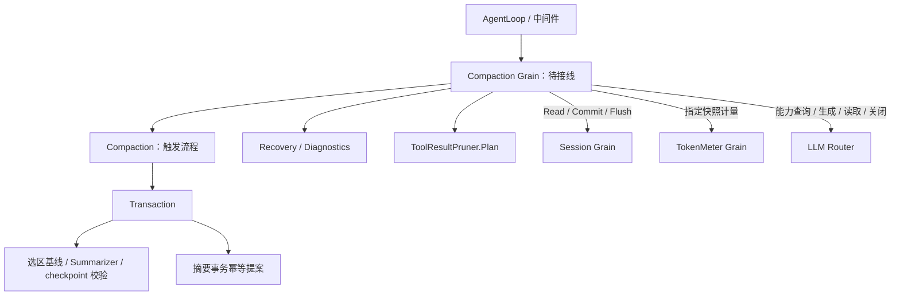
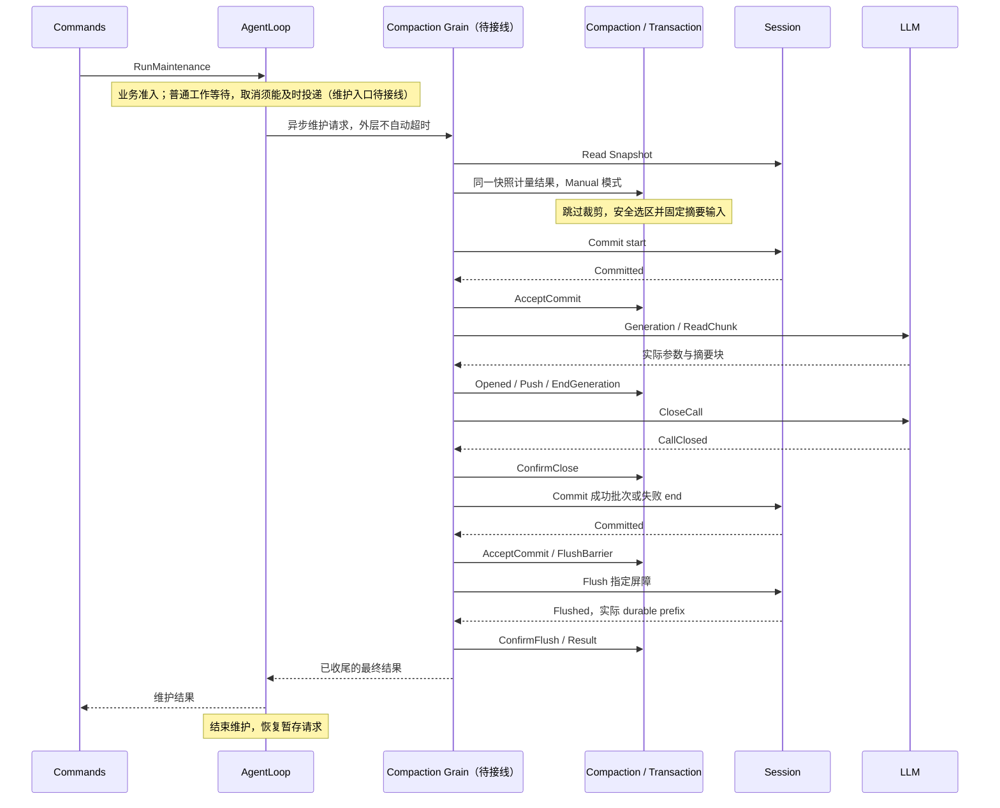
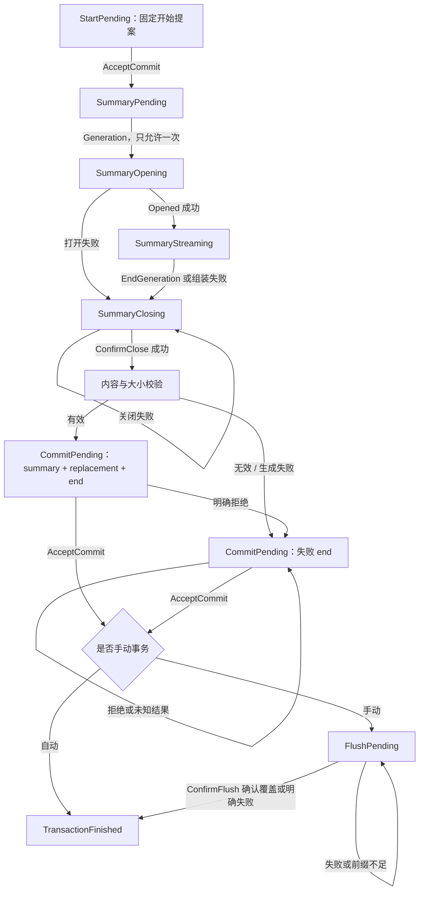

# Compaction 模块设计与实现状态

状态：纯业务流程已迁移并通过 Basic、ToolResultPruner 包测试；Compaction Grain 已实现依赖调度，手动成功与持久化失败路径已通过真实 Grain 测试；已接入中间件 Invoke/Continue 契约；自动中间件取消已接通并验证；AgentLoop 手动维护入口和生产装配尚未完成。本文按最新职责与流程组织，不再将旧 Plugin 实现、过渡候选或局部验证描述为生产能力。整体实施顺序见 [实施计划](12-implementation-plan.md)。

已确认的约束：Actor 只负责编排和调度；完整 PreStep 在 Step 输入准备之前执行；手动 RunMaintenance 独占 AgentLoop，但取消必须能够中途打断摘要，不能跟普通工作一起等到正常压缩结束。原来完整 StashNonReentrant 的维护草案不再满足最新取消要求；手动维护准入与取消投递仍待接线。原压缩请求只在取消后的资源和事务清理结束后回复。

## 1. 目标与来源

Compaction 通过工具结果裁剪或摘要替换，缩减模型可见的 Session Surface。原始日志不删除，替换保留来源引用，工具调用与结果不被切开，后续模型输入可以从 Session 重建。

行为来源使用 [专项基线](../01-porting-scope-and-baseline.md) 中 Compaction 的 `b150a551b8d465e31e418e1b2eaf5e79bbb7d28e`，不自动跟随参考仓库的新提交。该基线的 `packages/compaction/compaction-basic/src/index.ts::compactNow` 直接计量、选区、摘要替换和 Flush，没有预先调用工具结果裁剪；重构前 Go 也保留此行为。手动跳过裁剪是沿用行为，不是 Actor 框架要求。源码没有明确说明这一选择的动机。

每 Agent 一个 Compaction 执行 owner 是本次生命周期方案。旧 Scope 服务不是天然每 Agent 一个；业务能力的来源与 Actor 实例数量分别说明。不为裁剪、选区、摘要或每次事务建立独立 Actor。

## 2. 模块架构与职责

| 对象或模块 | 职责 | 不负责 |
|---|---|---|
| [Compaction](../../compaction/basic/compaction.go) | 三种触发流程、阈值、保留预算、摘要次数、下一阶段和最终进展 | 消息投递、Session/LLM I/O |
| [Transaction](../../compaction/basic/transaction.go) | 一次选区摘要的阶段、资源关闭确认、成功/失败提交、手动持久化确认 | Agent 准入、压力策略、调度线程 |
| [Recovery](../../compaction/basic/recovery.go) | 每 Agent 溢出恢复额度、重置边界和重试建议 | 直接启动模型调用、调用投递去重 |
| [Diagnostics](../../compaction/basic/diagnostics.go) | 相同模型容量配置错误按目标去重，返回可报告 error | 日志通道、回调、决定是否继续执行 |
| [Summarizer](../../compaction/basic/summarizer.go) | 摘要参数与输入准备、逐块组装、安全文本校验 | 网络调用、流资源关闭 |
| [选区与基线](../../compaction/basic/baseline.go) | 固定历史顺序、选区、价格与请求头输入 | 重新读取 Session、持有业务 owner 引用 |
| [ToolResultPruner](../../compaction/toolresultpruner/pruner.go) | Unicode 预算、富内容顺序、裁剪内容及固定批次 | 触发判断、摘要、Actor 生命周期 |
| Compaction Grain（待实现） | 请求外部组件、关联回复、超时与迟到回复处理、按业务阶段调度 | 阈值、选区、摘要是否有效、是否重试、是否完成 |

图中的外部请求由 Grain 执行；箭头不表示业务对象持有外部实例。业务层不存 Actor 地址、Context、取消函数或 Session/Agent 对象，不自行运行 goroutine、mutex 或队列。内部对象不反向持有 Compaction。

Basic 的 Plugin、Factory、RuntimeOptions、automation、regionCompactor 同步实现已删除。严格配置入口为 [DecodeConfig](../../compaction/basic/config_decode.go)，返回 ResolvedConfig。独立 Pruner Grain 候选已删除；没有兼容 Engine、bind/release 或第二套 Runtime。

## 3. 上下游契约

| 外部 owner | 契约与责任 |
|---|---|
| AgentLoop | 拥有 Turn、Step、维护准入、取消和关闭协调；在合法执行点请求压缩，消费结果 |
| 中间件 | 拥有 PreStep/RequestError 顺序、继续下游和调用关联；压缩规则仍由业务对象决定 |
| Commands | 请求 AgentLoop 的手动维护，不能直接修改 Session 或绕过准入 |
| Session | 提供一致 Snapshot；串行执行 FindCommit/Build 和原子追加；拥有持久化与创建身份验证 |
| TokenMeter | 对指定 Snapshot 的事件计量；返回相同 LogRevision 的 Measurement；不选范围 |
| LLM | 拥有 Provider 注册、实际参数解析与流资源；执行摘要，不写 Session |
| Projection / API Proxy | 消费已提交 Session 事实；不直接消费摘要流作为持久化事实的替代品 |

Session CreationID 只出现在 Actor 的 Session/TokenMeter 请求中，不进入摘要业务事实。CompactionID 是持久化摘要事务身份；SourceCommandID 仅表达手动来源；LLM CallID/RequestID 属于运行调用关联。它们不能相互替代。

## 4. 三种压缩流程

| 规则 | Pressure | Overflow | Manual |
|---|---|---|---|
| 入口 | Step 前的完整 PreStep 钩子 | 原模型流已关闭后的 RequestError 钩子 | AgentLoop 维护准入 |
| 自动路由 | 必须已有 Session 请求路由且 Auto 开启 | 同左 | 可使用摘要策略及备用模型 |
| 模型容量 | 必需，用于阈值与保留预算 | 不需要 | 不需要 |
| 工具结果裁剪 | 达到阈值后按配置执行 | 按配置执行 | 跳过，沿用原行为 |
| 选区保留 | 策略指定的 token 预算 | retainTokens=0 | retainTokens=0 |
| 摘要次数 | 最多 CompactionRetries + 1 | 最多一次 | 最多一次 |
| 完成条件 | 事务收尾后重测，低于阈值或结束/报错 | 收尾后依据实际进展给恢复建议 | 已开始事务终结后，等待 Flush 成功或明确失败 |

没有安全选区时可返回无操作。Pressure 在已有摘要后仍超阈值且无安全选区，或次数耗尽时返回错误并保留已提交进展。自动模式不会借用备用模型绕过缺失的持久化路由。

### 4.1 自动压力

1. AgentLoop 领取输入后执行完整 PreStep；尚未准备运行上下文与最终 Step 输入。
2. 调度层读取 Session，对这个快照请求计量；`CapacityTarget` 决定是否需要查询模型容量。
3. `Compaction.Begin` 校验 Snapshot/Measurement、路由、日志锁与策略。低于阈值直接完成。
4. 需要裁剪时准备固定 Plan，确认原子提交，再读取新 Snapshot 并重新计量。
5. 仍超阈值时选择安全前缀并创建 Transaction。事务完成后再读、再计量，由业务对象决定是否继续下一次摘要。
6. 已收尾的普通失败通过 Diagnostics 报告后继续原 PreStep 链；未收尾的资源或事务不得放行下一次模型调用。
7. 完整 PreStep 结束后，AgentLoop 读取最新 Session、准备 Prompt 与可见上下文，最后准备并开始 Step。

Compaction 不组装完整对话，不返回 Prompt，不决定上下文去重。中间件仍可修改其准入消息；运行上下文随后由 AgentLoop 追加。

### 4.2 溢出恢复

原模型失败且流已关闭 → `Recovery.Prepare` 校验 canonical `CONTEXT_WINDOW_EXCEEDED`、当前 Turn、路由与额度 → 执行一次 Overflow Compaction → 收尾 → `Recovery.Complete` 决定是否建议重试 → 原 AgentLoop 重新准备模型输入。

只有已确认的 Surface.ReplaceGeneration 增长才消耗一次重试额度；无进展不消耗。先裁剪成功、后摘要失败时，只要资源与事务已收尾，仍可返回 Retry=true，并用 Diagnostic 保留应报告的错误。Diagnostic 不是中间件返回错误，不能让它覆盖合法的重试建议。取消优先于进展，不批准重试、不消耗额度。

Recovery 每 Agent 独立保存当前 Turn、最近已提交 AssistantMessage 的序号、次数和一次恢复是否正在进行。新 Turn 或新 AssistantMessage 提交重置额度。失败模型调用不生成 AssistantMessage，依据为 [Attempt.MessageDraft](../../agentloop/internal/modelrequest/attempt.go)。旧快照、错误 Agent、非当前 Turn 均拒绝。

RequestFailure 没有 attempt identity，Session 也没有覆盖所有失败路径的独立 request-start；业务不猜测调用身份，不声称支持任意重复调用幂等。投递关联与迟到回复隔离由中间件 Actor 负责，其 Compaction 接线仍待验证。

### 4.3 手动压缩

无安全选区返回无操作，不伪造 start/end 或 Flush。维护忙碌时由 AgentLoop 返回 Busy。已经开始并提交失败 end 的手动事务，同样必须等待 Flush 结果，不能只对成功摘要 Flush。

## 5. 主业务状态机与接口

[Compaction](../../compaction/basic/compaction.go) 的 Stage 是主流程唯一阶段来源。

| 阶段 | 输入/方法 | 业务行为 |
|---|---|---|
| CompactionIdle / CompactionFinished | Begin(Invocation) | 校验并开始新调用；活动调用期间拒绝重入 |
| PrunePending | Pruned(Snapshot, error) | 消费确定的裁剪结果，记录进展或结束；成功后等待新计量 |
| MeasurementPending | Measured(Snapshot, Measurement) | 校验同一修订、阈值和预算，选择范围，创建 Transaction 或结束 |
| MeasurementPending | RejectMeasurement(error) | 明确计量失败时结束调用，保留已提交进展；不能绕过活动事务收尾 |
| TransactionPending | CurrentTransaction / CompleteTransaction | 只消费已结束事务及不早于事务提交的快照；压力模式成功后再计量 |
| CompactionFinished | Result | 返回 Outcome.Latest、Outcome.Changed 及原始 error |

Invocation 包含 Mode、Snapshot、Measurement、可选 ContextWindow、Fallback、SourceCommandID 和 Prune 能力开关。快照必须属于同一 Session、修订不能倒退。Outcome 保留已提交进展，不能用是否生成过摘要替代它。

Actor 可以按 Stage 选择发送哪一种请求，但不能自行解释阈值、次数、选区或是否完成。

## 6. 选区、基线与摘要

[selectRange](../../compaction/basic/selection.go) 输入同一 Snapshot、Measurement 和保留预算，校验日志长度、LogRevision、节点数量、逐位置序号和安全整数价格。范围按 Surface 的当前位置确定，不按日志序号大小排序。retainTokens=0 仍保留最后一个节点，并向前调整到合法工具配对边界，不是清空历史。

[region](../../compaction/basic/region.go) 示例：Surface `[2, 9, 5, 6]` 中选择 `[9, 5]`，`start=9/end=5` 是日志序号，`first=1/last=2` 是包含两端的位置，`sequences=[9,5]` 是独立顺序副本。位置只适用于捕获时的快照。

`captureBaseline` 固定选区、原 Surface 顺序、选区价格及摘要输入；不保留 Session 实例或可变计量对象。Transaction 构造时完成基线与摘要请求准备，开始后不重新换一份历史生成摘要。自动完成要求整个 Surface 顺序稳定；手动完成只要求所选区域稳定，允许选区外变化。

Summarizer.Request 保留所选历史、最后请求头的 system/tools、摘要指令及既有持久化来源。策略可覆盖摘要模型；LLM 使用统一 `Generation` 加 `Parameters` 传入单次完整配置，不写回 Agent 配置。实际返回参数由 Opened 保存并用于摘要事实，不能以请求候选参数冒充实际参数。

Summarizer.Push/Result 复用 LLM BlockAssembler；拒绝错误、取消、截断、图片、空文本和仅推理输出，保留原始推理/内容与用量用于摘要记录。正常 EOF 语义沿用 BlockAssembler，不增加重复结束状态机。

[buildReplacement](../../compaction/basic/replacement.go) 构造包含包装说明及 checkpoint 来源的消息，用纯 EstimateMessage 接口估价；估价失败、负值或不小于原区域均拒绝。内容安全与包装后缩小是两个独立校验。根 compaction 包不反向依赖 TokenMeter，避免与其持久化事件依赖形成循环。

## 7. Transaction 与摘要提交

Write 返回当前固定幂等提案。Generation、Opened、Push、EndGeneration、ConfirmClose、AcceptCommit、FlushBarrier、ConfirmFlush 和 Result 均检查合法阶段。没有开始提交就不生成；没有关闭确认就不替换；必要的 Flush 尚无结果时不返回最终结果；明确持久化失败以错误结束调用。

| 提案 | 原子内容与幂等规则 |
|---|---|
| [transactionStart](../../compaction/basic/transaction_start.go) | 独立 start；提交点验证选区、配对、锁和 Turn；按 CompactionID 精确确认原字段 |
| [transactionCompletion](../../compaction/basic/transaction_completion.go) | summary、带来源引用的 checkpoint replacement、成功 end 同批提交；再次验证稳定性；重放校验原连续三事件 |
| [transactionEnd](../../compaction/basic/transaction_end.go) | 固定失败 end；只允许匹配活动事务；相同原因重放原结果，不同原因/来源/Turn 冲突 |

成功后不能再追加失败 end，失败后不能追加成功批次。重放 start 不代表允许重新生成。Start 未持久化选区，因此 CompactionID 必须一次生成并绑定原操作，不能被重分配给另一选区。

AcceptCommit 只解释已解码的 Session 业务回复：成功必须精确匹配待确认批次和屏障；明确错误且无事件进入内部拒绝处理；事件与错误并存则保留原提案要求确认。框架超时或无有效回复不伪造成业务拒绝。结束提交结果未知时重试原计划，不再发起模型生成。

ConfirmFlush 在业务层检查实际 durable prefix 的 SessionID 一致且 NextSeq 覆盖事务结束。成功回复中的其他 Session 或不足前缀保留 FlushPending。明确 Flush 失败则进入 TransactionFinished：没有此前压缩错误时返回 ManualErrorPersistence 并保留原始 Cause；否则保留此前压缩错误，Flush 错误不覆盖它。生成错误与后续关闭、提交或持久化错误保留因果；普通交互使用 error，只有持久化失败 end 将诊断固定为文本。

## 8. 工具结果裁剪的幂等提交

[ToolResultPruner.Plan](../../compaction/toolresultpruner/plan.go) 是独立于摘要事务的 IdempotentWrite，不添加无意义的 start/end。NewPlan 接收固定 Snapshot 和纯估算接口，预先生成不可变草稿与 Result，不保留 Pruner/Estimator。

每项裁剪对应相邻的计价事件与 tool/result 替换；保留 Unicode 预算、富内容顺序、扩展字段和原始来源。所有项同批全成或全败。Build 只接受准备时修订；FindCommit 在原起始位置精确校验相邻草稿与来源，返回原批次及原屏障，不重计价、不把第一次成功变成“无变化”。

原位置被其他写入占用、部分批次或内容冲突均明确拒绝。该方案不新增持久化字段，也不宣称可以跨进程重建未保存候选。无变化计划没有持久化批次身份；空结果不能证明先前另一个成功批次已提交。Plan.Result 描述候选，只有 Session 确认后才能作为已提交结果消费。

## 9. Actor 通信与维护独占

### 9.1 已确认的通信方式

每 Agent 一个 Compaction Grain；业务对象仍是普通 Go 对象。Session/TokenMeter 使用 RequestGrain 异步请求；LLM 使用 Router、CallID、RequestID 和 GenerationStarted/ChunkRead/CallClosed 等具名结果。普通短计算与 Get/Set 直接回复，不人为异步化。

GoAkt v4.5.3 支持 Receive 中的同步 Ask/AskGrain；这里选择异步是为避免长时间摘要占用共享 dispatcher worker，不是框架禁止同步。Actor 只处理地址、消息类型、关联、超时和调度，业务结果全部交回业务对象。

维护外层仍使用异步请求等待最终业务结果；内部依赖操作各自有超时。最新已确认行为要求取消可中途到达 Compaction，不能沿用“普通请求、取消、关闭全部暂停消费”的维护草案。手动维护 Actor 需在后续接线时保持业务互斥，并允许取消控制及时到达；不能以整个压缩必须正常完成为前提。

外层维护仅收到一次最终业务结果，包括已收尾的业务失败。具体 LLM、Session 等操作各自有超时；超时后必须继续必要收尾。最终 Result 按契约表示本次业务已经结束，AgentLoop 收到后即可继续，不增加第二次业务完成确认。请求传输失败与 Result 是不同情况。

手动维护需要独立的生产调用测试；框架请求等待实验不能证明业务互斥、中途取消或故障目标清理。

### 9.2 关键事件与最终回复

[消息契约](../../compaction/basic/actor/messages.go) 声明 Initialize、Execute、Result 和 Close；[Grain 实现](../../compaction/basic/actor/grain.go) 已接通 Session、TokenMeter 和 LLM Client。Initialize 绑定 SessionID、CreationID、Meter、Router、策略与可选 Pruner；Execute 只传模式、来源和备用模型，快照和计量通过异步请求获取。

关键业务结果通过 Session 的既有事件提交并由 Session 发布变更通知：开始对应 compaction start，摘要和替换对应摘要事件及 SurfaceReplace，成功或失败对应 compaction end。业务对象生成事件草稿，Compaction Actor 只调度 Session Commit；事件提交成功后才是可消费的业务事实。订阅方按 Session 契约读取已提交事件，不新增一套由 Actor 自行发布的持久化业务事实。

Session 事件不是维护请求的回复，不会完成原 RequestGrain。维护过程中无需向 AgentLoop 提前返回“中断”或“稍后恢复”；已移除 Interrupted/Resume 草稿接口及仅服务于恢复的 Execute.ID。关闭、结束提交尚未确认，或必要的 Flush 结果未知时，原维护请求保持未完成。Flush 明确失败是最终业务错误，不等待它最终成功；业务流程结束后回复 Result。

compaction end 提交和维护完成的含义不同：订阅方可能先看到 end，随后手动维护才完成 Flush。不得把 end 通知解释为 AgentLoop 已恢复准入或数据已达到所需持久化屏障。AgentLoop 的恢复以原维护请求的最终结果为准。

生成或读取超时必须关闭同一 Call，不能重发 Generation。Close/提交未确认，以及 Flush 交付结果未知时保留原操作；Flush 明确失败按业务规则结束。目标 Grain 异常停用、原调用恢复身份、恢复控制如何到达仍占用中的 AgentLoop、生命周期退出时的流回收与最终回复，均尚待实现和集成验证。框架停机不等于业务资源已释放。

### 9.3 最新 DSH 对照：结束事件、Flush 与维护返回

2026-09-08 fetch 官方 origin HEAD，核对提交 `c389f96bf3a9b6807cb71ed6bdad5849be0df6d8`；本次仅作行为对照，不更改固定兼容基线。

- `packages/compaction/compaction-basic/src/region.ts:217-255`：先追加 `compaction/end`，再 await 可选 Flush，最后返回结果或抛出错误。
- `packages/compaction/compaction-basic/src/index.ts:376-400`：手动压缩在 runMaintenance 内调用上述流程，并传入 sessions.flush。
- `packages/core/agent-loop/src/agent.ts:153-175`：等待维护任务，在 finally 中恢复 idle；成功和失败都会退出维护。
- `packages/compaction/compaction-basic/tests/manual-compaction.spec.ts:240-273`：验证 end < flush < 下一轮 turn/start；`:691-703` 验证 Flush 失败返回 persistence，而已提交的 summary/end 仍保留。

因此，“end 后仍需执行 Flush”是原有调用顺序，不是新增事件协议，也不要求消费者收到最终结果后再次检查完成状态。

已按用户确认对齐 Flush 明确失败路径：Transaction.ConfirmFlush 消费明确结果并结束事务，不再保留 FlushPending 等待成功。单独 Flush 失败映射 persistence；此前摘要或提交失败优先。成功/失败 end 和已提交摘要保持不变，不补写或改写事件。transaction_test.go 覆盖错误分类、优先级、事件不变与拒绝再次 Flush；compaction_flow_test.go 覆盖主流程结束及下一次调用准入。这些是业务层证据，生产维护 Actor 接线仍待完成。请求超时造成的结果未知不传入 ConfirmFlush。

## 10. 实现证据与剩余验收

| 范围 | 当前状态与证据 |
|---|---|
| 策略、触发与恢复 | 已实现；[compaction_flow_test](../../compaction/basic/compaction_flow_test.go)、[recovery_test](../../compaction/basic/recovery_test.go) |
| 摘要事务、失败和持久化屏障 | 已实现业务层；[transaction_test](../../compaction/basic/transaction_test.go)、[transaction_failure_test](../../compaction/basic/transaction_failure_test.go) |
| 原批次确认、来源与重放 | 已实现；[transaction_completion_test](../../compaction/basic/transaction_completion_test.go)、[transaction_replay_test](../../compaction/basic/transaction_replay_test.go)、[pruner plan_test](../../compaction/toolresultpruner/plan_test.go) |
| 配置与压力诊断 | 已实现；[config_decode_test](../../compaction/basic/config_decode_test.go)、[diagnostics_test](../../compaction/basic/diagnostics_test.go) |
| Compaction Grain | 已实现依赖调度；真实 Grain 测试覆盖手动成功与 Flush 失败，生产接线未完成 |
| AgentLoop / 中间件 / Commands | Compaction 已消费 InvokePreStep / InvokeRequestError，并经真实协调器测试；自动中间件取消传播已通过真实协调器测试；生产路由和手动维护/Commands 尚未接入 |

最近已完成的业务验证范围是 `go test -race -count=1 ./compaction/basic ./compaction/toolresultpruner`、对应包的 vet 与 build。它们不证明 Actor 或生产调用链已完成。旧同步测试的业务规则已迁至上述测试；原 maintenanceStub 的模拟准入没有被当成真实框架验证。

下一阶段必须验证：

1. 同一快照计量、容量回复迟到、创建身份与调用关联隔离。
2. Session 明确拒绝与回复丢失、原裁剪/摘要计划重试、部分或冲突结果拒绝。
3. LLM 打开、逐块读取、取消、关闭失败重试与迟到回复；实际参数进入摘要事实。
4. AgentLoop 真实 RunMaintenance 准入和 Busy，普通工作互斥、取消可中途到达并等待取消清理。
5. 真实失败 end 和 Flush 请求，durable prefix 校验、caller/Agent 取消与 ManualError 分类。
6. PreStep 普通诊断后继续、未完成事务阻止新模型调用；溢出仅凭已提交进展建议重试。
7. 验证 Session 关键事件不解除维护等待；完成目标故障恢复、关闭等待和资源回收。
8. 清除剩余旧调用、完成生产装配与跨模块验收后再记录整体完成。

### Compaction Grain 当前接线证据

[Actor README](../../compaction/basic/actor/README.zh-CN.md) 说明模块内职责、依赖和调用流程。Grain 初始化时启用异步请求所需 reentrancy；Session/TokenMeter 使用 RequestGrain，LLM 通信统一交给 llmactor.Client，不在 Compaction 内复制请求 ID、回复类型判定和超时跟踪。业务阶段仍以 Compaction / Transaction 为唯一来源。

[grain_test.go](../../compaction/basic/actor/grain_test.go) 使用真实 GoAkt、TokenMeter 和 Session Log，控制模型和 Flush 回复：生成与关闭完成、end 已提交但 Flush 未回复时无最终 Result；Flush 成功或明确失败后能返回最终结果并关闭绑定。测试尚未覆盖生产 Session PubSub、自动压力/溢出、中间件维护接线、目标永久故障与强制停机释放，不能视为整个模块完成。

### 自动中间件接线

Compaction Grain 直接处理 InvokePreStep 与 InvokeRequestError，复用同一 Compaction owner，不新增中间件 Actor。每次调用只保留 Invocation 的协调者地址、CallID、Handler 和原回复；不持有 AgentLoop 对象。PreStep 在本地压缩结束或准入失败后调用 ContinuePreStep；Diagnostics 拥有告警抑制规则。RequestError 在 Session 快照上调用 Recovery.Prepare；未获准或没有进展时 ContinueRequestError，已完成且有进展时回复 Retry。原压缩错误只作为诊断，不覆盖原模型失败。

准入失败必须调用 Recovery.Reject，不能把上一次 Compaction 的结果误认为本次结果。只有本次 CompactionFinished 才能交给 Recovery.Complete。下游 Continue 使用原 CallID/Handler，等待下游最终结果再结束原 Invoke。自动中间件取消传播已有定向测试；维护准入与生产注册仍待接线，当前不能宣称已进入生产装配。

自动中间件当前证据：[grain_hooks_test.go](../../compaction/basic/actor/grain_hooks_test.go) 经真实 Middleware Coordinator 验证 PreStep 无路由/元数据失败后 Continue、非溢出错误 Continue、溢出压缩真实提交 Surface 替换后 Retry。自动中间件取消另有下述测试；尚缺生产注册与手动维护，不将局部验证标记为整体完成。

### 取消的业务边界

取消原因作为业务输入进入 Compaction / Transaction；Actor 只关联 CancelInvocation 与原 Invoke，并向 LLM Client 投递 Cancel。取消确认不结束原 Invoke，也不证明 Call 已关闭。已提交 start 后仍须结束事务；未知提交不替换原提案；已提交成功批次不改写为失败。正在等待 Flush 时继续消费明确 Flush 结果，最终错误中取消优先。提交前取消不再启动摘要；已发出的生成/读取仍等待结果并关闭同一 Call。

PreStep 完成必要收尾后继续原协调器；RequestError 通过 Recovery.Complete 的取消参数禁止 Retry。协调器拥有整个中间件调用的取消结果。手动维护也需支持中途取消，不能等待摘要正常生成完；其入口接线仍未实现，当前可用的取消通信入口是自动中间件的 CancelInvocation。

取消验证证据：transaction_cancel_test.go 覆盖开始提交前/后取消不启动生成、迟到块丢弃、取消优先于 Flush 错误、已提交摘要保持不变。grain_cancel_test.go 经真实中间件协调器，在读取挂起时发出取消，验证同一 Call 收到 Cancel、Close 未确认前原 Invoke 不返回、关闭后提交失败 end 且不生成摘要或替换 Surface；错误调用身份不能取消当前工作。该测试覆盖自动中间件，不能替代尚未实现的手动维护取消入口。
