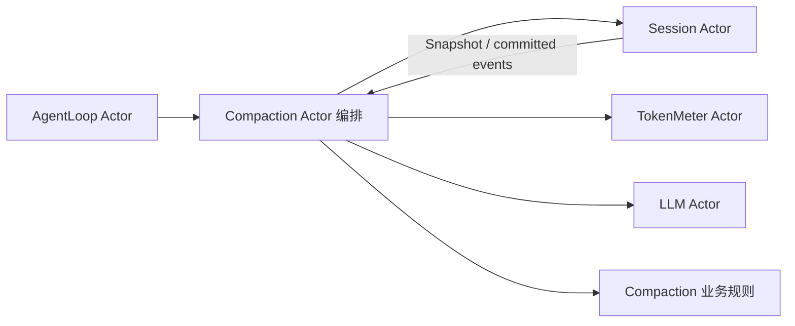

# Compaction Actor 迁移设计

## 模块边界与业务层

Compaction 根包拥有压缩事务事件、持久化 provenance、错误分类、事务结果、日志不变量与工具调用配对边界。业务层只消费已提交事件和一致的 Session Snapshot，不持有 Agent 或 Session 对象，也不执行维护调度、模型调用和存储 I/O。

删除旧 Engine（嵌入 plugin.Service）、ManualAgentContext（SessionValue 与 RunMaintenance 回调）和携带 Session.Context 的 AgentContext。它们把 Agent admission、Session 写入和压缩策略绑定在同步接口中；Actor 迁移直接删除，不增加旧 API 包装。Basic Provider 和 command 的旧调用方随后迁移，当前允许中间编译失败。

## 接口与关键数据

`InspectLog` 消费日志，校验开始/摘要/结束事件的关联和顺序。`Result` 表达压缩事务结果，`ManualError` 保留 errors.Is/As 的因果链。`ToolPairingBoundaries` 从一个 Snapshot 建立 Surface 序号到位置的索引及每个切分位置的配对状态；`CutBefore/CutAfter` 判断边界是否跨越未完成工具调用。

单点工具配对查询直接接收 Snapshot；保留 `ToolPairingBalancedBefore/After` 业务名称，删除重复的 Snapshot 后缀入口和 Session 对象入口。纯函数不增加生命周期、锁或回调。持久化 `compaction/*` 事件和 checkpoint 的原始 plugin 来源标记保持兼容；它们不要求运行时 Plugin 存在。

## 上下游契约

AgentLoop owner 决定何时允许压缩与关闭，Compaction Actor 编排 Session 读取、TokenMeter 测量、LLM 摘要和 Session 提交。Session 独立决定批次提交是否有效并负责 flush。Compaction 业务规则不能提前把未提交摘要视为完成，也不能由存储适配器选择压缩范围或修复日志。

本步骤只迁移根包业务边界；Compaction Actor、Basic 策略与 Commands 接线尚未完成，不把原实现的验证记录用于证明新的生产链可用。
