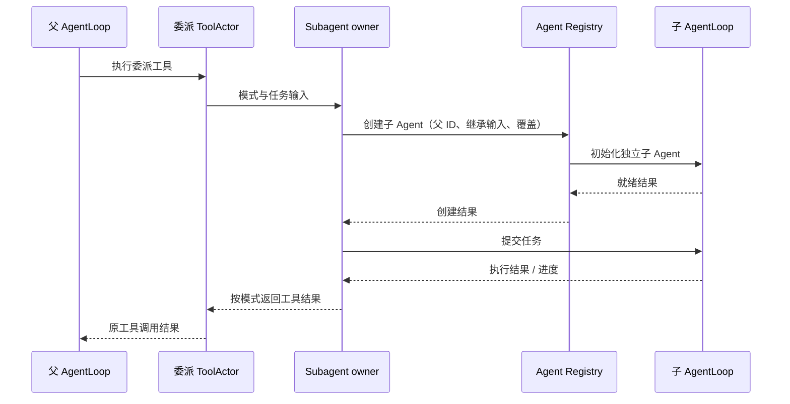
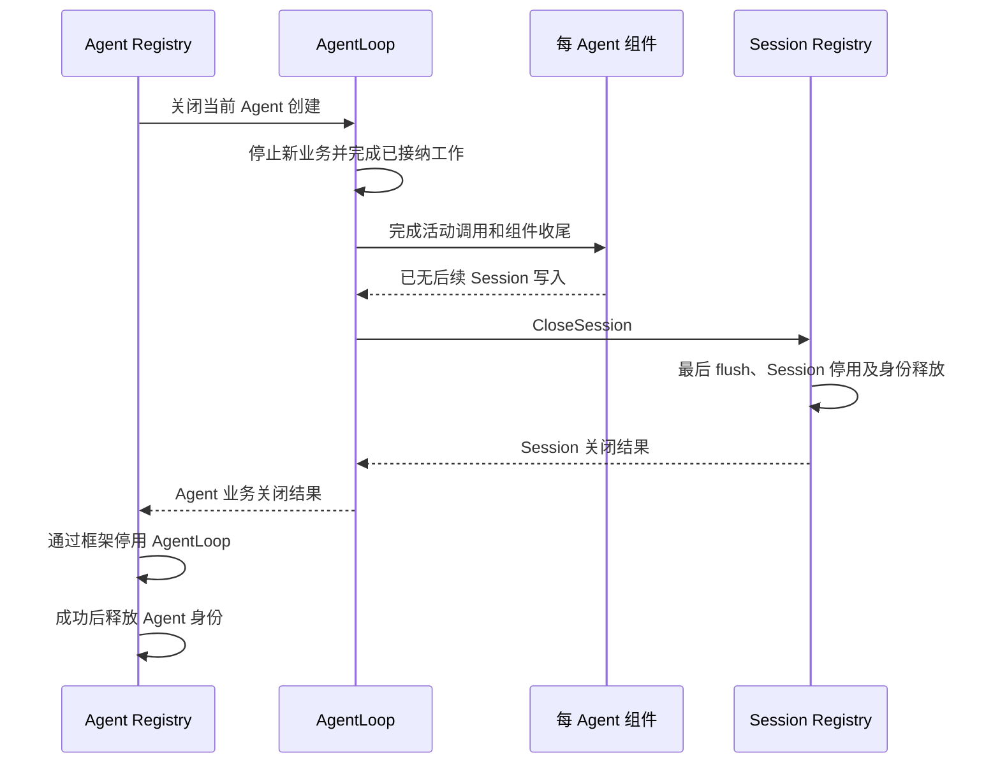
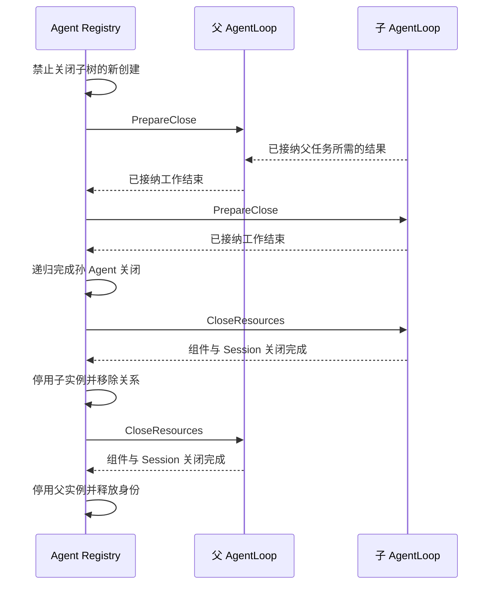

# Agent 模块设计

## 职责与依赖

先实现 Agent，再实现 AgentLoop。Agent 根包负责身份、配置值、Inbox 和父子关系业务约束；不调度模型/工具调用，不持有 Session 对象。AgentLoop Actor 使用这些对象编排每个 Agent 的执行；Registry Actor 后续负责跨 Agent 创建与关闭。

## Agent、Registry 与 AgentLoop 的职责

已有 [所有权](01-ownership.md)、[生命周期](07-lifecycle-implementation.md) 和 [Subagent 配置](04-subagent-configuration.md) 用于理解原有考虑，不作为不可修改的约束。当前按事实归属、依赖方向、失败恢复和实现复杂度比较方案，先明确业务 owner，再决定具体类型。Agent 的业务数据不自动要求新增聚合 struct；现有 Inbox、配置值和执行状态对象能表达时，不额外建立转发对象。

| 对象 | 拥有的事实与决策 | 不承担 |
| --- | --- | --- |
| Agent 业务对象 | 业务身份、有效配置值、Inbox 规则及对外状态语义 | Actor 调度、跨组件请求、持久化 I/O |
| Agent Registry | 身份占用、父子关系、创建/关闭事务、初始化失败清理进度 | 单 Agent Turn/Step、Inbox 内容、模型与工具调用 |
| AgentLoop | 单 Agent 初始化、配置就绪、消息处理、Turn/Step、取消收尾和更新屏障 | 全局目录、其他 Agent 的执行、Session 最终身份释放 |
| Session Registry | Session 创建授权、实例绑定、最终关闭与身份释放 | Agent 父子关系和模型执行 |
| Session Grain | 日志原子提交、恢复、flush 与自身业务关闭 | Agent 配置、Inbox 调度和工具选择 |

AgentLoop 是单个 Agent 的唯一执行 Actor；不增加一个与之相互转发的 Agent Actor。Agent Registry 是独立 Actor，其内部可以有纯业务目录，但目录不能代表完整的 Registry。GoAkt 负责邮箱、请求回调、重入和技术激活；它不决定业务就绪、父子关闭规则或何时可以释放身份。

## 创建与就绪

Agent Registry 接收创建/恢复请求，按 SessionID 查找并占用身份，合并同一创建中的重复请求。子 Agent 创建先固定父有效配置快照和覆盖输入，不与父对象建立动态配置引用。

Registry 创建未就绪的 AgentLoop，传递身份、创建事务与运行时入口。AgentLoop 请求组件解析配置，并协调 Session 和每 Agent 组件初始化；Session Registry 是 Session 创建的唯一执行方。全部必要组件成功后，AgentLoop 向 Registry 报告可处理消息，Registry 才移交用户输入。创建失败尚未清理完时，Registry 保留占用，不能创建同 ID 的替代业务实例。

目前 Session CreatingNotice 订阅链与旧初始化设计同时存在；最终接线必须保证 Session 创建只发起一次，不能既由订阅器又由 AgentLoop 各启动一条独立创建事务。通知是初始化触发，成功判定必须来自所属创建事务的明确结果。

## 消息处理与配置更新

用户消息交给目标 AgentLoop，后者按 Inbox 业务规则构造草稿并请求 Session.Commit，提交确认后应用已提交事件。Turn/Step、模型请求、工具执行和收尾由 AgentLoop 编排。Prompt、工具和模型配置由各自 owner 解析；AgentLoop 只消费结果并决定其开始生效的业务边界。

工具更新必须等待前面的用户消息处理结束，再完成工具与 Prompt 的一致更新，之后继续下一条用户消息。Registry 不参与逐步运行或代替组件组装配置。父配置变化不自动更新已创建的子 Agent。

## 配置与模型选择的职责拆分

迁移前调用链：`agent.Options` 保存 provider/model/maxTokens；`agent.ModelSelectionRef` 保存显式选择和读取回调；`apiproxy/session.AgentSessions.Selection` 创建 Ref 并安装到 Scope；`sessionModels.SelectModel` 校验后直接调用 SetCurrent；`llm/modelconfig.Catalog` 持有全局配置并解析 overrides。旧 API 正在代管 Agent 可变状态，不能把这条调用链原样搬入 Actor。

| 数据或操作 | 建议负责人 | 交互边界 |
| --- | --- | --- |
| 全局模型默认值、provider 与凭证引用 | ModelConfig | Read / Resolve 请求 |
| 每 Agent 显式模型选择和配置覆盖值 | Agent 业务对象，由 AgentLoop 串行访问 | API 向 AgentLoop 发出变更命令 |
| provider 能力、reasoning 与输入模态校验 | LLM 能力 owner | AgentLoop 请求校验，错误返回调用方 |
| 当前模型请求的完整参数 | 当前请求本身 | 解析成功后固定，后续配置变化不能修改 |
| 父有效配置的继承输入 | 子 Agent 创建用例 | 一次性读取、复制、覆盖，不共享可变 Ref |
| 用户选择 RPC 的 wire 映射 | API Proxy | 只解码、发送请求并映射结果，不保存选择状态 |

Registry 不需要保存第二份可变模型选择，也不负责在每个 Step 解析默认值。它仅为创建事务固定必要的配置输入；AgentLoop 接收并应用组件解析结果，Agent 业务对象保存已接受的覆盖值。Prompt 不保存模型选择。

### 明确选择与实际请求参数

显式选择表达用户意图；ModelConfig.Resolved 表达一次解析结果。它们不是同一个状态，不能以全局 Catalog 直接替代每 Agent 选择，也不能保留 API Proxy 的选择 map 与 Agent 各存一份。新的业务 API 不应返回 ModelSelectionRef、source callback 或可变 Agent 指针。

建议变更命令在校验并被 AgentLoop 接受后返回具名结果；不改变已启动的模型请求。实际下一请求使用的参数在请求边界固定。模型选择与工具集合是否共享“完整用户消息结束后应用”的边界，需要结合既有 selectModel 可观察语义单独确定，不能把已明确的工具屏障未经说明扩展到所有配置。

### 恢复语义不能凭名称推断

当前 SelectModel 只更新内存 Ref，并未立即追加模型选择事件；恢复路径通过 Session 的 LatestRequestHeader 查找上次实际请求模型，再回退默认值。因此“已接受选择”与“已持久化选择”不能混为一谈。此次职责调整不自动新增持久化事件；若需要选择后尚未请求也能跨重启保留，必须明确作为行为变更，并设计相应存储契约。

### 验收依据

需要验证：两个 Agent 的选择相互独立；拒绝的选择不改变原值；进行中的请求参数不变；恢复时采用约定来源；API 不再安装 Scope 或共享可变 Ref；子配置与父配置不共享可写对象。旧 ModelSelectionRef 测试只能证明旧 fallback 行为，不能证明上述 Actor 边界。

## 子 Agent：执行、生命周期与委派分开

每个子 Agent 使用独立 SessionID、AgentLoop、Session、Prompt Runtime 和 Tool Runtime。AgentLoop 的实现不分父版和子版，父子只是 Registry 中的身份关系。配置在创建时复制父有效快照并应用子覆盖，不共享父对象、Inbox、取消句柄或工具实例。

当前 `subagent/tools/delegation.Tool.Execute` 把工具调用转换为 OneShot 或 Continuable 请求；`subagent/internal/subagents.Service` 分派模式，Bound 有自己的接纳、绑定及结果交付。该调用链说明委派是一项独立业务能力，不能因为改为 Actor 就把它并入 Registry 或父 AgentLoop。

| 责任 | 所属 owner |
| --- | --- |
| 运行通用模型/工具循环、等待异步工具结果 | 父或子 AgentLoop |
| 委派参数、模式、深度、任务续接和结果表达 | Subagent 业务模块 |
| 工具参数与委派命令之间的转换 | 委派 ToolActor |
| 子身份登记、父子关系、创建和最终关闭协调 | Agent Registry |
| 子任务执行、Inbox 与组件运行 | 子 AgentLoop |
| 子日志提交、持久化与恢复 | 子 Session |

### 创建与执行交互

父 AgentLoop 发出工具执行请求，委派 ToolActor 请求 Subagent owner。Subagent owner 固定任务模式、父 ID、继承快照与自定义覆盖，向 Agent Registry 请求创建子 Agent；父配置快照由父执行 owner 提供，不能由 Registry 从多个可变组件临时拼接。

Agent Registry 登记关系并启动子 AgentLoop。子组件就绪后，Subagent owner 提交任务。OneShot 的完成结果用于完成原工具调用；Continuable 的首次返回可包含子身份，后续输入与完成通知按该模式处理；Bound 的消息接纳和交付规则仍归 Bound owner。具体 Actor 消息在 Subagent 迁移时定义，此处不建立一个通用任务协议抹平模式差异。

图中的箭头是职责层面的异步交互，不表示持有对方业务对象，不要求所有进度都经过 Registry。Registry 不中转模型流或每个工具结果。

### 完成、取消与关闭

子任务完成不等于子 Agent 必须关闭：OneShot 与可继续模式的复用策略由 Subagent owner 决定。需要销毁时，它向 Registry 请求关闭，不直接删除身份。取消工具等待也不自动证明子执行停止；模式 owner 明确传播取消并等待必要的业务确认。

Registry 维护父子生命周期约束。父工作仍依赖子结果时，关闭协调必须允许该结果返回；父工作已经结束或明确取消后，再完成子先父后的资源释放。子 AgentLoop 仍负责自己的结果提交与组件收尾，父 AgentLoop 不替子方关闭 Session。

对外工具名、模式与结果字段不因本轮职责梳理而改变。跨 Actor 契约只携带身份、具名输入和结果；运行创建身份用于拒绝旧任务结果，不能把相同 SessionID 的新创建当作原子任务实例。需要验证前台/后台委派、续接、取消和父关闭，不能仅验证父子 map。

## 关闭职责的方案比较

以下是本轮建议，尚未落实为 Actor 代码。保留父子生命周期、当前消息完成后关闭 Session、独立 owner 和异步请求等用户要求；可调整具体哪个 owner 发起请求，不因历史步骤已存在就机械复用。

| 方案 | 单 Agent 收尾的负责方 | 主要取舍 |
| --- | --- | --- |
| Registry 在 AgentLoop 停用后关闭 Session | AgentLoop 收尾组件，Registry 接续 Session 关闭 | 停用后不会再有 AgentLoop 写入；Registry 需要了解并恢复单 Agent 的资源关闭步骤 |
| AgentLoop 请求 Session Registry 关闭后再回复 | AgentLoop 协调组件与 Session；Registry 最终停用与释放 Agent 身份 | 收尾集中在知道依赖关系的 owner；必须明确禁止关闭后的 AgentLoop 重新写入或初始化 |

建议采用第二种。理由是 Session 是独立 owner，但何时不再需要写入 Session 的业务事实属于 AgentLoop。Session Registry 继续负责自身关闭授权、最后 flush、框架停用与 Session 身份释放；改变的是调用方，不把持久化逻辑搬到 AgentLoop。

### 单 Agent 关闭

Agent Registry 保持 Agent 身份占用并请求业务关闭。AgentLoop 停止接纳新业务，完成已接纳工作与结果提交，再关闭可能继续产生 Session 写入的组件。所有写入方结束后，AgentLoop 请求 Session Registry.CloseSession；Session Registry 确认最终日志持久化及 Session 停用，再回复。

AgentLoop 收到成功结果才向 Agent Registry 确认自身业务关闭完成。Registry 最后停用 AgentLoop，成功后释放 Agent 身份。关闭后仍存活的 AgentLoop 只允许查询/重试关闭等必要命令，不重新接受消息、配置初始化或开启组件。框架仍在运行与业务仍可运行是不同事实，不建立新调度器来表达这个区别。

Session Close 已包含最后 flush；没有额外业务需要时，不人为添加一次先行 Flush 请求。正常 Turn 完成时的耐久性要求独立保留。

### 父子关闭的两段确认

建议区分两条业务命令，名称直接说明作用，不把框架停用当作它们的回复：

| 命令 | 接收方 | 成功回复代表什么 |
| --- | --- | --- |
| PrepareClose | AgentLoop | 已拒绝新业务，已接纳工作及其结果提交结束；仍保留资源供关闭协调使用 |
| CloseResources | AgentLoop | 本 Agent 组件与 Session 已关闭；后续不能恢复执行 |

这两个名字是本设计的拟议 Go 消息，不新增外部 RPC 或业务状态字符串。叶子 Agent 也可以执行相同步骤；没有子项时 Registry 直接从第一段推进到第二段。

1. Registry 接纳父关闭，保留父创建身份并停止该关闭子树的新业务/子创建接纳。
2. Registry 请求父 AgentLoop.PrepareClose。父方继续接收已发出请求的结果、必要的工具结果及显式取消，不释放这些任务仍使用的资源。第一段成功不表示 Session 已关闭。
3. 父方第一段结束后，Registry 对仍属于它的子创建递归执行完整关闭。子方也先完成已接纳工作，再关闭其子项，最后关闭自己的资源。已在单独关闭中的子项加入原关闭过程，不启动第二次销毁。
4. 所有子项完整关闭后，Registry 请求父方 CloseResources。父 AgentLoop 完成组件收尾并请求 Session Registry.CloseSession，成功才回复。
5. Registry 完成父 AgentLoop 框架停用，移除身份与关系，对外报告父关闭完成。

Registry 自己必须继续处理子初始化、关闭结果和查询；等待父结果不能阻塞整个 Registry。父 AgentLoop 等待子任务结果时，也不能用普通新业务的拒绝规则丢弃完成原任务所需的回复。这些属于请求和接纳策略，具体重入实现必须由真实框架测试证明，不通过另建消息 queue 绕过邮箱。

### 子创建与关闭竞争

Registry 串行判定创建和关闭的先后，以接纳创建并登记原创建身份作为边界：先接纳的子创建即使尚未初始化完成，也计入父关闭；后到的新创建明确拒绝。关闭不能只查询“已就绪子 Agent 列表”，否则会遗漏初始化中的子资源。

关闭根节点后，后续对子孙节点发出的新创建也必须检查祖先是否正在关闭，不能仅冻结父方当前的直接子列表。登记父关系与检查关闭接纳必须在同一 Registry 消息处理过程中完成；具体关闭事务留在 Registry Actor，不在父 AgentLoop 另建子目录。

正常关闭不会暗中取消已接纳工作，但停止新创建意味着当前任务若此后请求新委派，会收到明确拒绝。执行 owner 按正常工具失败规则处理，不能无限等待一个未创建的子项；若产品要求关闭期间仍可扩展任务树，需要另行改变接纳语义，不能同时承诺子集合已封闭。

子初始化失败但清理未结束时，父关闭不能跳过它；只有资源清理完成且原创建身份释放后才算该子项结束。任一子关闭失败，保留父方已完成的 PrepareClose 和仍存在的关系；不进入父 CloseResources。重试从未完成阶段继续，不重复执行已结束用户任务。

子 Agent 配置仍只在创建时复制和覆盖，父子关闭关系不引入运行期配置继承。

### 失败和重试归属

- 当前工作或组件收尾失败：AgentLoop 返回错误并保留未完成的收尾信息；Registry 保留身份占用，不停用其恢复所需实例。
- Session 关闭失败：AgentLoop 继续负责重试原 CloseSession；Session Registry 保存其已确认进度。不能重新执行用户消息或重新创建 Session。
- AgentLoop 业务关闭已成功、框架停用失败：Registry 只重试最终停用；AgentLoop 不重复获取已释放的资源。
- AgentLoop 意外失效：Registry 进入异常清理路径，根据原创建身份向已知组件查询/关闭；不能激活一个新 AgentLoop 并假装已经恢复原内存收尾状态。需要由创建事务记录资源归属，具体协议另行验证。
- 任一请求超时：不等同于操作未执行。查询或重试同一创建的关闭；未确认结束前禁止同 ID 的新业务初始化。

Session 身份可能先于 Agent 身份释放，但新的 Session 初始化必须属于已获 Agent Registry 授权的新创建，不能利用这个时间窗口重建同 ID 资源。CreationID/InstanceID 只用于 Actor 层授权与晚到结果隔离，不进入业务配置或日志。

### 与当前代码的关系及验收

现有 `session/registry.CloseSession` 接收 SessionID 和 CreationID，不要求调用方为 Agent Registry，支持替换调用方；它已保留关闭成功结果并在框架停用失败时重试原过程。这里的代码可复用性不证明整个方案已经成立。

新增流程必须验证：最后一条消息完成前不关闭 Session；组件收尾后不存在晚到写入；Session 关闭失败可以原地重试；业务关闭成功但 Actor 尚未停止时拒绝新命令；父方等待子结果时不提前关闭子方；异常失效清理；同 ID 重新创建不能越过身份占用。通过这些验证前，本节仍是职责方案，不能对外宣称关闭链已实现。

## 当前纯目录实现及其限制

`Registry` 当前代码仅维护 `Registration{ID, ParentID}`：要求身份唯一、父项存在、关系不可变、返回值分离、移除父项前先移除子项。entries 的 key 为 AgentID，value 为登记值；存在不表示组件就绪。这个 map 可以支持业务约束，但缺少创建事务、运行身份授权、失败回滚与关闭协调，因此不能替代上述 Registry owner。

旧 RegistryService、Plugin、Factory、Host、Handle、Scope 和 Setup 已在工作区删除，尚未提交。其跨 Agent 行为必须由后续 Registry Actor 实现补齐。纯目录测试只证明关系约束，不证明创建与关闭。

Inbox 沿用 [Inbox 设计](27-agent-inbox-module.md)。initiator 已改为 SessionID 归因值，不保存 Agent 对象；它不授权调用或区分实例。Agent 同步接口、Subject 对象事件和模型选择 Ref 已按文末契约清理；其旧消费者尚未迁移。提前建立的 AgentLoop Actor 初始化方式只覆盖 Inbox，尚未实现这里的组件请求和就绪流程，已暂停扩展，不能作为最终创建契约。

## 实现顺序与验收

1. 完成 Agent 业务契约：保留具名数据和行为，移除跨 owner 同步方法、对象引用及 Scope 回调；验证 Inbox、配置复制、取消意图与归因。
2. 实现 Agent Registry 创建和关闭编排：验证同 ID 并发创建、初始化失败清理、父子关系、关闭失败重试与旧身份拒绝。
3. 实现 AgentLoop：先接通组件初始化与 Inbox 提交，再接通 Turn/Step、LLM、工具和更新屏障，最后验证取消与 flush/关闭。
4. 更新 API、Subagent 和组合根调用方，运行主流程与全仓验证。每段都直接替换旧路径，不新增兼容包装。

本轮只梳理职责和记录实现差距，不将尚未验证的代码或具体接口视为已确认设计。

## 模型选择纯业务实现

`ResolveModelSelection(requested, events, defaults)` 接收显式选择、分离日志和已取得的默认选择，返回 `*ModelSelection, error`。优先级保持为显式选择 → 最近的 request/header → 完整默认路由；均无可用值时返回 nil。显式选择存在时不读取 fallback 日志；恢复路径日志错误原样返回，不冒充无选择。返回值独立复制。

移除 ModelSelectionRef、ModelSelectionSource、锁及隐式来源回调。不另建只有一个 requested 字段的包装对象。AgentLoop 后续保存 Agent 自身的显式选择，并向该纯函数提供已获得的输入；API 旧 Scope 调用方直接迁移，不保留兼容入口。LLM 能力校验仍在执行边界，这个函数只决定选择来源，不声称模型可用。

本步骤改变 Go 内部调用契约，不改变 RPC 字段、request/header 格式或选择的持久化时机。

## 通知与决策契约分离

原 events.go 同时定义已发生事实、vetoable publication 和 Waterfall 决策，并携带 Subject Agent 活对象。此次拆为 notices.go 与 decisions.go：通知统一以 Notice 命名，只携带 AgentID 和相关业务数据；决策输入/输出保持具名值，不保留 RuntimeWaterfall marker、Scope event marker 或同步 Execute 回调接口。

CreatedNotice 只表示已成功就绪，不能由订阅者否决；原来参与创建成功判断的校验必须成为初始化请求，不得静默改为 PubSub。PreStepInput、RequestInput、RequestFailure 是有确定结果的决策输入，分别对应 PreStepDecision、RequestResolution、RequestErrorAction，不能因为旧名字叫 Notice 就广播处理。业务决策完成后再由执行 owner 推进步骤。

topic 字符串继续使用 agent/created、agent/disposed、agent/status、agent/inbox/* 等原值，Go 内部常量改用 Topic 后缀。持久化 InboxSpliced Event 不受影响。通知中的 AgentID 只定位业务身份；需要隔离晚到通知的运行消费者必须通过 Actor 层创建身份契约校验，不能据业务 ID 对新创建执行操作。

拆分不声称 PubSub 具有旧 ordered observer 的同步交付语义；需要等待消费者处理的行为必须保留明确 Request 回复。旧 AgentLoop、Subagent 与 API 消费者后续直接迁移，不增加旧类型别名或对象包装。

旧同步运行接口及 Same 对象身份比较已删除；跨 owner 不直接调用业务对象，也不提供函数式维护任务回调。当前 agent.Agent 是框架无关的业务操作契约，Actor 客户端提供异步运行操作，详见本文末尾确认的拆分边界。

## Registry 关闭接纳业务实现

`BeginClose(ID)` 在已登记身份上记录关闭接纳，重复调用幂等；不存在的身份返回 error。`CheckAdmission(ID)` 检查自身及祖先是否已经接纳关闭，命中时返回 ErrClosing；它不判断组件是否就绪。Register 在同一次业务调用中执行父身份接纳检查后才登记，因此不能在关闭中的子树添加新项。

closing 是集合：key 为本目录已接纳关闭的 AgentID，空值只是存在标记。它记录“该身份不再接纳新业务”的必要业务事实，不记录 Actor 是否停止、活动任务、等待者或关闭步骤。Registry Actor 的后续资源收尾结果不能提前删除它。Remove 成功后移除对应标记；正常再次登记同 ID 不继承前次的业务关闭状态，但旧创建请求仍须由 Actor 层先验证创建身份。

该集合只标记明确开始关闭的根，不向所有后代复制状态；后代通过父 ID 链检查祖先。关闭期间现有成员保留，包括尚未初始化完的已接纳子创建。其他无关树仍可登记。没有取消关闭/重新开放接口，关闭失败保持接纳限制直到正常清理完成。

验证需覆盖祖先关闭后拒绝孙节点创建、既有关系保持、独立树不受影响、重复关闭、未知身份不产生标记、删除后新登记及 Actor 层旧身份防护的区别。纯业务测试不代替真实创建/关闭竞争测试。

## Options 的复制与校验

`agent.Options` 自身提供 Clone 和 Validate。Clone 保留 nil 语义并独立复制 MaxTokens，避免父子创建输入或请求快照共享可写指针。Validate 保留原 AgentLoop 中的正安全整数限制；不在此校验厂商模型，也不根据空字符串发明配置覆盖语义。

原 AgentLoop 的 cloneAgentOptions、validateAgentOptions 删除，调用方直接调用 Options 方法。这是把既有规则移回拥有配置类型的模块，不新增运行对象或通用深度合并。子配置集合的覆盖规则仍需由对应配置 owner 定义，Clone 不等于完成子 Agent 全量配置继承。

## Agent Registry Grain：身份与接纳入口

`agent/registry.Grain` 是共享 Registry 的框架 owner，内部持有纯业务 Registry 和每身份的创建标识。预留、校验、关闭接纳与预留释放在同一邮箱串行处理，无额外锁或异步任务。它尚未驱动 AgentLoop 创建；CloseAgent 的资源关闭编排见文末。Completion 仅确认当前原语命令，不表示 Agent Ready 或 Close 完成。

`Creation{AgentID, CreationID}` 是框架层创建凭据。Reserve 同时提供新 Creation 和可选 Parent Creation：子创建必须匹配父当前创建且祖先允许接纳；相同输入重试幂等，但关闭开始后不得作为新接纳成功。更换父或创建 ID 不能重用已有预留。CheckAdmission 同时检查创建身份与业务祖先限制，BeginClose 同时检查创建身份再关闭接纳。

ReleaseReservation 只释放调用方已确认无需继续持有的预留，绝不执行或证明资源关闭；父有子项时仍拒绝释放。它是进程内生命周期编排原语，不暴露到 HTTP。后续创建/关闭事务必须在资源结束后调用，不能让 API 将其当作 Close。旧创建的延迟 Release 或 BeginClose 不得影响同 ID 新创建。

Grain 停用不清理 AgentLoop 或 Session；当前恢复为空目录，生产必须用进程启动隔离与创建授权约束激活，不能把丢失内存目录当作资源已关闭。真实框架测试只验证本节的身份、重复请求和父子接纳，不代替完整生命周期验收。

## AgentLoop 激活绑定

Registry 处理 agent/actor 定义的 Claim{AgentID, CreationID, InstanceID}，将当前创建绑定到第一次请求的非空激活标识。相同标识可重试，另一个标识返回 ErrInstance；不存在/已替代创建返回 ErrCreation；关闭子树拒绝初始化 Claim。InstanceID 由 AgentLoop 每次激活取得，不用 SessionID 或 CreationID 冒充。

reservation 新增 instanceID，是执行授权事实，不能作为框架地址或调度状态。它只存在 Registry Actor，Agent 根包的 Registration 不增加运行字段。AgentLoop 后续必须先 Claim 成功再初始化资源；单独实现此接口并不代表现有 AgentLoop 已完成重激活防护。关闭中的原实例仍可处理必要的完成结果，这不通过新的 Claim 授权。

此限制不允许在旧创建上自动重建执行实例。异常停用后必须先清理旧创建资源，再分配新 CreationID；否则无法确定旧工具操作是否已结束。Registry 自身丢失授权时不能开放旧资源执行，恢复策略仍须整体生命周期验证。

激活授权已接入当前 Inbox 初始化段：无预留拒绝初始化，首次授权成功后读取 Session，框架停用后重新激活不能用原创建重新 Claim。真实框架验证不代表完整资源关闭或模型循环已实现。

依赖方向修正：Claim/Claimed 归入 agent/actor 的运行授权契约，不归具体 AgentLoop。agent/registry 和 agentloop/actor 都依赖 agent/actor；Agent 包树禁止导入 agentloop。创建时的具体执行实现装配属于组合边界，不能为了静态构造便利让 Agent 反向依赖执行实现。

## 关闭接纳返回子创建

BeginClose 的回复改为 CloseAccepted{Children []Creation, Err error}。Registry 在同一邮箱处理内校验当前创建、关闭子树接纳，再读取直接子项的当前创建身份；回复按 AgentID 排序且不暴露内部集合。这样关闭协调方取得的子项均属于已经禁止新增成员的子树，不必根据裸 AgentID 猜测待关闭的是哪次创建。子项包括已预留但尚未初始化完成的 Agent，不能只返回 Ready 实例。

重复 BeginClose 返回仍登记的直接子项：已完成释放的子项不再返回；剩余子项继续沿用原 CreationID。旧父创建返回 ErrCreation 且不返回新创建的子项。该回复只确认关闭接纳与成员身份，后续仍须等待每个子 Agent 的业务关闭和释放，最后释放父方；本步骤不增加执行对象引用或宣称完整关闭编排已经实现。

## Registry 子树关闭编排

CloseAgent{Creation} 由 Registry 处理，回复 agent/actor.Closed。Claim 增加 Executor GrainIdentity，由 AgentLoop 提供自身框架地址；Registry 校验逻辑名称并固定地址，不导入具体 AgentLoop，也不保存执行对象。尚未 Claim 的创建不推断为无资源：关闭停止新接纳并返回明确错误，创建失败清理仍需后续创建事务完成。

每个创建保存一个关闭操作，依次执行 PrepareClose、递归 CloseAgent 关闭直接子创建、CloseResources、框架停用、移除业务关系。所有业务调用使用异步 RequestGrain；Registry 使用 AllowAll 处理其他身份和子关闭请求。多阶段结果由 PipeToSelf 返回具名内部消息，回调不持有池化上下文。框架停用在受管理任务中等待真实完成。

相同创建的并发关闭共用该操作；失败回复 error 并保留阶段，重试不重复已成功的资源关闭。等待回复句柄属于未完成请求，不是自行维护的用户消息队列。关闭中不允许 ReleaseReservation 绕过协调。子项失败时父资源保留；子项成功后才从目录移除。完成后保留该 ID 最近一次创建的关闭结果直到下次 Reserve 替换，以便重复关闭幂等；旧请求不能影响替换后的创建。

当前接通 Inbox/Session 资源持有者，尚未 Claim 的创建清理、执行中工作排空、Actor 异常失效清理以及完整生产创建事务仍需继续实现；正常子树关闭验证不能替代这些验收。

## 本轮完整实现边界（以本节为准）

用户确认拆分业务接口与运行接口。agent.Agent 由 ReactLoopAgent 实现，定义身份、只读 Inbox、状态及 Followup/Steer/Inject/Cancel 业务操作。输入操作返回 Admission（待提交的 InboxEdit 与是否请求执行）；这表示业务准入决定，不冒充 Session 已提交。Actor 客户端的同名调用通过异步请求在提交确认后回复，并独立提供取消投递和 WhenIdle。客户端不是业务 Agent，不强制实现同一个接口。

ConfirmAdmission 在核对完整 Session.WriteResult 与原编辑后投影 Inbox，再记录执行请求。Followup 进入 next-turn，Steer 进入 next-step，Inject 不唤醒；活动已取消时，新的 waking 输入进入 next-turn。Actor 不再自行选择 InboxTarget。Cancel 保留类型化原因，生成可选清空编辑，实际 I/O 取消由 Actor 投递。

业务 activity 表达已接纳的执行预约及取消原因，与已提交的 Turn 不同：waking 消息提交后即有活动，即使消息随后被删除也仍须打开初始 Turn；maintenance 及已取消活动中的 wake 需要在活动退出后检查 Inbox 再重放。它不保存 goroutine、mailbox、Context、任务队列或回复等待者。WhenIdle 等待活动及收尾完成，等待机制归 Actor 客户端。

### 当前缺口与完成标准

| 范围 | 当前证据 | 必须完成的结果 |
|---|---|---|
| 业务接口 | 已拆分，ReactLoopAgent 编译断言成立；删除 execution | 完整生产调用方继续迁移 |
| 输入 | 业务决定目标与预约；完整提交确认及 Inject 已接入 Grain | 主驱动消费执行预约仍待接线 |
| 活动 | 缺少执行预约和取消后的 wake | 预约、正常继续、取消重放、维护互斥及状态通知完整 |
| Step | 独立 flow 协议与多份准备数据 | 单一业务数据 owner，Actor 顺序请求；不保留重复解释器 |
| 请求 | 完整 ModelRequest 与旧 BeginModel 并存 | 仅完整请求入口，Hooks 和外部执行端口完整接线 |
| 工具 | 只有批次计数和结果结论 | 调用、并发/独占、按序提交、附加上下文、取消全部闭合 |
| 收尾 | 成功提交丢弃 WriteResult 后总是回读 | 正常直接确认并 flush，仅不确定/去重情况回读 |
| 生命周期 | Registry 保留身份但创建组合未完整 | 初始化回滚、父子关闭、旧身份拒绝、资源关闭确认 |
| 调用方 | API、Subagent、assembly 仍引用删除的 Factory/Scope | 一次性迁移实际入口；不恢复旧接口或加入兼容包装 |
| 验证 | 局部编译通过，全仓构建缺失旧 factory 包 | 行为、取消/关闭及端到端测试通过；全仓构建与适用检查通过 |

后续实施按此清单收敛，不以局部接口存在或测试文件可编译宣称重构完成。LLM 独立模块迁移暂停；AgentLoop 使用明确外部契约，不能为绕过缺口引入第二套模型运行时。

### 删除 execution 接口

Grain 直接持有 `*agentloop.ReactLoopAgent`。原 execution 接口只有这一实现，混合恢复、输入、模型和关闭阶段，没有独立消费者语义，故删除，不改名保留另一份方法清单。`agent.Agent` 保留为通用业务契约，Actor 客户端是独立运行适配。具体 Grain 依赖具体 ReAct 实现是适配器向业务层的正常依赖，不构成反向耦合。

## 业务状态机及非法请求约束

状态统一管理指每个状态事实只有一个权威 owner，不是把框架请求、Agent 生命周期、Turn 与 Step 做成笛卡尔积枚举。ReactLoopAgent 的生命周期状态机管理恢复、配置就绪、关闭接纳及释放；活动管理执行预约及取消事实；Turn/Step 管理各自已开始、运行和结束的约束。Actor 不保存这些业务状态的副本，只保存正在请求的外部操作和回复资源。

### 生命周期转换

| 状态 | 允许的转换 | 输入与清理规则 |
|---|---|---|
| 未恢复 | Restore 成功进入已恢复；接纳关闭进入初始化未完成的关闭状态 | 不接纳输入 |
| 已恢复 | Initialize 成功进入就绪；接纳关闭进入初始化未完成的关闭状态 | 可读取恢复结果，不接纳输入；禁止重复 Restore |
| 就绪 | 接纳关闭进入已就绪的关闭状态 | 接纳输入；禁止重复 Restore/Initialize |
| 初始化未完成且关闭中 | 资源关闭确认后释放 | 保留历史输入，不消费它，不阻止失败创建清理 |
| 已就绪且关闭中 | 已接纳业务全部结束且资源关闭确认后释放 | 拒绝新输入；允许取消、提交确认和既有业务收尾 |
| 已释放 | 无 | 关闭重试幂等；禁止恢复和初始化 |

ready/closing 两个布尔字段删除，由生命周期状态独占这些判断。Initialize 返回 error，非法调用不得先覆盖配置。Release 必须先通过关闭条件；Actor 技术停用直接丢弃自己的业务对象，不调用业务 Release 冒充正常关闭。

后续执行状态机必须覆盖执行预约、Turn 开始确认、Step 准备、模型/工具执行、停止钩子、结束提交和持久化确认。前一操作未确认时拒绝越阶段调用；取消不能丢弃已提交事实，重复/晚到响应不能推进另一轮。既有 flow 协议的移除必须同时迁移这些约束，不以 Actor 按顺序调用替代业务检查。本节生命周期实现不代表完整执行状态机已经收敛。
