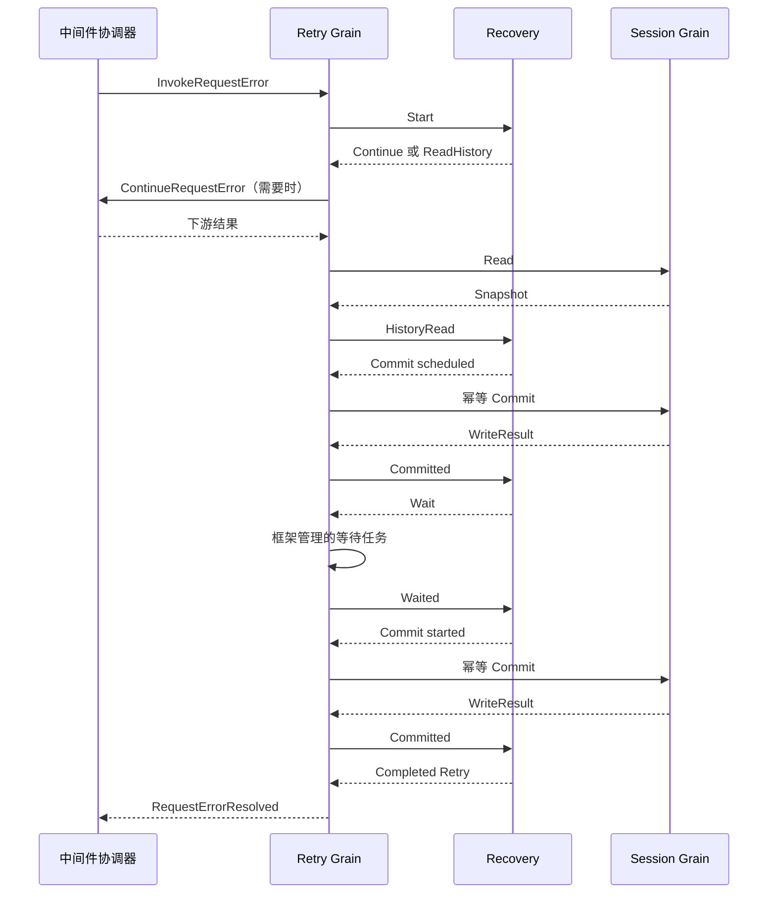

# 请求重试中间件

状态：实施中。所属计划见 [LLM 模块](./33-llm-module.md)。本模块保留 `llm/retry` 路径及持久化事件名，直接替换旧 Plugin，不保留兼容入口。

## 职责与边界

Recovery 是一次请求恢复的业务对象。它根据 RequestFailure 中固定的 RetryPolicy、Session 历史及下游恢复结果，决定委托、记录计划、等待或返回 Retry。它不持有 Agent、Session 实例、Actor 地址、Context、Timer，不直接调用模型。

ModelRequest 消费恢复结果，决定是否创建下一次 Attempt；llm.Call 执行一次模型调用。三者不互相创建或回调业务对象。

Retry Grain 每 Agent 独立，初始化时取得对应 Session 的地址与创建身份。它实现 InvokeRequestError/CancelInvocation，持有一次恢复调用的框架回复和 Recovery；Session 请求、ContinueRequestError、计时、取消投递和结果关联属于 Actor。一次原调用结束前不接受第二个恢复调用，不自建队列。

## 业务规则

normal 策略仅处理 retryable code；达到当前 Turn/Step/provider/policy 链的上限或有效 Retry-After 超出 maxDelay 时，交给下游。always 策略先等待下游：下游成功要求 Retry 时直接采用；下游拒绝或失败后应用本地退避，失败不直接变成恢复失败。没有策略时只委托下游。

读取历史后推导下一 retry 序号和 chain ID。已有链继续使用原 ID，新链使用调用时提供的随机 ID。随机数和 ID 由调度边界提供值，业务对象不保存回调函数。退避规则复用 policy.go。

只有 llm/retry 事实提交成功后才开始计时。等待结束后提交 llm/retry-started，确认成功后返回 Retry:true。等待期间取消不提交 started；取消与提交交错时先等待原提交回复，不能假称写入没有发生。取消不删除已经提交的事实。

## 接口与数据

Recovery.Start/Advance 接收与产生封闭的具名操作和结果：ReadHistory、Continue、Commit、Wait、Completed；输入结果分别为 HistoryRead、Continued、Committed、Waited、Failed。错误保持 error。阶段校验及取消结论由 Recovery 决定，Actor 不自行选择下一业务步骤。

Commit 使用不可变的 WritePlan，Build 在 Session owner 内校验最新历史与待追加事实，防止读后发生变化仍提交非法序号。相同 retry ID/序号/事件类型的重试返回原 WriteResult，内容冲突报错。事件字段、编码和历史校验规则沿用原实现。

## 交互

## 实施与验收

| 顺序 | 工作 | 状态 |
|---|---|---|
| 1 | Recovery 业务及幂等重试事实 | 待实施 |
| 2 | Grain 中间件、Session 请求与取消计时 | 待实施 |
| 3 | 迁移旧 Plugin 测试，保留 normal/always 语义覆盖 | 待实施 |
| 4 | 接入 ModelRequest 的恢复路由与应用装配 | 待实施 |

必须验证预算、Retry-After 上限、下游优先级、下游错误隔离、取消等待、提交交错、旧回复识别，以及幂等事实追加。局部测试不能证明应用已经安装默认重试路由。
