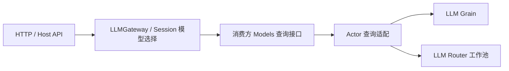

# API Proxy 模型查询迁移

状态：实施中。仅迁移 LLM 查询消费边界，保留现有 API 方法、wire DTO、排序和逐 provider 失败隔离。总体 LLM 契约见 [LLM 方案](./33-llm-module.md)。API Proxy 的 Agent、Session、Commands 等其余迁移不由本切片宣称完成。

## 当前问题

LLMGateway 的 ListProviders/ListConfigurableProviders 接口不能表达 Actor 查询失败，而且分两次读取可能观察到不同注册快照。Session API 和 Host 直接要求已删除的 LlmRuntime，混入未使用的注册、生成和发现职责。

## 目标职责与接口

API Proxy 自己定义只读 LLMDirectory：ReadCatalog(ctx) 返回同一次注册查询中的 active/configurable 快照或 error；ListModels 和 ResolveModelInfo 只查询提供者元数据。Session 模型选择另定义 Models 接口，在目录能力上增加 ResolveCallConfig。它们不包含 Stream、Register、Dispose 或 Plugin 方法，不以新名字保留旧 Runtime。

LLMGateway 继续负责 wire 投影、目录排序和逐 provider 失败隔离。注册目录查询整体失败时返回技术 error，不能伪造空目录；某 provider 查询失败仍写入原 failures 数组，不隐藏其他 provider 的可用模型。

模型查询的 Actor 适配由装配层提供，内部使用 LLM Grain.ReadCatalog 和 Router 的模型查询协议。Host 的 RuntimeOptions 显式接收模型查询能力，不通过 Plugin.Require 或服务注册表发现 LLM。Actor 负责异步请求与结果关联，业务 gateway 保留普通 Go 接口。

## 验收

保持 providers/models 返回字段和顺序、可配置但未激活 provider、模型能力校验及图像模型选择限制。新增注册目录查询失败测试；验证完整目录只读取一次。实际 Actor 查询适配接线后验证错误与 deadline 传播。API Proxy 整包被其他旧依赖阻断时如实记录，不能把单文件检查或 LLM 局部测试当作 API 集成通过。

## Request 与 Router 结果桥接

HTTP 查询处理器通过一个长期存活的 LLM API ModelQuery Grain 请求模型查询。API ModelQuery Grain 仅将框架 Request 的延迟回复与 Router 的显式结果关联，不处理目录业务、不执行提供者 I/O、不承担配置或注册。RequestID 由 API 适配对象在发送前生成，桥接 Grain 保留该 ID 并将 ReplyTo 指向自己；收到结果或截止时间到达后回复原请求并删除关联。

并发查询的关联表仅保存 GrainReply 和计时取消函数，这是 Router 不转发 Request 响应通道所要求的传输状态，不是业务 queue 或另一套 LLM Runtime。目录快照直接请求 LLM Grain。API 适配对象只持有查询入口及 ActorSystem，将具名结果映射为消费方契约；不能调用 Binding 或提供者来绕过 Router。

## 当前实现证据与未完成项

API Proxy 已移除 LlmRuntime 引用，Directory 适配使用 LLM Grain 和 API ModelQuery Grain；Host 改为从 RuntimeOptions 接收消费方查询能力。LLMGateway 将注册查询失败作为技术错误返回，不伪造空目录。

API ModelQuery Grain 关联表只处理传输请求，真实 Grain 测试验证并发回复与超时，LLM Actor race 测试与 vet 通过。API Proxy 的完整测试仍被 Commands、UserQuestions、Workspace 中旧 Agent/Session 接口阻断；新增 gateway 测试尚未执行，生产装配尚未接线。

## 本地请求取消传播

GoAkt v4.5.3 的真实请求测试证明，调用方 Context 取消不能作为 API ModelQuery Grain 内部可观察到的取消信号。本方案不依赖这个假设：API 适配对象在发送前生成 RequestID，等待被取消后以同一 ID 向 API ModelQuery Grain 发送 CancelQuery，并报告投递错误。桥接转发至 Router，Worker 按该 ID 取消独立查询 Context。

API ModelQuery Grain 通过 NoErr/Err 确认取消消息的处理；不能对 TellGrain 使用普通 Response 代替确认。截止时间到达和桥接停用也发送 CancelQuery。Worker 保留查询取消能力到实际 I/O 返回，再移除关联；迟到结果不能回复已经结束的请求。

取消命令投递确认不宣称提供者已经退出。`TestQueryCallerCancellationReachesProviderThroughRouter` 使用真实 API ModelQuery Grain、Router、Worker 和阻塞提供者，分别验证调用方停止等待与提供者实际退出。API Proxy 整包仍被其他旧依赖阻断，因此该证据不等于真实 HTTP 取消链路已验证。

## 领域子模块迁移

API 目录业务和契约现归 `apiproxy/llm`，查询 Grain 与 Directory 客户端归 `apiproxy/llm/actor`。原 `apiproxy/modelquery`、`apiproxy/actor` 已删除。`Catalog` 独立处理目录业务，Gateway 包装 RPC 结果，Session 消费 Catalog。目录查询设计行为不变。

取消回归测试现直接调用 Directory.ResolveModelInfo，由客户端自动发送 CancelQuery；测试不再手动补发取消消息。真实 Router/Worker 确认调用方取消后提供者退出。模块 race 测试和 vet 通过；生产 Host 与 Session API 接线仍未完成。
