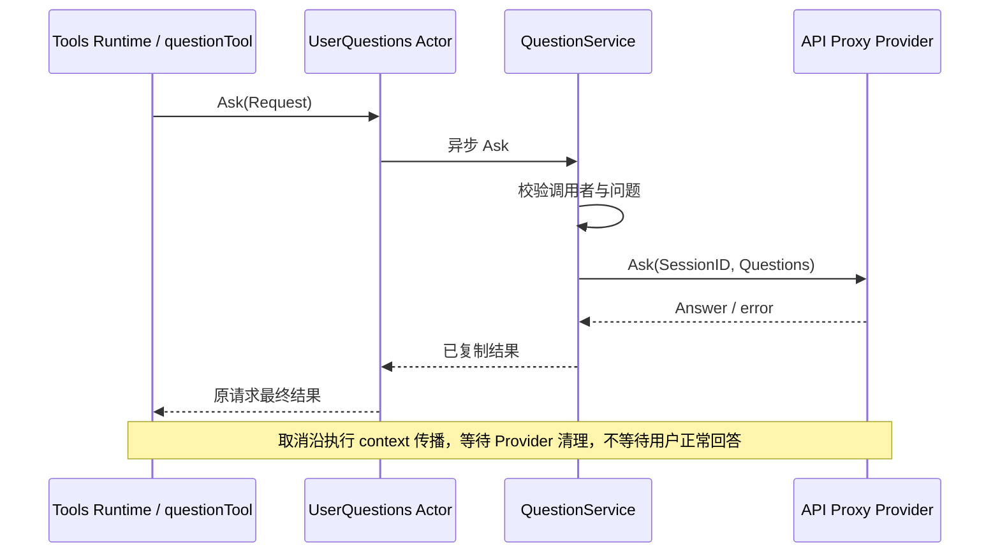

# Workspace、UserQuestions 与 Ask User 工具实现方案

## 目标与兼容性

移除三个模块的 Plugin、Factory 和旧 Agent/Session 对象依赖。Workspace SQLite 表、排序规则、工作目录校验及 API 事件名不变；ask_user_question 的 schema、答案字段、错误码与浏览器交互帧不变。调用身份由旧 Agent 指针改为 Session ID，运行适配器负责绑定及校验调用者，业务层不引用框架身份。

## 模块架构与接口

### ToolActor 与问答 Actor 的集成验收

`tools/tool/actor/grain_questions_test.go` 使用真实 Tools Registry Grain、ToolActor、UserQuestions Grain 和问答 Client，工具构造复用 canonical ask_user_question 定义。人工答复来源由可控 Provider 替代；不使用假工具执行结果。测试由外部协调完成 Begin、Provision、自注册、Publish、Commit，不代表生产 Agent 生命周期已接入这些步骤。

验收覆盖 SessionID 和问题参数穿过两层 Actor 后不变、原答案 JSON 返回；取消从 ToolActor.CancelCall 传播至问答 Provider，取消确认不完成原工具请求，必须等待 Provider 退出；等待期间工具 Close 被拒绝且资源未释放，退出后 Close 释放一次。此测试验证工具体边界，不包括 Tool Runtime 的 policy/结果规范化、Session 持久化或 API WebSocket 通知。

### Session Header 数据来源

workspace/actor.Headers 实现 Workspace 拥有的 SessionHeaders 端口，只读取 Header，不读取 AgentLoop 或创建 Session。Get 先查询 Session Registry.FindSession，已初始化的实时 Header 优先；明确不存在时通过 persistence.Reader.Inspect 读取持久化 Header。List 分页读取持久化 Header，再覆盖同 ID 的实时 Header，按 SessionID 排序返回独立副本。空实时 Session 也应可见；关闭并已持久化的 Session 仍保留在结果中。

适配器依赖现有 Registry 地址、ActorSystem、仅含 Inspect/List 的持久化读取接口及请求超时，不持有数据库或 Workspace Registry。读取错误必须传播，不能将超时当作不存在；只有 persistence.NotFoundError 转为 found=false。合并不是跨存储与 Actor 的原子快照，不改变成员关系、CWD 校验或持久化语义。Workspace 的异步业务任务调用此同步客户端，不能在 Actor Receive 中阻塞调用。

验收使用实际 Session Registry 和 SQLite：未持久化的实时 Session 可读、关闭后从持久化读取、同 ID 去重、返回数据不别名共享、缺失及读取取消语义正确。

- Workspace Registry 独占目录注册、Session 归属及归档集合。Backend 仅执行持久化操作；SessionHeaders 只提供 Header。初始化显式接收依赖，不使用服务定位器。Actor 独占 Registry，串行执行操作，提交后发布非持久化 Notice；快照及 ID 是跨 Actor 契约，不传 Registry 或 Workspace 活对象。
- UserQuestions Service 接收不可变 Provider 与调用者校验端口；负责空问题、展示意图、委派调用限制和输入输出复制。Provider 拥有浏览器等待与关联；Actor 将等待放到异步任务，保留原请求回复，接受取消，任务清理结束后才回复原请求。
- ToolAskUser 提供 NewDefinition，消费最窄的 Ask 接口。工具的实例与执行由现有 Tools Runtime 管理，不增加重复的 Tool Registry 或等待队列。

## 关键数据与决策

Workspace 保留现有 StoredRegistry/StoredWorkspace 持久化形状；WorkspaceState 是脱离 owner 的快照。Notice 只在持久化成功后产生。Registry 不持有实体反向引用，也不包含 Actor 地址。存储失败不安装新内存状态。

UserQuestions Request 包含 Questions 和 SessionID；不包含 Agent、Grain 或 CreationID。框架请求 ID 只用于匹配取消与结果，不是业务身份。Caller 校验端口负责取得实时调用资格，错误原样向上传递。委派 Agent 不得直接发起人机交互。取消不能被正常答案覆盖。

## 上下游契约与流程

Workspace 的查询、更新与事件发布按一次操作排序；API Proxy 映射 wire DTO，Session 创建流程显式 AttachSession。关闭需在已接受的操作结束后关闭 Backend。业务代码不调用 GoAkt；Actor 不判断目录归属、提问资格或答案呈现规则。

## 验证要求

迁移原有业务测试并覆盖真实 Actor 的取消、串行更新、错误传播；检索三个目录确保无 Plugin/Factory 兼容路径。未迁移的全局装配不能作为这些模块完成生产接通的证据。

## 本地最新 DSH 对照：CWD 与 Workspace 通知

按用户要求，本节参照本地 `../deepseek-harness` 的 `c389f96bf3a9b6807cb71ed6bdad5849be0df6d8`；不整体替换历史协议基线，也不把尚未迁移的 API/storage-domain 描述为已完成。

| 行为 | 最新 DSH 证据 | Go 处理 |
| --- | --- | --- |
| 确定创建目录 | `packages/api/session-controller/src/commands.ts` 的 `create`：Workspace path、请求 cwd、默认目录依次选择；禁止 workspaceId 与 cwd 同传 | 创建用例把结果放入 `session.CreateOptions.Metadata.CWD` |
| 写入 Header | `packages/api/session-controller/src/agent.ts` 的 `createOrAdopt` 传 `meta.cwd`；`packages/core/session/src/index.ts` 的 `snapshotSessionHeader` / `validateSessionHeader` 复制、校验并冻结 Header | `session.NewLog` / `buildHeader` 复制并校验绝对路径；Header 在创建后不可变 |
| 重新采用已有 Session | `agent.ts` 的 `assertAdoption` 以及持久化恢复分支比较原 cwd，不同则抛 `ApiSessionCwdConflict` | 保留 CWD 冲突语义，不覆盖已有 Header |
| Workspace 归属 | `packages/workspace/workspace/src/types.ts` 声明 path 永不改写；`entity.ts` 的 `attachSession` 明确依赖 Header cwd 与 Workspace path 均不可变 | Attach 只验证并记录成员，不修改 Session CWD |
| Workspace 持久化和通知 | `packages/workspace/workspace/src/spec.ts` 定义独立 domain 数据；`packages/api/workspace-controller/src/feed.ts` 的 WorkspaceFeed 订阅 `domain/changed` | Workspace Backend 持久化成功后产生 Notice，由 Actor 发布；Notice 不是写入 Session 的命令 |

结论：本次不增加 CWD 变更事件、Setter 或可变 Header。切换执行目录需要创建另一 Session；已有 Session 继续使用创建时的 CWD。此前讨论的“初始 Header 加 CWD 变更事件”属于未采纳扩展，不是 DSH 现有行为。

持久化时机也要区分：最新 DSH `session-persistence/src/index.ts` 的 create 合约要求 create 返回后本进程读取可见，并区分 append 与 flush；当前 Go Session 的 Header 随首次事件批次 materialize。这里只确认 CWD 的不可变语义，不能据此声称两套持久化生命周期完全等价。

Go 的 Workspace Notice 名称是现有 Go 契约，并非最新 DSH 的同名事件；后续 API feed 迁移必须单独核对 baseline、增量与重连行为。

## 最新 DSH 对照后的修正与验证

- `workspace/src/paths.ts` 的 `realpathNormalize` 在文件系统解析前拒绝相对路径。Go `canonicalDirectory` 同步收紧，不再基于进程 cwd 自动补全；由 `TestRegistryRejectsRelativePathsWithoutPublishing` 覆盖。
- `workspace/src/entity.ts` 的 `mutate` 对每个通过校验的操作执行候选成员清理，即使移动到自身也一样。Go 由 Registry.update 统一执行清理、判定无变化、写入和记录 Notice，无业务回调包装。`TestNoOpMovePrunesInvalidCandidatesDurably` 验证清理落盘与真正无变化时不通知。
- `interaction/user-questions/src/index.ts` 的 `ask` 依据 `agents.roots()` 判断委派关系，明确不以持久化 Session lineage 限制重新独立运行的根 Agent。Go Callers 只读取当前 Registry 的 ParentID，不读取 Origin；`TestFormerChildCanAskAsNewRuntimeRoot` 验证当前子 Agent 被拒绝、释放并重新注册的根 Agent 可以提问、旧 creation 仍然被拒绝。

这些是当前模块切片的行为证据，不意味着 API Session 恢复入口或全局服务器装配已经完成。

## 当前验证进度

新增 `workspace/actor/actor_shutdown_test.go`：真实 Actor 执行写入期间从外部关闭 PID，检查取消到达后仍等待写入退出、调用方收到最终取消结果、存储最后关闭。`go test -race -count=10 ./workspace/actor -run '^TestShutdownWaitsForWorkspaceOperationBeforeClosingStorage$'` 通过。该场景未复现竞态，因此没有据此添加锁；其他关闭交错仍需各自的证据。

业务与 Actor 实现已移除本模块的 Plugin/Factory 路径；通过 `go test -race -count=1 -timeout=30s ./workspace/... ./userquestions/... ./toolaskuser/... ./agent/registry`，并通过同范围 vet、build。`toolaskuser/actor_test.go` 验证真实 Tools 执行经过 UserQuestions Grain，保留 Session ID 和规范答案。

整体 `go build ./...` 仍在 internal/assembly/catalog.go 引用已删除的 Agent、AgentLoop、Compaction、LLM、Session Query/Title Factory 时失败；它不属于已完成的全局装配。本模块保留具名初始化和消费入口，后续装配应直接使用，不能恢复旧 Factory 作为过渡。

### Header 查询返回契约

Workspace.SessionHeaders.Get 返回 `(*session.Header, error)`。查到时返回独立 Header 副本；`nil, nil` 表示实时 Registry 与持久化历史均不存在；查询失败返回 `nil, error`。不存在不作为存储失败，也不通过 Header 零值推断。Workspace 根据自身操作把缺失映射为 UnknownSessionError 或 AttachError，保留既有业务错误和 wire 行为。移除 found 布尔值，同步实时/持久化适配器、业务调用方及测试端口，不提供旧签名兼容路径。

## 默认提问工具装配补充

组合入口把 QuestionService 交给 toolaskuser.Provider。Provider.Open 返回独立 questionTool，底层不可变业务能力可以共享；ToolActor 仍按 Session 与工具名称独立存在。不启动 UserQuestions Actor，等待与取消由通用 ToolActor 和 Interaction Gateway 各自负责。Agent 准入由 Registry 的当前 Ready 和 Inspect 结果确认，当前调用的工具生命周期阻止旧 Agent 未结束时同名身份被重用。具体启动、覆盖与关闭顺序见 [服务装配](./41-server-composition.md#内置工具与回答入口装配)。

UserQuestions 是唯一提问接口，QuestionService、Actor Client 与客户端回答适配器均实现 Ask。删除签名完全相同的 Provider 接口，不保留别名。业务校验与回答输送的区别由 QuestionService / Gateway 的对象职责表达，不重复定义相同交互契约。

### 删除重复提问调度层

UserQuestions Grain 只包装 QuestionService.Ask 并维护重复的 pending / cancel / reply，通用 ToolActor 已承担这些职责。因此删除 Grain、Client 和其关闭协议，保留查询 Agent Registry 的 Directory / Callers 适配。原两层 Actor 的行为测试改为通用 ToolActor 直接执行 QuestionService，继续验证取消后等待回答端清理；旧 Grain 测试删除。上文早期双 Actor 验证记录不再代表目标结构。
