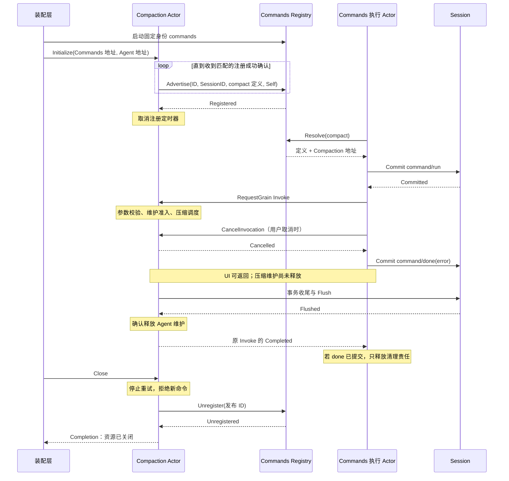

# Commands 与手动压缩迁移设计

状态：命令业务、Commands Actor、Compaction 直接注册与执行已实现并完成组件组合验证。
生产 API Proxy 与装配入口仍在迁移，尚未完成服务器端到端验收。
关联：[Compaction](31-compaction-module.md)、[AgentLoop](30-agentloop-business.md)。

## 来源与兼容范围

本地 DSH `c389f96bf3a9b6807cb71ed6bdad5849be0df6d8`：

| 源码 | 保留行为 |
| --- | --- |
| packages/interaction/commands/src/index.ts：parseCommand、normalizeDefinition | 命令语法、原始参数和元数据校验 |
| 同文件：CommandRuntime.execute、withAbort、appendLifecycle | 识别后先记录 run；结果或 UI 取消产生 done；UI 取消不等待 handler 清理 |
| packages/compaction/command-compact/src/index.ts | 参数校验、CommandID 传递、错误与结果文案 |
| packages/compaction/compaction-basic/src/index.ts：compactNow | 维护准入、取消、事务与 Flush 收尾后释放维护 |

保留当前 Go wire 的 images、附件拒绝、run/done 字段与 sourceEventSeq。
本次修改内部注册和调度方式，不改客户端协议或持久化事件形状。

## 模块职责

| 对象 | 职责 |
| --- | --- |
| commands.Registry | 定义校验、复制、查找、排序和确切身份撤销；无框架依赖 |
| commands.Command | 单次准入、唯一结论、来源校验及 run/done 幂等提案；无 I/O |
| commands.Catalog | 全局默认定义与 Session 覆盖的实时继承 |
| commands/actor.Registry | 固定名称 commands 的全局 Grain，发布配置地址和 Session 实例地址 |
| commands/actor.Grain | 调度 Session 提交、能力请求、取消及关闭等待 |
| Compaction Actor | 注册并处理 compact 命令，调度已有压缩流程 |
| compaction/command | Definition、ValidateInput、RenderResult 普通业务函数 |
| 装配层 | 创建既有组件，启动全局 Commands Registry，连接各 Session 的执行 Grain、Compaction 和 AgentLoop |

命令不单独创建 Actor。一个能力 Actor 可以注册多个命令；定义与执行仍分属 Commands 与能力 owner。
删除普通 Handler/Runner、后台方法调用和独立 Compact 转发 Actor。
Commands 不导入 Compaction；Compaction 的 Actor 适配依赖 Commands 运行契约和本模块业务转换函数。

## 注册与运行接口

全局 Registry 由装配层以固定名称 `commands` 和 LongLivedGrain 启动。
Compaction Initialize 接收已启动的 Registry 地址并校验名称；不扫描 ActorSystem，不调用 GrainOf 创建 Registry。

Register(ID, SessionID, Definition, Handler) 注册全局配置（空 SessionID）或 Session 覆盖。
Advertise(ID, SessionID, Definition, Handler) 只在默认定义不存在时建立默认，并发布该 Session 的实例地址。
Catalog 实时合并元数据；实例地址不遮蔽全局元数据更新。撤销 Session 配置后恢复继承。
地址优先级为 Session 配置地址、Session 实例地址、全局配置地址。
Registry 的 handlers 保存配置地址，instances 保存能力实例地址，均映射至发布 ID。

注册 ID 由发送方生成且在重试中保持不变；相同 ID、相同内容返回相同确认，内容冲突报错。
Unregister(ID) 撤销确切发布，并保留退休标记，防止已在途的注册重试复活旧项。
Session 实例撤销不会删除全局默认定义。

Compaction 完成业务初始化后立即注册，并使用框架定时器周期重试。
收到匹配本次 ID 且无错误的 Registered 后，标记注册成功并取消定时器；已入邮箱的 tick 也不再发请求。
注册重试期间不保留已回收 GrainContext。关闭停止注册重试、撤销发布，确认后才释放资源。
有压缩正在执行时关闭仍被拒绝；关闭已开始则不再接受新命令。
Registry 若独立丢失状态，目前没有自动重新发布机制；生命周期要求 Registry 最后关闭。

Commands 执行 Grain 在 run 提交后发送 Invoke(CreationID, Invocation)，Invocation 包含
SessionID、CommandID 和原始参数。能力 Actor 以 Completed(Result, Err) 最终回复。
Compaction 校验创建与 Session 身份，使用普通业务函数校验参数，将 CommandID 传入 SourceCommandID，
生成独立维护 RequestID，复用既有 Execute 调度路径。只有维护释放确认后才转换并回复命令结果。

CancelInvocation(CreationID, CommandID, Cause) 只传递取消；Cancelled 不结束原 Invoke。
旧创建或非当前命令的取消是无副作用确认。
框架使用 RequestGrain 关联原调用与最终回复，允许重入并关闭该长请求的计时器。
不设置额外 Invoked 接收确认、不主动发送另一份最终通知。
Then 需要继续调度 Session 时，通过激活期 ScheduleOnce(0) 传递内部结果，下一轮使用当前 GrainContext；
不保留已经回收的接收上下文。Compaction 的最终转换只需保留 GrainReply，不增加额外邮箱往返。

## 调用与取消流程

普通成功在最终回复后读取 Session 校验来源，再写 done 并回复用户。
取消与结果由 Command 确定唯一结论。run/done 按 SessionID、CommandID、事件类型幂等；
回复丢失重发原提案，不重新执行能力调用。强制停用不能证明后台能力已清理。

## 验证与剩余工作

commands 的业务测试覆盖解析、注册、结果校验、唯一结论与幂等写计划。
commands/actor 测试覆盖注册地址、run/done 顺序、长请求期间取消、关闭等待、提交回复丢失后不重复调用。
compaction/basic/actor/grain_command_test.go 使用真实 Commands Registry、执行 Grain 和 Compaction Grain，
配合真实 Session Log 与可控模型/维护/存储适配，验证自注册、参数拒绝、来源 CommandID、
取消在 Flush 完成前返回、收尾前拒绝撤销/关闭、正常撤销及旧创建防护。

未完成：生产启动和 API Proxy 接线、真实 AgentLoop/持久化/模型的完整服务器验收、
永久依赖失败或未知维护/注册结果的恢复。局部组合测试不作为整体 Actor 重构完成证据。

补充验证：Catalog 测试覆盖实时继承、Session 覆盖撤销与失败更新不改变定义；Registry 测试覆盖
重复发布确认、冲突 ID、Session 地址隔离及撤销后的迟到重试拒绝。Compaction 组合测试阻塞首次注册，
解除冲突后验证周期重试成功，并确认收到 Registered 后超过一个周期不再触发定时任务。

## 普通请求客户端

`commands/actor.Client` 供 API 请求 goroutine 使用，绑定已初始化的执行 Grain、CreationID 和短操作超时；不创建 Grain，不缓存目录或执行状态。List 先向执行 Grain 发送 ListCommands(CreationID)，由该 Grain 检查当前创建和未关闭状态，再异步读取全局 Registry 的 Session 有效目录。不能直接读 Registry 而绕过旧创建防护。

Execute 在发送前生成独立 CommandID，原调用 Context 决定等待期限；不把 Registry/取消操作的短超时当成命令完成上限。Context 取消导致等待退出后，客户端用同一 CommandID、独立的有限 Context 发送 Cancel，检查 Cancelled 并保留投递错误。取消确认不证明处理端已释放；处理端继续按已有 run/done 和关闭契约收尾。Grain 内调用方继续使用 RequestGrain，不在邮箱中调用这个阻塞客户端。
