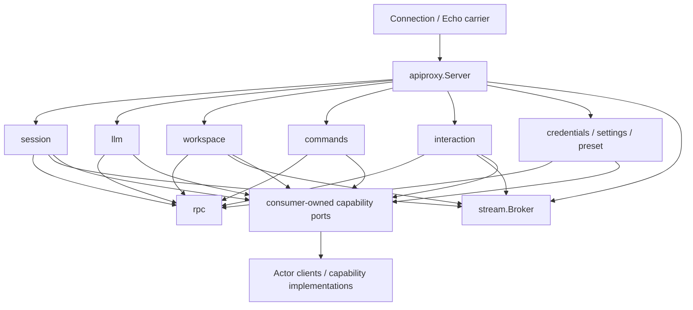
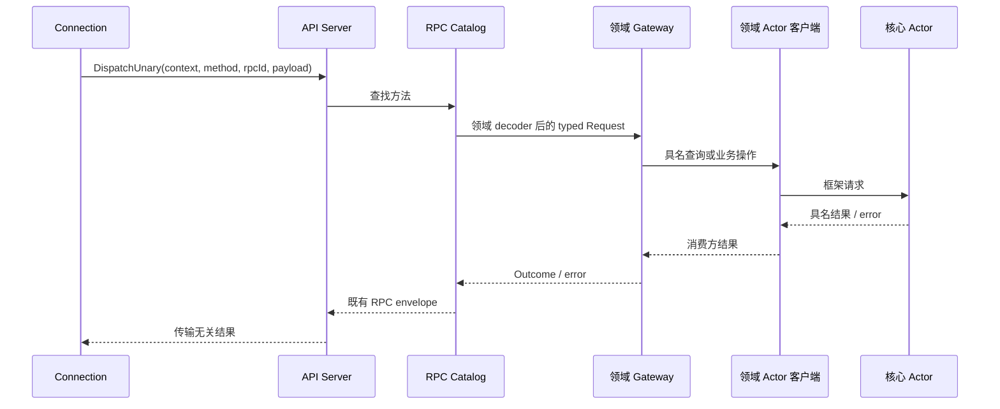
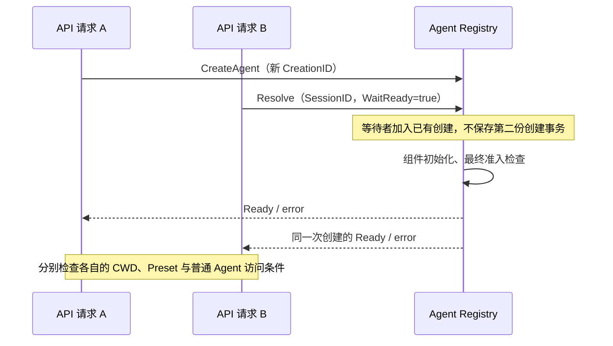

# API Proxy 领域模块与组装设计

状态：模块职责已确定，代码迁移未完成。本文落实“按领域业务职责划分子模块，apiproxy 统一编排”的要求。Subagent 暂缓重构；不借 API 拆分改写其生命周期和配置。旧 Plugin 组装不作为目标架构。

## 现状与根因

当前 `apiproxy/host/methods.go` 组装各 Gateway，但 Gateway、方法契约、decoder 和领域帧散落在根包。`apiproxy/session` 依赖根包的 Session DTO 和 RPC 泛型；根包因此不能直接组装 Session 子模块，否则形成 Go import cycle。

`catalog.go` 的 Request、Outcome、Catalog 和 `pending.go` 的应答关联是跨领域 RPC 机制。`session_decode.go` 中对象、字符串字段等基础读取被其他领域解码器复用；这些函数的归属不能继续依附 Session。相反，Session 提示消息、Workspace 路径、Credentials 引用和 Commands Remote 参数的校验规则都由各领域负责。

`frame_values.go`、`mux_frames.go` 和 `host_frames.go` 按传输形状集中不同业务。`LiveFrameSource` 同时订阅业务事实和维护推送连接，`InteractionGateway` 则拥有审批/提问的请求关联。迁移必须拆清事件转换、交互结算和订阅传输，不能仅搬 Gateway 文件。

当前构建还有独立的旧依赖问题：Commands Gateway 仍调用已经消失的 Registry.Execute；Session API 和 LiveFrameSource 仍引用旧 LiveStore/Context；Host 和生产 assembly 仍依赖 Plugin Factory。移动文件不能视为完成这些行为迁移。

## 模块归属

以下是同一个 API Proxy 内部的能力划分，不重新划分 Session、LLM、Credentials 等核心业务 owner。只有实际迁入实现时才创建目录。

| 模块 | 主要对象及职责 | 从现有文件迁入 | 下游契约 |
| --- | --- | --- | --- |
| `apiproxy` | `Server` 组装方法、交互、事件订阅和关闭流程，对 Connection 提供统一入口；保留 `host.describe` 的部署信息汇总 | `host/plugin.go` 的组装和统一入口、`host/methods.go`、`service.go`、`host.go` | 各子模块；不访问存储和模型实现 |
| `apiproxy/rpc` | `Catalog` 管理方法与待回复关联，`Request`/`Outcome` 表达 typed RPC 请求结果，基础 JSON 字段读取与错误编码 | `catalog*`、`pending*`、其他 decoder 中真正共享的字段读取 | `connection` 的协议值；不依赖业务子模块 |
| `apiproxy/session` | `Gateway` 编排会话读取、创建、模型选择和对话操作；本模块拥有 `session.*` DTO、decoder、错误映射和 Session/Agent 事实到帧的投影 | 现有子包及 `session_api`、`session_decode*`、`session_wire_projection`、LiveFrameSource 的会话投影 | Session、Agent、Projection、Query、Title、模型查询等消费方窄接口 |
| `apiproxy/llm` | `Gateway` 负责 `llm.providers/models`、提供者失败隔离、模型目录视图；Actor 查询适配归本模块 | `llm_api`、`llm_gateway*`、`actor/directory`、`modelquery` | LLM 配置 Grain、查询 Router；不拥有提供者或模型生成 |
| `apiproxy/credentials` | `Gateway` 负责 `credentials.*` 请求校验及无 secret 的结果投影 | `credentials_api`、`credentials_gateway*` | 只包含 Describe/Set/Unset 的 Provider，不含 Resolve |
| `apiproxy/workspace` | `Gateway` 负责 `workspace.*`，工作区事实到 Host 帧的投影 | `workspace_api`、`workspace_decode`、`workspace_gateway` | Workspace 业务接口及 Actor 客户端，不访问 SQLite |
| `apiproxy/commands` | `Gateway` 负责 Commands Remote 参数与结果映射，先经过 ordinary Agent 访问检查 | `commands_api*` 中的契约、decoder、Gateway | 当前 Agent 创建对应的 Commands 查询/执行能力；不调用业务 Registry.Execute |
| `apiproxy/interaction` | `Gateway` 负责审批和结构化提问的浏览器请求、回复校验、重连待答投影与取消结算 | `interaction_*` 和对应领域帧 | Approval/UserQuestions 消费方接口、RPC 待回复关联、推送发布接口 |
| `apiproxy/stream` | `Broker` 负责 Mux/Host 订阅、顺序、断开、背压和发布，不判断 Session 事实含义 | `events*`、`frame.go` 的公共编码、`live_frame_hub*` 的传输部分 | Connection 协议值；不读取 Session、不决策交互终态 |
| `apiproxy/settings` | `Gateway` 负责 `settings.describe` 及缺少 Provider 的既有错误行为 | `settings_api`、`settings_gateway*` | SettingsDescriber |
| `apiproxy/preset` | `Gateway` 负责 `agentPreset.list` 及无 Provider 的既有空目录行为 | `agent_preset_api`、`agent_preset_gateway*` | 只读 roster；不新增 preset authoring |

`bound_*` 与 Subagent 相关，当前不迁移业务实现。后续独立恢复该范围时再将 API 适配归入 `apiproxy/bound`；此次不让普通会话路径依赖 Subagent 实现，也不把 Bound 方法静默替换为空成功。最终服务器启用哪些暂缓接口，须在恢复生产入口时明确记录，不能由移动目录隐式改变。

不另建一个平铺的 `apiproxy/actor` 收纳全部领域适配。现有 LLM 适配与查询 Grain 归 LLM API 模块，后续 Workspace、Commands 等 Actor 适配跟随各自消费模块。小模块保持少量文件，不强制每个模块都存在 actor 子目录。

## 依赖与接口

图中业务模块到 Broker 的联系是发布接口依赖，不是互相持有完整 owner。任何子模块不 import 根包；根包单向构造和持有子模块。核心业务包不依赖 API DTO、RPC 或 GoAkt。

各业务模块提供具名 `Gateway`、自己的请求/结果类型和 `Register(*rpc.Catalog, ...) error`。方法注册将 decoder 与业务方法绑定，保留 canonical method string。不引入统一的 `Module`/`Install`/`Dispose` 接口来重建 Plugin。

跨业务模块只依赖真实消费接口。例如 Session 模型选择需要目录查询及 ResolveCallConfig，不应持有 LLM Gateway 或调用 `llm.models` RPC；LLM 适配可以满足两个消费接口，由组装注入。Commands 的 ordinary Agent 检查通过消费方访问接口完成，不持有整个 Session Gateway 或纯业务 `agent.Agent`。

| 对象/契约 | 核心数据与边界 |
| --- | --- |
| `Server` | 方法 Catalog、流 Broker、业务入口和订阅释放句柄；不保存第二份 Agent/Session 注册表 |
| `rpc.Request[P]` | RPCID、具名 Payload；不传 Echo Context |
| `rpc.Outcome[V]` | 成功值、业务 RPCError、absent 状态；技术错误仍用 error |
| `rpc.Catalog` | 方法名到 decoder/handler；RPCID 到当前待答关联；不解释 ApprovalID/QuestionID |
| `stream.Frame` | 领域帧提供类型判别和校验方法，公共编码仅构造既有 wire envelope；不增加万能业务 payload struct |
| 领域 DTO/Frame | 与方法、事件的业务归属一起迁移；JSON 名称、presence、判别值保持不变 |
| Commands 客户端 | 固定执行 Grain 地址与 CreationID；每次执行独立 CommandID；注册查询使用 SessionID；不创建 Agent 或 Commands Grain |

现有 MuxFrame/HostFrame 包私有 marker 方法无法由其他包实现。迁移为 stream 拥有的显式帧接口，领域模块提供实现并负责字段校验；通道与方法注册仍由组装约束。Go 类型身份允许破坏性迁移，所有调用方和测试一并改名导入，不保留根包类型别名和转发函数。

## 交互流程与 Actor 边界

HTTP goroutine 可以等待 Actor 客户端；Grain 内部继续使用异步 Request/continuation，不阻塞 dispatcher。Actor 只调度消息、关联回复和传播取消。Gateway 的字段校验、目录排序、普通 Agent 检查和 RPC 错误映射是独立 Go 业务，不搬入 OnReceive。

Commands 查询全局 Registry 的有效 Session 目录；执行发送至当前创建的 Commands Grain，由其提交 run、调用能力 Actor、提交 done。API 不自己执行 Compact，不通过 PubSub 等待一条恰好匹配的完成事件。HTTP 取消必须由客户端发送同一 CommandID 的取消意图，不能把停止等待当成压缩已结束。详细业务结算见 [Commands 设计](./37-commands-module.md)。

订阅方向为“核心 owner 发布事实 → 对应 API 领域适配投影 → Broker 发布 → Connection 推送”。Session 投影使用 Session 日志和现有 Projection，不在 Broker 内重放或折叠业务。重连时交互模块提供当前待答项目，Session 模块提供基线；Broker 负责拼接后的传输顺序，不能凭 pending frame 决定业务是否已结算。

`/api/respond` 由 Catalog 按 RPCID 路由到 Interaction 注册的 decoder；Interaction 校验 Session/审批/提问身份并确定本次浏览器交互结果，再通过领域端口回复核心 owner。Connection 断开只结束订阅，不能自动取消仍可重连回答的交互。

## 启停与失败契约

进程组装先启动核心 ActorSystem 与能力入口，再创建 API 各模块和注册方法；全部初始化成功后开放 Connection。根包汇总注册/订阅错误并逆序撤销已获得的 API 资源，不负责创建 LLM provider、Session backend 或业务默认配置。

关闭先停止新请求准入，撤销 API 事件订阅并结束自身待答/推送资源，再向进程 owner 报告关闭结果。已发送的业务请求通过明确取消/等待契约收尾；API 关闭不能擅自停用共享 Session/Agent/LLM Actor。不得因 HTTP 已返回、取消已确认或事件已发布而宣称业务资源已释放。

移除旧 `host.Plugin`/Factory 时，把其真实组装职责收回根包；Connection 使用不嵌入 `plugin.Service` 的服务接口。暂不通过旧 Plugin 包装新的 Server，也不为减少编译错误恢复已删除的能力 Factory。

## 实现顺序与验收

| 步骤 | 工作与完成证据 | 当前状态 |
| --- | --- | --- |
| 1 | 抽取 RPC 请求/结果、路由、待答关联和共享 JSON 字段读取；迁移原测试，子模块不再依赖根包协议类型 | 路由与待答关联已迁移，rpc race 测试/vet 通过；共享字段读取待业务切片迁移 |
| 2 | 迁移 Credentials、LLM、Settings、Preset 的完整垂直切片：接口、decoder、Gateway、测试、Actor 查询适配；删除原位置实现 | Credentials、LLM、Settings、Preset 已迁移，模块 race 测试/vet 通过；生产组装待迁移 |
| 3 | 迁移 Commands 垂直切片并验证真实 Registry/执行 Grain 查询、执行、取消与 stale creation 拒绝 | API 契约/解码/Gateway 和运行客户端已实现，客户端真实 Grain 测试通过；Resolver 和生产链路待实现 |
| 4 | Session API 契约并入现有子模块，替换旧 Agent/LiveStore 消费；Workspace API 同步迁移到已完成能力 | 待实现 |
| 5 | 领域帧归属、Interaction 和 Broker 分离；真实 Actor 事件到帧、重连、顺序、取消和关闭测试 | 已迁移 stream 帧编码及 Interaction Gateway/帧；真实 Catalog 与取消/关闭 race 测试通过，Broker 和真实事件集成待完成 |
| 6 | 根包 Server 接替 Host Plugin 组装，切换 Connection 和生产入口，删除迁移范围内 Plugin 接线；完整普通会话验收 | 待实现 |

每个步骤先补本模块接口及生命周期细节再改代码；整包暂不能编译时记录真实阻塞，不引入兼容路径。测试随所属模块移动；最终不能只凭某个新子包测试通过宣称 API Proxy 已完成。

本次设计依据为当前代码入口及用户确认的拆分方向，不改变既有客户端协议。验证须覆盖 HTTP/RPC 错误区别、Commands absent value、敏感值不回显、provider 失败隔离、事件顺序、取消、断开与重连，并运行原协议 golden fixtures。普通会话生产链路完成前，本模块保持“实施中”；Subagent 暂缓范围单独列出，不计为已完成。

### 第一步：RPC 内部实现

本步先迁移 `catalog.go`、`pending.go` 及其独立行为测试到 `apiproxy/rpc`。Catalog 保留现有路由锁和待答锁：调用来自并发 HTTP goroutine，移动包不改变它们的同步需求，也不把 Catalog 包装成没有调度职责的 Actor。

Catalog 拥有路由及 RPCID 关联表；PendingResponse 持有当前关联句柄，Withdraw 只撤销同一注册项，Wait 取消只停止本次等待。decoder 拒绝或 panic 不消费关联；成功响应和撤销竞争只有一个结论。Interaction 继续负责业务身份与审批/提问状态，测试通过 RPC identity 创建次数验证拒绝发生在注册之前，不读取 Catalog 私有 map。

Host describe 测试仍归根包；通用路由的失败隔离、重复方法和 pending response 测试归 RPC。共享字段读取将在迁移首个完整业务模块时抽取，以真实跨模块调用确定导出面，避免提前导出 Session 私有校验。

### Credentials API 切片

`apiproxy/credentials` 的 `Gateway` 持有消费方 `Provider`（Describe/Set/Unset），不增加 Actor 或凭据缓存。API 层只校验请求并投影 `View{Configured, Source, Writable}`；`SetRequest.Value` 是唯一携带凭据值的输入，WriteValue 保持空对象。框架请求由已有 Credentials Actor Client 完成，Gateway 不依赖 GoAkt。

模块内使用 `DescribeRequest`、`SetRequest`、`UnsetRequest`、`Gateway`、`Register` 等名称，包路径表达所属业务。迁移修改 Go 导入与调用点，不改变 credentials.describe/set/unset 方法、JSON 字段、错误码或现有校验行为。原 Gateway 测试随模块迁移，经真实 rpc.Catalog 调用；继续补齐 unset 和写入拒绝的协议测试。

基础对象读取、必填字符串和 invalid_type 构造从 Session decoder 移入 rpc，由原调用方直接消费，删除原实现。数组索引采用 strconv.Itoa，不为字符串转换新增共享对象。Credentials 引用语法与数量限制保留在 Credentials decoder。

### LLM API 切片

模型目录 DTO 从 Session API 移入 `apiproxy/llm`，因为 Host llm.models 与 Session 模型选择都消费目录。Session 保留 Current/Routable 与选择命令，不拥有提供者目录行。

`Catalog` 是无框架的目录查询业务对象，消费 `Directory` 的 ReadCatalog/ListModels/ResolveModelInfo；负责提供者顺序、reasoning 视图和逐 provider 失败隔离。`Gateway` 只将 Catalog 的结果包装为 RPC Outcome。Session 消费 Catalog，不持有 LLM Gateway。目录查询整体失败仍返回 error，不能转换为空目录。

`apiproxy/llm/actor` 放置现有 Directory 客户端和查询 Grain；前者将具名 Actor 结果映射为 Directory 契约，后者只关联 Router 查询请求与回复。移除 `apiproxy/actor` 和 `apiproxy/modelquery` 原位置，不保留转发包。查询取消、期限和 Worker 退出的契约保持 [模型查询设计](./35-api-model-queries.md) 所述行为。

### Settings 与 Preset API 切片

Settings Gateway 消费 `Describer.DescribeSettings`，校验 namespace 唯一性、revision、applies 和 JSON 后返回独立副本；它不拥有设置文件或设置变更。缺少 Describer 保留既有 RPC internal failure。`DescribeValue` 的 Schema/Value 必须由 Provider 预先脱敏，Gateway 无凭据解析能力，不新增 Settings Provider。

Preset Gateway 消费 `Roster.List/DefaultID/Authorable`，验证 ID、trust 和 broken reason，投影默认项及部署可打开路径能力。未注入 Roster 返回空数组且不可 author；不新增配置继承、子 Agent 或 preset authoring。返回的可选文本复制为独立值，不把 Provider 持有的可变指针直接交给 wire。

两个模块均为普通 Go Gateway，通过 rpc.RegisterUnary 绑定固定 method。它们没有独立运行状态或后台调度，不为目录拆分增加 Actor。请求 Context 原样传至 Provider；关闭不释放注入的共享 Provider。接口、DTO、Gateway、方法注册和原测试随模块迁移，根包仅保留显式组装调用。

### API 请求编排 Actor 的待决边界

用户提出 API LLM 不必独占 Actor。当前代码没有已实现的 API Proxy 统一编排 Actor，只有查询桥接 Grain；不能仅移动或改名该 Grain 就声称完成统一编排。统一 API 请求 Actor 是待决方案，尚未实现，也不因目录拆分为其他 Gateway 增加 Actor。现有查询桥接在替代通信路径验证前保留，需同时保持 Router 结果关联、超时、取消和迟到回复处理。

### Commands API 消费接口

`apiproxy/commands.Gateway` 消费 `Resolver.ResolveCommands(ctx, SessionID)` 返回的当前 Agent 创建对应的 `Executor`。Resolver 负责普通 Agent 访问检查和按需激活，拒绝用既有 RPCError 表达；Executor 只提供 `List(ctx)` 与 `Execute(ctx, line, options)`，不向 API 暴露纯业务 Agent、Registry map 或 GoAkt 类型。技术错误返回 error，由既有 Remote 封装处理。

执行客户端绑定 SessionID、CreationID、Commands Grain 和全局 Registry 地址；它不是 Actor，也不创建 Agent/Grain。Gateway 将图片数量传为 ExecuteOptions，未识别命令保留 absent value。按当前 Session 名称临时创建执行 Grain，或以配置 Registry 代替运行客户端，都会绕过生命周期初始化，禁止使用。

本切片先迁移请求契约、严格 Remote decoder、Gateway 和访问端口。生产 Resolver 随 Session 生命周期迁移实现，Host 必须显式注入，不保留旧 Registry.Execute 兼容调用。未完成 Resolver/执行客户端/生产调用链时明确标为未完成。

### Session 激活接入：并发创建结果归属

原 `AgentSessions.Ensure` 用 `creations` map、mutex 和 done channel 归并同 Session 的并发 HTTP 创建；模型选择还通过 Scope 安装 ModelSelectionRef。迁移后 API 不再拥有这些生命周期状态。Registry 已保存首次 CreateAgent 的输入和等待回复句柄，应由它提供现有创建的等待入口。

#### 接口与数据

`Resolve{AgentID, WaitReady}` 保持默认非等待行为。WaitReady 为 true 时，仅在该 ID 已有在途创建且祖先仍允许准入时，复用该创建的最终回复；不存在或已关闭时仍返回 ErrCreation，不自动启动 Actor。初始化完成的查询仍校验原 InstanceID。关闭开始后拒绝新增等待者，先前已接收的等待者收到同一次创建最终错误，不能得到半初始化地址。

API 的获取流程为：等待解析现有创建 → 仅不存在时读取 Session 持久化元数据并决定恢复/新建 → 提交新的 CreateAgent → 若另一请求抢先登记，等待解析胜出的创建 → 使用 Header 的 CWD、AgentPreset 和当前父子关系检查能否接管。每个请求保留自己的业务检查条件，不能把第一个调用者的接管结论共享给所有请求。检查普通 Agent 归属使用当前 Registration.ParentID；历史 Header.Origin 不替代当前父子关系。

调用方停止等待不撤销共享初始化，不触发 Session 关闭。失败创建仍须走 CloseAgent；API 不删除 Registry 条目，也不启动组件补偿失败。验证包含等待成功、初始化失败、等待期间关闭、缺失身份以及默认 Resolve 不等待，生产 Gateway 接入完成前不将此步骤计作 Session API 完成。

### 流帧编码与 Interaction 分离

`apiproxy/stream` 先接收现有帧编码、Mux/Host 帧契约和流请求封装，接口方法改为可跨包实现的 Type/Validate/MuxFrame/HostFrame。领域模块继续拥有字段、校验和规范 type 字符串；编码器只验证并加入 type，不读取 Session 或处理业务事件。此迁移不改 JSON 字段、RPCID 或通道。旧根包不保留别名、编码转发函数。

`apiproxy/interaction.Gateway` 接收 RPC Catalog 与消费方 FrameBroker；它负责审批/提问关联和终态结算，FrameBroker 负责待答帧发布、重放和终态替换。Gateway 实现现有 approval.Answerer、userquestions.Provider，直接由组合根注入，不使用 Plugin。Dependencies/Options/帧与问题 DTO 均归该模块；Gateway 方法分文件统一 gateway_ 前缀。

本阶段先验证真实 Catalog 的无效响应拒绝、有效回答、取消、重复请求和关闭。Broker 与真实 Session 事件重连集成仍须在流模块迁移后验证，不将录制发布接口的测试当作完整 WebSocket 验证。

### Broker 实现契约

Broker 只管理下行订阅、已编码帧和待答帧重放，不保存 Session/Agent 对象。发布时完成编码并持有字节副本，每次读取再返回独立字节副本，避免调用方修改帧或某一消费者修改 payload 影响其他连接。

`OpenMux/OpenHost` 原子登记订阅；Mux 同时捕获待答基线，按现有 question/requested、approval/requested 组内注册顺序重放。`Subscription.Replay` 返回此基线，`Next(ctx)` 读取登记后的增量。Session 上游必须先 OpenMux，再读取 Session 基线，发送 SubscribedFrame、交互 Replay、队列基线，最后读取增量并按 Session 截止序号过滤；不能先读 Session 再注册订阅造成遗漏。

`Release` 仅移除一个连接，不撤销待答交互。`PublishPending/ResolvePending` 对应交互的稳定 RPCID，已解决的交互不进入新连接基线。广播使用有界 channel；满载时仅关闭慢订阅并返回可识别的慢消费错误，其他订阅和业务交互继续。Broker.Close 停止所有订阅，幂等；不取消核心业务，不宣称 Agent 或 Session 已关闭。

Broker、订阅和内部 delivery 之间只共享单向叶子对象，没有互相持有 owner 或闭包反向引用。API 组合根负责释放订阅。下游 FrameBroker 满足 Interaction 消费接口，但 Broker 不导入 Interaction 模块。

### Workspace API 聚合与规则归属

Workspace 的接口注册、严格解码、响应视图和 Host 通知统一归 `apiproxy/workspace`。
根 API Proxy 只装配 Gateway、注册方法并连接事件及传输；子模块不反向依赖根包。
Go 名称使用包内 `Gateway`、`CreateRequest`、`View` 等，删除根包旧声明，不保留别名。
`workspace.*` 方法、`host/workspace-*` 通知和 JSON 字段保持原有协议。

Gateway 不持有可变 Workspace 对象，不自行加锁扫描重名。
名称裁剪、冲突检查和提交由 Workspace 业务 owner 一次执行，Actor 只调度这个操作。
API 消费返回独立快照的操作接口；Actor 客户端适配在 Workspace API 模块内完成。
重命名及移动响应必须来自同一次操作的提交结果，不能另发读取请求拼接，以免被后续操作覆盖。
Workspace Gateway 已改为消费 Directory，actor/Directory 适配已完成的 Workspace 客户端；生产 Host 装配仍待整体替换。并发验证见 INT-05。

### Session 下行类型命名

`apiproxy/session/events` 内的类型不重复叠加 Host、Session 前缀。
`EventFrame` 是下行通知，`LogEvent` 是持久化日志在协议中的表示，二者不能混用。
队列消息与任务视图随各自的校验和投影聚合；`notifications.go` 只放下行帧契约。
本次改变 Go 名称与文件归属，不改变事件 discriminant、JSON 字段或持久化格式；调用方直接迁移，无旧类型别名。

### Session 快照的 Actor 读取入口

Session API 的流基线先读取 Session Registry 的初始化清单，再按清单中的 SessionID、CreationID 解析现有实例地址。
Registry 的 `ResolveSession` 仅返回已初始化且尚未退役的原实例，不执行 GrainOf，不启动新的 Session；生命周期初始化成功时保留其地址。
API 适配器获得地址后发送 Session.Read，转换为独立 Snapshot，不把地址传入业务 Feed。

列表和读取之间允许 Session 关闭：若解析或读取证实该创建已失效，基线跳过这条旧记录；普通通信超时或未知错误必须返回失败，不能当作 Session 已关闭。
新一代使用相同 SessionID 时，旧 CreationID 不能解析到新实例。
该入口也供后续 Session Gateway 读取迁移使用，业务 owner 与 Actor 调度继续分离。

### Session Gateway 业务端口替换

Session API 的请求、响应和严格解码归入 `apiproxy/session`，根包不保留重导出；子模块不再导入根 API Proxy。
读取用例消费独立的活动 Session 视图（Header、Events、Projection、Running），不读取可变 Agent/Session 对象。
持久化读取使用消费方定义的最小接口，实际由 persistence.Reader 提供，保持历史分页、投影截止序号和搜索可见性规则。

激活用例只提出“解析／创建／恢复”请求，并根据返回 Header 与当前父子关系检查接管条件；并发创建由 Agent Registry 统一收敛。
模型选择由 Agent 对应 LLM 配置 owner 保存，API 不安装 ModelSelectionRef、Scope 或 selectionLease。
这些替换需要同步更新调用和测试；剩余旧装配的编译错误不得以兼容别名绕过。

### 队列提升与模型选择接线核对

固定基线 `47f943859bef60e4160492346772ded9b24f765a` 的 `packages/host/apiproxy/src/api-proxy.ts:updateQueue` 使用 remove 后 steer；取消中的 Steer 会回到 next-turn。
Go 的 Promote 保留原取消／重新插入日志语义，但将两个 splice 一次提交，业务 owner 检查当前消息位置与运行状态。取消和队列操作仅查询活动 Agent，不恢复冷 Session；非文本编辑在查询之前拒绝。

Actor Client 的模型配置读写直接请求 LLM。AgentLoop 不提供 Configuration/Configure，不保存下一次模型配置，也不在生成前执行 SetConfiguration。Registry 在创建阶段把 Session 历史交给 LLM 初始化缺失配置；已有配置保持不变。

### Session Actor Client 实现契约

业务接口按领域拆分：Agents 管创建与查找，Agent 管输入与执行控制，Logs 管 Session 日志，Projections 管指定日志前缀的视图，Titles 管人工标题。`apiproxy/session/actor` 的各 Actor Client 分别实现这些接口，不在 Agent 上聚合其他领域能力。

`apiproxy/session.Reader` 组合 Logs、Projections、Agents 的结果供 API 列表和历史使用。Logs 通过 Session Registry 捕获创建身份再读取日志；Projections 使用 Compute 构建独立折叠，旧前缀不能替换实时投影。状态是独立观察，不宣称跨 Actor 原子快照。Compute 当前逐次折叠，性能优化须保持此前缀契约。

AgentLoop 的 ReadActivity 校验 CreationID，回复 Activity 中的 Pending 与业务 Status。两者来自同一次邮箱处理，不维护第二套状态。旧 GetInbox 无身份查询删除。客户端固定原创建身份，同 ID 重新创建后旧客户端请求被拒绝。

输入修改等待 Changed。Replace/Remove 成功但未改变任何记录时返回 agent.ErrInputMissing。Titles 从已就绪 Components 找到 Title，Rename 消费本次已提交事件，不再次读取标题。错误和取消通过 error/context 传播；请求超时不自动重试写入。此迁移不改变 HTTP、WebSocket 字段和 Session 持久化格式。

### Workspace 成员接口接线

待完成：Session Gateway 的 Workspaces 端口由 Workspace API 的 Directory Actor Client 实现。Read 将明确的 Found=false 转为 nil；AttachSession 转发给 Workspace owner，由其读取 Session Header、验证 CWD 并持久化成员关系。API 不自行验证或修改成员集合，不因附加失败回滚已经创建的 Session。

### Title 生命周期接线

API 不启动 Title。Title Registry 接收 Agent Registry 的 StartComponent/StopComponent，负责创建 Grain、完成初始化、等待 Session 订阅确认，再返回组件地址；关闭先停止订阅，再取消并等待 Title 业务退出，最后停用 Grain。启动失败保留已取得的资源地址，StopComponent 仍负责清理；同一创建的重试共享启动结果，旧创建不能操作新实例。

Title Registry 只保存框架创建阶段和资源地址。标题策略、日志投影、生成资格与结果采纳仍属于现有 title 业务对象；Registry 不复制这些决策。Subscriber 用一次性的订阅就绪通道表达框架确认，不再要求额外的启动观察 Actor；按显式 SessionID/CreationID 过滤事件。
