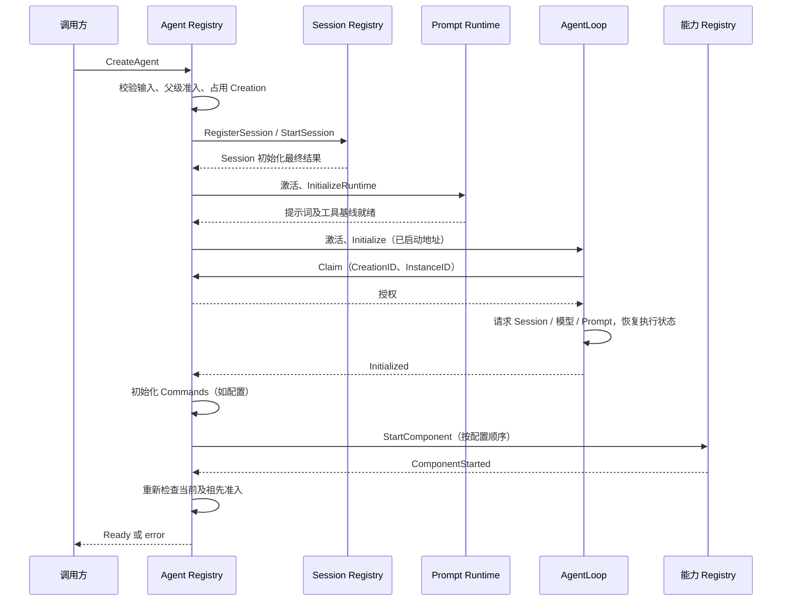
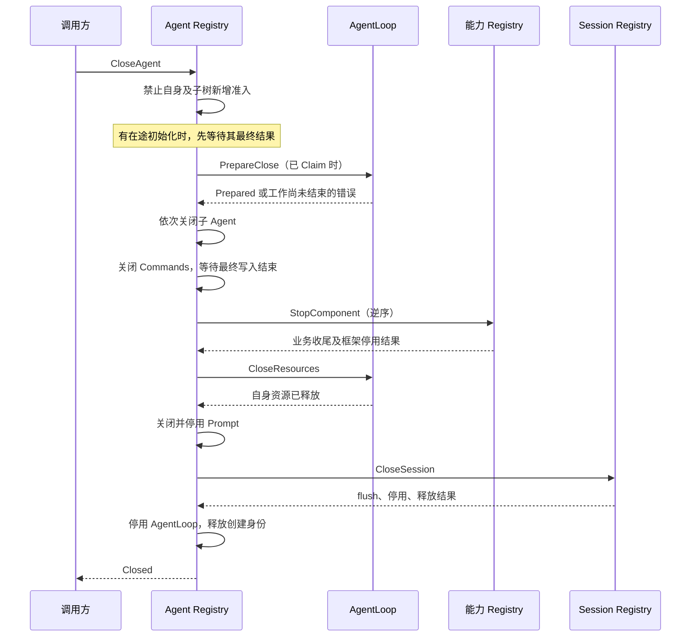

# Agent 生命周期实现

本文确定本次 Agent/AgentLoop 生命周期边界。业务职责见 [Agent 模块](./32-agent-module.md)，API 后续接线与进度见 [实施计划](./12-implementation-plan.md)。Subagent 配置和生产 HTTP 接线不在本次迁移内；已有父子关闭规则保留。

## 对象与依赖

| 对象 | 职责 | 持有的数据 |
| --- | --- | --- |
| agent.Registry | 身份登记、父子关系、祖先准入限制 | AgentID、ParentID、关闭标记；无框架依赖 |
| agent/registry.Grain | 统一创建、恢复、就绪检查、失败清理和关闭编排 | 精确创建身份、原始输入、组件地址、未完成请求及已完成阶段 |
| agentloop/actor.Grain | 初始化自身业务状态、对话执行、维护准入、释放执行资源 | ReactLoopAgent、已启动组件地址、执行请求关联 |
| Session Registry | Session 创建、恢复、flush、停用和身份释放 | Session 创建输入及日志生命周期进度 |
| Prompt Runtime | 请求提示词定义与工具基线，组装提示词 | 自己的配置与工具版本 |
| Commands Grain | 每 Agent 命令执行及最终 Session 写入 | 当前创建、在途命令；不管理 AgentLoop |
| 能力 Registry | 启动、初始化和关闭自己提供的每 Agent 组件 | 所属策略、共享依赖、精确组件生命周期 |

Agent Registry 是生命周期 Actor，不再增加一个转发层。它通过 GrainOf 启动固定核心组件，通过具名消息请求可选能力的 Registry。AgentLoop 不调用 GrainOf、Spawn，也不负责其他组件或 Session 的关闭。

GoAkt v4.5.3 的 GrainFactory 和 ActorSystem.GrainIdentity 已弃用，本实现不使用。Registry 对具体核心 Grain 的依赖属于框架编排；共享生命周期消息位于 agent/actor，AgentLoop 不导入 Registry 实现，纯业务不导入 Actor 框架。

## 接口与关键数据

- `CreateAgent`：Creation、可选 Parent、Restore、Session Options/Storage、核心配置入口、可选 Commands Registry 和 Components 列表。输入在首次准入时复制固定，后续同一创建输入不匹配时拒绝。
- `Ready`：精确 Creation、分离的 Registration、已初始化 Executor/Commands，以及能力 owner 与 runtime 地址。任何错误都不附带可执行地址。
- `Resolve`：查询现存创建；初始化尚未完成时返回未就绪。发布地址前向 AgentLoop 请求 Verify，校验 CreationID/InstanceID。该请求可能触发框架对旧地址的重新激活，但不会授权新的业务生命周期。
- `Initialize`：包含 AgentID、创建授权和已启动的 Session、Prompt、模型配置地址。AgentLoop 请求 Session.Read 恢复 Inbox，再请求模型配置与 Prompt.ReadRuntime，不启动其他 Actor。
- `PrepareClose` / `CloseResources`：分别冻结执行准入并检查既有工作、释放 AgentLoop 自身执行资源。两者不表示 Session 已持久化或其他组件已关闭。
- `StartComponent` / `ComponentStarted`：能力 Registry 接收当前 AgentID、CreationID、Agent/Session 地址；最终回复其 runtime 或 error。
- `StopComponent` / `ComponentStopped`：能力 Registry 确认该创建的业务收尾及框架停用。Agent Registry 不解释具体能力配置。

`activation` 保存创建请求的框架编排进度；`closure` 保存关闭阶段和待回复句柄。它们没有业务消息队列、mutex 或对方业务对象引用。组件列表顺序是生命周期依赖顺序，关闭按逆序进行。已确认业务关闭但框架停用失败时保留确认，重试不再次执行业务关闭。

## 创建和恢复

重复创建共享原始输入和一次初始化结果；Claim 只授权激活，不能代替就绪。初始化失败保留身份，由 CloseAgent 清理；没有 Claim 的创建仍可能持有 Session 或 Prompt，因此清理不能以“未 Claim”为成功依据。调用方停止等待不撤销已接收的创建事务。

Session 恢复严格使用 Restore。Session 目前按已有规则延迟持久化空会话，未产生持久化事件的空 Session 不保证可从存储恢复；生命周期实现不改变该语义。

## 关闭、取消与错误

关闭不隐式丢弃消息或取消业务工作。待处理 Inbox、在途命令或维护未完成时返回明确错误，保留准入关闭状态与资源，原业务取消入口仍可使用，完成后重试关闭。子 Agent 关闭失败时父资源不释放。

身份释放没有绕过 CloseAgent 的直接删除消息。已接收的关闭请求共用一次操作；失败后保留成功阶段，新请求从失败点继续。初始化中开始关闭，原创建最终不得发布 Ready。旧 CreationID 请求不能关闭或发布替代创建；InstanceID 防止同一框架地址意外再激活后复用旧授权。

Resolve 的投递失败不证明业务状态丢失，因此仅返回错误；收到明确的激活身份不匹配时停止准入并保留身份。意外丢失执行状态后无法确认资源清理，CloseAgent 返回错误，不能宣称恢复成功或直接放开身份。进程崩溃后的全局恢复不由本次内存生命周期协议保证。

## Compaction 生命周期

`compaction/basic/registry.Grain`（Go 包名 compactionregistry）接受 Configure，保存已验证的策略和共享依赖；收到 StartComponent 后启动同 Agent 的 Compaction Grain，发送其现有 Initialize。StopComponent 等待现有 Close 和框架停用，保留幂等关闭结果。

Compaction 同时服务 PreStep、RequestError 与 /compact。它的生命周期不依赖模型工具列表，也不属于 Agent Registry 的专用配置字段。Agent Registry 只知道通用能力生命周期契约；工具实例应由 Tools 自己的生命周期管理。

## 框架约束与命名

通过普通调用方 AskGrain 发起首个需要延迟回复的请求时，Registry 必须用 WithGrainReentrancy 激活；Actor 调用方使用 RequestGrain。Receive 中不阻塞等待；RequestGrain 和 PipeToSelf 分别承担异步请求与重新进入邮箱/框架停用等待。

Registry 使用 SessionID 索引当前生命周期，Actor Name 统一为 `<sessionID>.<service>`，例如 `s-123.agentloop`、`s-123.session`、`s-123.prompt`、`s-123.commands`、`s-123.compaction`。Title、Projection Cache、TokenMeter 分别使用 title、projection-cache、tokenmeter 后缀；全局服务继续用固定名称。

每个服务的消息契约文件定义 RuntimeName。创建和寻址使用同一函数；初始化消息显式携带 AgentID/SessionID，或已有 Header.ID。业务身份不得通过拆分 Actor 名称得到，不保留旧名称回退。CreationID 独立标识一次生命周期。

GoAkt 实际按 Go 短包名和类型名生成 Kind，并非完整 import path。不同路径的同名 registry.Grain 仍会冲突；自定义 Name 不能消除此类型注册冲突，因此能力包使用 compactionregistry 等明确包名。

普通工作 Actor 可用 supervision；当前 Grain 不提供普通 PID 的 SpawnChild/监督树，框架子 Actor 的并发停止也不能替代上述业务关闭顺序。

## 验证边界

[创建测试](../../agent/registry/grain_creation_test.go) 使用真实 Registry、AgentLoop、Session、Prompt、Commands、Compaction Registry/Grain 和 SQLite，覆盖并发创建、配置冲突、就绪前拒绝解析、初始化期间关闭、失败清理、组件逆序关闭重试、持久化恢复与旧身份隔离。配置 owner 和部分故障能力使用具名契约夹具。

[父子关闭测试](../../agentloop/actor/grain_close_test.go) 覆盖三代关系、未完成子项、独立子关闭、父级重试、初始化失败后的 Session 清理；[执行关闭测试](../../agentloop/actor/grain_test.go) 覆盖取消保留输入、flush 失败后身份保留和重试。

这些测试不证明旧 API Session/Scope 已迁移，不证明完整对话、工具调用及生产 HTTP 装配已经完成。相关上游缺口继续在 API Proxy 设计与实施计划记录，不保留兼容别名来伪装接通。
