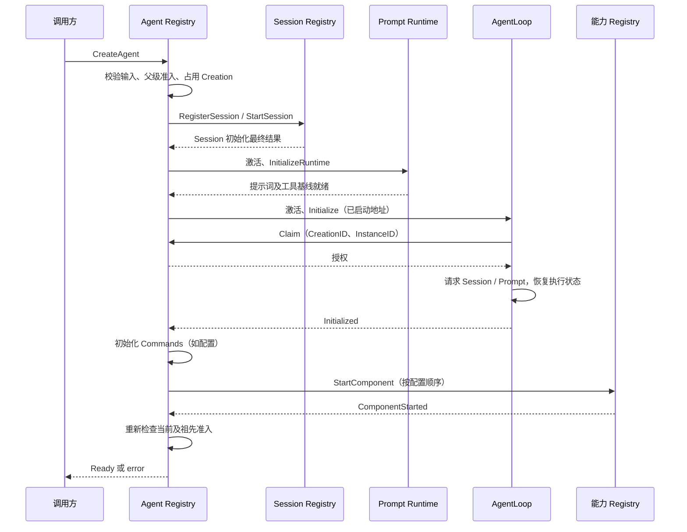
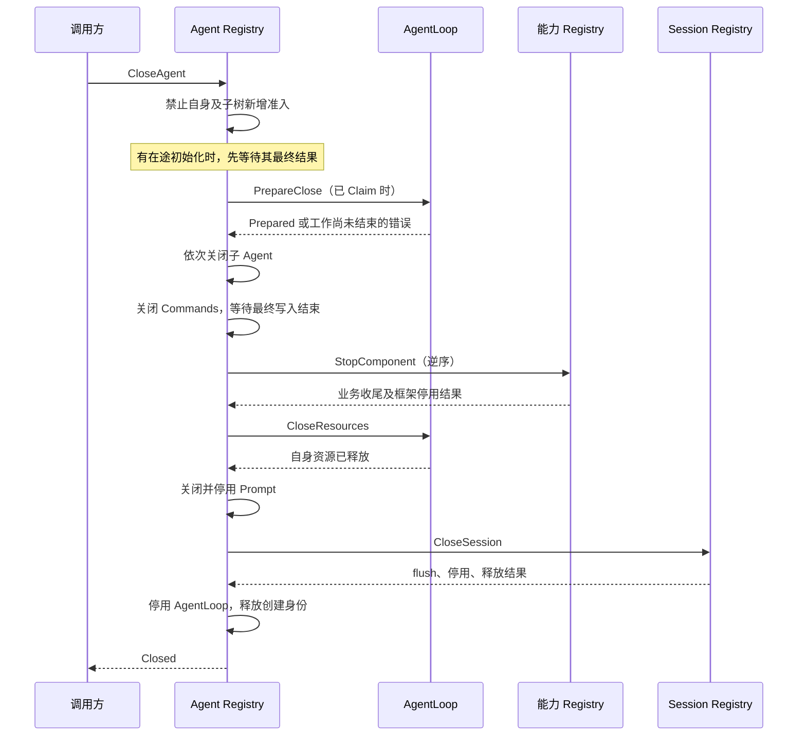

# Agent 生命周期优化方案

状态：职责原则已确认；Registry 已按组件依赖、就绪事实和资源责任实施，初始化失败自动清理与取消保留 Inbox 后关闭已有测试。生产 Tools Runtime 初始配置接线仍未完成。当前实现以文末“本次实现收敛”及模块 README 为准，旧实现记录不再是目标设计。

业务关联见 [Agent 模块](./32-agent-module.md)，生产集成与验证记录见 [本轮集成问题](./40-integration-findings.md)，后续安排见 [实施计划](./12-implementation-plan.md)。本轮目标包含生产接线，Subagent 重构暂缓，既有父子生命周期关系保留。

## 已确认的生命周期职责调整

以用户确认的五条约束为准：Agent 业务 Registry 拥有 Initializing、Available、Closing、Closed 四个状态；组件登记独立；Session → Tools 配置/定义 → Prompt → AgentLoop → Ready 为创建依赖；关闭先冻结准入、确认执行结束，再释放依赖资源，最后 Session flush 和框架停用；Actor 只投递异步请求与结果。

业务 Registry 的成员记录保存 Registration 与 Lifecycle。Register 建立 Initializing，CompleteInitialization 转为 Available；BeginClose 转为 Closing，Remove 只接受 Closing 并在子成员已关闭后转为 Closed。Closed 不再出现在 Get/List/Children 的活动成员视图中，但 State 可读取关闭结果，下一次 Register 可替换它。CheckAdmission 保留初始化所需的身份/祖先准入检查，CheckReady 专门限制对外就绪发布；不把框架启动步骤当作生命周期状态。Actor 的关闭布尔标记随后由此业务状态替代，框架创建标识仍只负责拒绝旧消息。

## 优化方案评审草案：先确定契约，再实施

状态：用户已确认五条职责原则及两项失败/取消行为；具体 Go 接口名称和实现拆分仍为设计建议，不把前面的局部步骤改名视为本方案已经落地。本节不新增全局运行时、地址注册表或通用工作流引擎。

### Registry 业务决策与 Actor 调度的具体分离（评审建议）

当前 nextStartup、nextClose、ready 和 handleStartupResult/handleShutdownResult 中的部分判断仍属于业务。拆文件或将 stage++ 换成 switch 不能满足隔离要求。目标是业务 Registry 根据用户请求和组件事实返回有限的具名生命周期操作，Grain 执行这些操作，不自行选择依赖顺序或决定清理是否充分。

| 当前内容 | 目标归属 |
| --- | --- |
| 四种状态、父子准入、是否可发布 Ready | Agent 业务 Registry |
| 启动顺序、关闭顺序、失败后保留哪些责任 | Agent 生命周期业务 |
| 组件已请求/已就绪/释放未确认的业务事实 | 独立的组件登记 |
| GoAkt 地址、CreationID/InstanceID 授权、旧回复匹配 | Registry Grain |
| 请求句柄、框架任务取消、载荷类型校验 | Registry Grain |
| Session 历史中的模型配置恢复 | LLM 配置业务 |
| 工具配置合并、发布、切换、回滚 | Tools Registry / Tool Runtime 业务 |

不再让同一个 installation 对象同时作为纯业务资源账目和框架地址表。业务组件登记使用逻辑组件身份，知道它是否仍有清理责任；Actor 按同一逻辑组件身份保存实际框架地址。两者分别保存业务事实与寻址信息，不各自维护一份生命周期状态。业务对象不引用 Grain，框架注册记录也不嵌入回指业务 owner 的对象。

接口建议保持三个入口：创建请求、关闭请求、组件结果。创建请求输入 AgentID、父 AgentID 和所需组件的业务描述；关闭请求输入目标 AgentID；组件结果只携带业务事实和普通 error。框架内部创建身份与激活标识在 Grain 中先校验，过期结果不得交给新的业务生命周期。业务结果不能携带 GrainIdentity、GrainReply、context 取消函数或待执行回调。

输出使用封闭的具名操作集合，例如启动 Session、准备 Tools、启动 Prompt、初始化 AgentLoop、等待执行结束、关闭子 Agent、关闭组件和发布就绪。这些操作只含业务参数，不提供 Execute 方法，不是动态注册的脚本或通用工作流节点。一个结果只能完成当前已发出的对应操作；失败可能要求保留责任并返回错误，不能由适配器自动跳到下一项。

概念交互如下，方法名仍为评审建议，不代表已有生产 API：

```text
Registry.BeginCreation(input) -> Operation
Grain 调度 Operation -> 组件 owner
组件 owner 的结果 -> Grain 校验身份、转换为业务事实
Registry.Accept(result) -> 下一项 Operation 或业务结果

Registry.BeginClose(agentID) -> Operation
同一条结果通路推进关闭，业务 Registry 判断何时进入 Closed
```

框架步骤不必全部成为业务操作。例如 Session owner 自己确认登记与启动，Tools owner 自己确认候选/发布/退役。Agent 生命周期只看到所需组件尚未就绪、已就绪或仍需清理。业务上关心的释放确认不得被普通框架 Tell 成功替代。若现有 owner 接口无法提供完整确认，应先补它的契约，不能把内部流程重新搬回 Agent Grain。

LLM 的 readModelHistory、initializeModel 不再由 Agent Registry 保存 history 并组织恢复。生命周期要求“该 Agent 的 LLM 配置就绪”；LLM Actor 请求 Session 数据并交给其配置业务恢复，再回复配置就绪。这里 Actor 仍只负责数据请求和调度，模型选择与恢复规则不进入 Actor。

验收的首要结构条件：纯业务测试无需启动 GoAkt，即可证明创建依赖顺序、关闭与初始化交错、失败责任保留和四态合法转换；Actor 集成测试只补充投递、延迟回复、身份隔离和真实组件确认。若测试仍必须构造 Grain 才能验证上述业务顺序，说明职责没有完成迁移。

### 状态、资源责任与执行进度分别表示什么

Agent 业务 Registry 拥有四个生命周期状态及父子准入约束。Initializing 允许必要初始化请求，但不允许发布可用 Agent；Available 允许普通业务；Closing 拒绝新业务，但允许既有工作的结果、取消及资源清理；Closed 拒绝旧创建的所有业务，只允许读取或重试原关闭结果。新的创建身份可复用 SessionID，不能将 Closed 原身份改回 Initializing。

组件登记独立保存原创建身份对应的资源责任。建议每项只保留所属 owner、资源身份与已确认事实，不复制 Provider、配置或业务对象。发送启动请求前登记责任；成功回复确认就绪；回复不确定时保留责任。资源业务关闭与框架停用是两个确认边界，只有后者也完成才移除登记。

初始化、可用、关闭中和关闭完成的判断不能同时在业务 Registry 与 Grain 的 closed、failure、initializing 字段中各定义一遍。框架仅保留在途请求及结果关联；启动失败原因是操作结果，不新增第五种 Agent 状态。当前 Registry Grain 已统一使用业务生命周期，删除重复的 closed、initializing 和 failure 字段。四态、依赖和资源责任均由纯业务测试覆盖。

### 组件契约核对

| 组件 | 当前启动契约 | 当前关闭契约 | 本次需解决的事项 |
| --- | --- | --- | --- |
| Session | RegisterSession / StartSession | CloseSession | 明确登记未到达、已登记、其他身份占用的查询结果 |
| Tools | Registry 配置 + Runtime.Apply 业务 | Runtime.Close 业务 + RemoveTool | 接通 Runtime Grain、初始配置和目录清理 |
| Prompt | InitializeRuntime | CloseRuntime，随后框架停用 | 初始工具基线必须先就绪 |
| AgentLoop | Initialize，内部声明激活身份 | PrepareClose / CloseResources | 明确等待执行完成的异步契约 |
| 可选组件 | StartComponent | StopComponent | 按实际依赖核对就绪和释放顺序 |
| LLM | InitializeAgent 接收历史 | Call 关闭已有客户端 | 共享服务不随 Agent 停用；沿用关闭时保留 Agent 配置 |

证据：[AgentLoop 关闭业务](../../agentloop/agent.go)、[组件契约](../../agent/actor/component.go)、[Session 契约](../../session/registry/registry_messages.go)、[Prompt 契约](../../systemprompt/actor/runtime_messages.go)、[Tools 更新](../../tools/runtime/runtime.go)与[关闭业务](../../tools/runtime/runtime_close.go)。

### 建议创建流程

1. 业务 Registry 登记 Agent 身份，进入 Initializing。
2. Session owner 完成创建或恢复；若仍需两步请求，Agent 只编排，不接管 Session 内部恢复决策。
3. 配置 owner 从 Session 恢复自身配置。Tools Registry 提供精确配置，Tool Runtime 完成实例准备、定义发布与清理，确认可用版本。
4. Prompt 消费已准备好的配置与工具定义，完成首次快照。
5. AgentLoop 与其余必要组件完成初始化。依赖 AgentLoop 地址的组件可以取得未对外发布的内部身份，不能因此让普通调用提前进入。
6. 业务 Registry 检查所有必要组件就绪、无关闭请求，转为 Available；Grain 返回 Ready。

用户已确认：初始化失败后自动进入 Closing 并开始清理已登记资源责任，不依赖调用方另发关闭请求。失败转换和清理决策由业务生命周期拥有；Actor 仅调度相应清理操作。尚未启动的后续组件不再启动，未确认的启动结果继续核实并保留清理责任。

创建请求返回原初始化错误，不附带可用地址；该错误不表示清理已完成，也不被后续清理错误覆盖。清理全部确认后进入 Closed；清理失败则保持 Closing、原创建身份和未完成责任，通过 CloseAgent 重试并取得最终关闭结果。清理未完成时，同一 Session 不得创建替代实例。当前实现已自动发起清理；显式关闭与自动清理复用同一关闭请求关联。

初始化失败自动清理的验收要求：

- 任一必要组件失败后，无需调用方发送 CloseAgent，也会开始清理此前已登记的资源。
- 创建回复保留原错误，不发布 Ready；清理错误不会把原初始化错误替换掉。
- 清理中或清理失败时，旧身份仍承担责任，同一 Session 的新创建不能抢占。
- 关闭重试仅处理未完成责任；全部确认后新的创建身份才可使用同一 Session。
- 显式关闭与自动清理并发时，共用同一关闭业务流程，不重复释放资源。

### 创建依赖环核对

当前 ask_user_question 的 NewDefinition 只保存 UserQuestions 能力并构造 schema/executor，不发起提问或要求 AgentLoop 已就绪。UserQuestions Actor Client 的 NewClient 也只绑定现有地址，身份检查在实际调用时发生。因此对该工具，先准备定义、再初始化 Prompt、最后初始化 AgentLoop 不构成业务依赖环。证据：[工具构造](../../toolaskuser/tool.go)、[提问客户端](../../userquestions/actor/client.go)。

这不能推广为所有 Provider.Open 的保证：Provider 是扩展接口，Open 可以执行资源申请。目标启动契约应明确，准备工具不能执行用户业务或同步等待本 Agent 的 Ready；运行时才需要的 Agent 能力通过既有客户端在调用阶段访问。若具体工具确有初始化依赖，应在 owner 契约中说明并审查，不能用提前发布 Agent Ready 绕过。

Prompt 当前显式要求已发布工具基线，AgentLoop 初始化又要求 Prompt 中的有效工具版本；这两条是真实前置条件。零工具配置也必须由 Tools Registry/Runtime 完成合法空集合发布，不能用默认版本号或伪造空目录跳过初始化。这是后续生产创建测试应验证的关键路径。

### 建议关闭流程与待定行为

先由业务 Registry 将 Agent 转为 Closing，冻结子树新准入。已有初始化任务返回后登记其真实资源结果，禁止继续启动后续组件。建议 CloseAgent 等待既有工作完成；显式取消仍独立传递，不能因关闭请求自动丢弃已接收输入。

当前 PrepareClose 冻结 AgentLoop 准入，并利用已有 idle 通知异步等待实际执行结束。仅有待处理输入且未明确取消保留时仍返回 ErrPending；取消并保留 Inbox 后，非空 Inbox 不阻止关闭。若采用等待方案，需保证冻结后已接收输入仍能继续完成，取消与完成消息不受新业务准入限制；否则会形成“等待待处理输入清空，但又不允许处理”的死锁。此行为必须以真实 AgentLoop 测试证明，不能只修改关闭回复的时机。

确认执行结束后关闭子 Agent，之后依实际依赖关闭命令、可选组件、AgentLoop 执行资源、Tools、Prompt；最后由 Session owner 确认 flush 与关闭，再完成剩余框架停用并释放 Agent 身份。组件顺序需在接线前核对，尤其是工具更新与 Prompt 订阅退出、命令撤销与 Commands Registry 的关系，不能机械倒置启动列表。

任何关闭失败都保持 Closing 与原资源责任。启动从未到达不能永远阻塞关闭，回复未知也不能直接当作未启动：对应 owner 应提供按原创建身份核实或幂等停止的契约。Compaction Registry 已有未启动时记录停止身份以拒绝迟到启动的行为，可作为已有实现证据；不能未经核对直接复制到所有组件。

### 启动结果不确定时的接口核对

Session 的 FindSession/ResolveSession 只面向已初始化或可用会话，不能回答“登记是否成功但尚未启动”。内部 authority.Check 对身份不存在和身份不匹配返回相同错误。因此当前接口不足以让 Agent 生命周期安全判定无需清理，不能用查询不到已就绪 Session 来删除责任。

建议优先使组件 owner 的停止操作能处理同一创建的“启动尚未确认”，不要在 Agent Registry 增加先查询再关闭的双请求流程。停止与登记的交错应在组件 owner 内串行处理：本创建已登记则关闭，另一创建占用则拒绝且不修改，未登记时还须防止已发送的迟到启动随后获得资源。具体旧创建拒绝机制需要覆盖同一 Session 多次重建，单个最新关闭标记不足以证明所有旧请求都被拒绝。

验收必须分别覆盖：启动请求根本未执行、登记成功但回复不可识别、关闭先于迟到登记、新身份已存在时旧关闭到达、同一逻辑身份多次重建后旧启动到达。不能通过吞掉 unknown creation reservation 错误让测试通过。此项仍为组件协议设计工作，尚未新增查询、停止消息或状态字段。

### 实施顺序与验收

已确定初始化失败自动清理，以及取消后保留输入并关闭、下次恢复。下一步按业务状态与资源责任归属迁移调用方，再落实异步关闭等待；不再重复询问这两项行为。LLM 沿用当前显式删除契约，不在本轮增加关闭时删除配置。其次统一各组件的启动/停止确认与资源责任，接通 Tools Runtime 初始配置，最后调整 Agent 创建和关闭编排。整个过程不恢复 Plugin 或添加兼容别名。

验收包括：初始化期间不发布 Ready；关闭与初始化交错不启动后续组件；工具定义先于 Prompt 就绪；执行中关闭不死锁且支持独立取消；父子关闭顺序保持；未收到有效启动回复也能核实责任；关闭失败重试不重复已确认释放；Session flush 失败不释放身份；旧创建消息不能影响新实例。测试必须覆盖生产配置 owner，不能由预发布工具目录的夹具替代生产初始化。


### 评审核对：关闭等待与 LLM 保留

当前 AgentLoop 的 PrepareTurn 使用 lifetime.ready()，后者包括 closingAvailable，因此业务入口没有一概禁止关闭期间继续处理原执行。Cancel 同样使用 ready()，可继续表达取消；新输入通过 CheckExecution 被拒绝。已有行为来源：[Turn 开始](../../agentloop/agent_turn.go)、[生命周期](../../agentloop/agent_lifecycle.go)、[取消](../../agentloop/agent_admission.go)。这只是业务入口证据，不证明生产 turn 驱动已接通或 Registry 已能等待。

建议将“开始关闭”和“执行已结束”作为同一异步关闭准备请求的受理与最终结果区分：收到请求先冻结新准入，终态回复只在相关执行、工具、模型和维护实际完成后返回。不额外增加进度事件、定时查询或轮询队列；Actor 保存该请求回复句柄，并在原执行结果处理后重新调用业务结束检查。普通取消确认不触发关闭成功。

用户已确认：显式取消并要求 KeepInbox 后，保留输入并关闭，下次恢复。活动执行以及工具、模型、维护必须实际退出，相关 Session 写入得到确认，最终 flush 成功后才能报告关闭完成。Inbox 非空本身不再阻止这条关闭路径，也不能为了关闭而删除或继续执行这些保留输入。当前 CheckClose 仍要求 pending.HasPending() 为假，与已确认契约冲突，待整体方案确定后迁移；本次仅记录决定，没有修改生产代码。此决定不扩展为所有普通关闭都自动取消执行。

取消保留输入后的验收要求：

- 取消回复先到、工具或模型调用仍未退出时，关闭不能提前成功。
- 保留 Inbox 的原消息身份、内容与顺序；关闭不新增删除输入的 Session 事件。
- 任一相关写入仍未确认或 Session flush 失败时，保留原创建及清理责任，不发布关闭成功。
- 关闭成功后使用新的创建身份从真实持久化存储恢复，Inbox 与关闭前应保留的输入一致。
- 重复关闭不得重复写入或删除输入；旧创建的迟到回复不能影响恢复后的实例。

这些条件需要新增真实 Session 恢复用例。现有 grain_test.go 的关闭用例先显式 Remove 待处理输入，再恢复并断言 Inbox 为空，不能用于证明本次“保留并恢复”行为。

LLM 配置保留无需重新决策：[RemoveConfiguration](../../llm/actor/configuration.go) 已明确为显式删除，Agent 关闭不发送。Configuration 以 AgentID 保存配置，不以单次模型请求或框架 CreationID 保存。关闭只确认本 Agent 的模型调用释放，不停用共享 LLM，也不删除可供后续请求使用的配置。下一次恢复仍由 LLM 配置 owner 处理，Registry 不复制其恢复业务。


## 当前实现记录与已验证约束

以下记录用于定位已有代码和测试，不表示上面的优化方案已经实现。尤其是 Actor 中的阶段推进、Registry 读取模型历史、初始化失败后显式关闭等现状，必须按评审结果迁移。startupStep/shutdownStep 的显式 switch 是中间代码状态，不是业务与 Actor 隔离的验收结论。

### 对象与依赖

| 对象 | 职责 | 持有的数据 |
| --- | --- | --- |
| agent.Registry | 身份登记、父子关系、祖先准入限制 | AgentID、ParentID、关闭标记；无框架依赖 |
| agent/registry.Grain | 统一创建、恢复、就绪检查、失败清理和关闭编排 | 精确创建身份、原始输入、组件地址、未完成请求及已完成阶段 |
| agentloop/actor.Grain | 初始化自身业务状态、对话执行、维护准入、释放执行资源 | ReactLoopAgent、已启动组件地址、执行请求关联 |
| Session Registry | Session 创建、恢复、flush、停用和身份释放 | Session 创建输入及日志生命周期进度 |
| Prompt Runtime | 请求提示词定义与工具基线，组装提示词 | 自己的配置与工具版本 |
| Commands Grain | 每 Agent 命令执行及最终 Session 写入 | 当前创建、在途命令；不管理 AgentLoop |
| 能力 Registry | 启动、初始化和关闭自己提供的每 Agent 组件 | 所属策略、共享依赖、精确组件生命周期 |

Agent Registry 是生命周期 Actor，不再增加一个转发层。它通过 GrainOf 启动固定核心组件，通过具名消息请求可选能力的 Registry。AgentLoop 不调用 GrainOf、Spawn，也不负责其他组件或 Session 的关闭。

GoAkt v4.5.3 的 GrainFactory 和 ActorSystem.GrainIdentity 已弃用，本实现不使用。Registry 对具体核心 Grain 的依赖属于框架编排；共享生命周期消息位于 agent/actor，AgentLoop 不导入 Registry 实现，纯业务不导入 Actor 框架。

### 接口与关键数据

- `CreateAgent`：Creation、可选 Parent、Restore、Session Options/Storage、核心配置入口、可选 Commands Registry 和 Components 列表。输入在首次准入时复制固定，后续同一创建输入不匹配时拒绝。
- `Ready`：精确 Creation、分离的 Registration、已初始化 Executor/Commands，以及能力 owner 与 runtime 地址。任何错误都不附带可执行地址。
- `FindAgent`：查询现存创建；默认在初始化尚未完成时返回未就绪；WaitReady 为 true 时复用已有创建的最终回复，缺失身份仍拒绝且不启动 Actor。发布地址前向 AgentLoop 请求 Verify，校验 CreationID/InstanceID。该请求可能触发框架对旧地址的重新激活，但不会授权新的业务生命周期。
- `Initialize`：包含 AgentID、创建授权和已启动的 Session、Prompt 地址。AgentLoop 请求 Session.Read 恢复 Inbox，再请求 Prompt.ReadRuntime，不读取模型配置，也不启动其他 Actor。当前 Registry 在启动 AgentLoop 前读取 Session 历史并请求 LLM.InitializeAgent；该跨领域数据组织将在目标方案中迁回 LLM owner。
- `PrepareClose` / `CloseResources`：分别冻结执行准入并检查既有工作、释放 AgentLoop 自身执行资源。两者不表示 Session 已持久化或其他组件已关闭。
- `StartComponent` / `ComponentStarted`：能力 Registry 接收当前 AgentID、CreationID、Agent/Session 地址；最终回复其 runtime 或 error。
- `StopComponent` / `ComponentStopped`：能力 Registry 确认该创建的业务收尾及框架停用。Agent Registry 不解释具体能力配置。

`activation` 保存创建请求的框架编排进度；`closure` 保存关闭阶段和待回复句柄。它们没有业务消息队列、mutex 或对方业务对象引用。组件列表顺序是生命周期依赖顺序，关闭按逆序进行。已确认业务关闭但框架停用失败时保留确认，重试不再次执行业务关闭。

### 创建和恢复



重复创建共享原始输入和一次初始化结果；Claim 只授权激活，不能代替就绪。初始化失败保留身份，由 CloseAgent 清理；没有 Claim 的创建仍可能持有 Session 或 Prompt，因此清理不能以“未 Claim”为成功依据。调用方停止等待不撤销已接收的创建事务。

Session 恢复严格使用 Restore。Session 目前按已有规则延迟持久化空会话，未产生持久化事件的空 Session 不保证可从存储恢复；生命周期实现不改变该语义。

### 关闭、取消与错误



关闭不隐式丢弃消息或取消业务工作。待处理 Inbox、在途命令或维护未完成时返回明确错误，保留准入关闭状态与资源，原业务取消入口仍可使用，完成后重试关闭。子 Agent 关闭失败时父资源不释放。

身份释放没有绕过 CloseAgent 的直接删除消息。已接收的关闭请求共用一次操作；失败后保留成功阶段，新请求从失败点继续。初始化中开始关闭，原创建最终不得发布 Ready。旧 CreationID 请求不能关闭或发布替代创建；InstanceID 防止同一框架地址意外再激活后复用旧授权。

FindAgent 的投递失败不证明业务状态丢失，因此仅返回错误；收到明确的激活身份不匹配时停止准入并保留身份。意外丢失执行状态后无法确认资源清理，CloseAgent 返回错误，不能宣称恢复成功或直接放开身份。进程崩溃后的全局恢复不由本次内存生命周期协议保证。

### Compaction 生命周期

`compaction/basic/registry.Grain`（Go 包名 compactionregistry）接受 Configure，保存已验证的策略和共享依赖；收到 StartComponent 后启动同 Agent 的 Compaction Grain，发送其现有 Initialize。StopComponent 等待现有 Close 和框架停用，保留幂等关闭结果。

Compaction 同时服务 PreStep、RequestError 与 /compact。它的生命周期不依赖模型工具列表，也不属于 Agent Registry 的专用配置字段。Agent Registry 只知道通用能力生命周期契约；工具业务资源归 Tool owner；ToolActor 的创建与停用当前通过 Agent Registry 的工具生命周期请求实现。

### 框架约束与命名

通过普通调用方 AskGrain 发起首个需要延迟回复的请求时，Registry 必须用 WithGrainReentrancy 激活；Actor 调用方使用 RequestGrain。Receive 中不阻塞等待；RequestGrain 和 PipeToSelf 分别承担异步请求与重新进入邮箱/框架停用等待。

Registry 使用 SessionID 索引当前生命周期，Actor Name 统一为 `<sessionID>.<service>`，例如 `s-123.agentloop`、`s-123.session`、`s-123.prompt`、`s-123.commands`、`s-123.compaction`。Title、Projection Cache、TokenMeter 分别使用 title、projection-cache、tokenmeter 后缀；全局服务继续用固定名称。

每个服务的消息契约文件定义 RuntimeName。创建和寻址使用同一函数；初始化消息显式携带 AgentID/SessionID，或已有 Header.ID。业务身份不得通过拆分 Actor 名称得到，不保留旧名称回退。CreationID 独立标识一次生命周期。

GoAkt 实际按 Go 短包名和类型名生成 Kind，并非完整 import path。不同路径的同名 registry.Grain 仍会冲突；自定义 Name 不能消除此类型注册冲突，因此能力包使用 compactionregistry 等明确包名。

普通工作 Actor 可用 supervision；当前 Grain 不提供普通 PID 的 SpawnChild/监督树，框架子 Actor 的并发停止也不能替代上述业务关闭顺序。

### 验证边界

#### 进程停止准入

进程退出先向 Registry 发送 StopAdmission。业务 agent.Registry 永久停止本次实例的新注册与普通准入，但保留成员和父子关系以便关闭重试；不会将其视为资源已经释放。Actor 在同一邮箱轮次返回尚未移除的根 Agent Creation，包含未完成初始化和失败后仍持有资源责任的根创建，按 AgentID 排序。

组合根只遍历返回的根创建，逐一调用现有 CloseAgent；子树递归、组件逆序释放与 Session flush 仍归 Registry。重复 StopAdmission 返回仍存在的根，已关闭根不再返回。关闭失败返回 error，禁止停止 ActorSystem 或数据库绕过失败；重试沿用 Registry 中的关闭进度。Server 不另建 Agent 生命周期表。

该消息不会直接取消正在执行的 turn，也不表示可强制丢弃输入。CloseAgent 的 PrepareClose 等业务约束保持不变，执行中如何取消和等待仍按 AgentLoop 契约调用。

[创建测试](../../agent/registry/grain_creation_test.go) 使用真实 Registry、AgentLoop、Session、Prompt、Commands、Compaction Registry/Grain 和 SQLite，覆盖并发创建、配置冲突、就绪前拒绝解析、初始化期间关闭、失败清理、组件逆序关闭重试、持久化恢复与旧身份隔离。配置 owner 和部分故障能力使用具名契约夹具。

[父子关闭测试](../../agentloop/actor/grain_close_test.go) 覆盖三代关系、未完成子项、独立子关闭、父级重试、初始化失败后的 Session 清理；[执行关闭测试](../../agentloop/actor/grain_test.go) 覆盖取消保留输入、flush 失败后身份保留和重试。

这些测试不证明旧 API Session/Scope 已迁移，不证明完整对话、工具调用及生产 HTTP 装配已经完成。相关上游缺口继续在 API Proxy 设计与实施计划记录，不保留兼容别名来伪装接通。

### 单工具实例的生命周期

Agent Registry 的 CreateTool / RemoveTool 负责启动和停止 ToolActor，Tools Registry 不参与实例生命周期。CreateTool 接收当前 Agent Creation、工具名称、Tools Registry 地址及请求超时；返回 ToolInstance（框架身份和该工具的 CreationID）。重复创建复用现有未移除实例，目录地址冲突拒绝；RemoveTool 必须携带工具 CreationID，防止旧移除请求删除同名新实例。创建在 Agent/祖先关闭后拒绝；移除在关闭阶段仍允许，用于清理。

每个工具登记单独的 CreationID，区别于所属 Agent 的 CreationID；普通配置替换保留此 ID，移除后重新创建才生成新值。ToolActor 的 Initialize 必须携带生命周期 Authority；OnActivate 生成 InstanceID，通过 ClaimTool 请求 Agent Registry 将工具登记绑定到该次激活。相同声明幂等，不同激活不能抢占同一工具登记。未授权初始化不构造工具业务对象，旧消息重新激活 Grain 也不能使用旧登记获取资源。此变更只涉及内部消息，不改变工具调用 ID 或持久化数据。

Actor 名称由 ToolActor.RuntimeName 生成，为 SessionID + .tool. + 工具名的十六进制编码，保证包含点号等字符的 SessionID/工具名不会产生分隔歧义。逻辑检索仍用 AgentID 与 canonical 工具名；不建立全局地址服务，不使用已废弃 GrainFactory。

Registry 只记录框架地址、已确认初始化/关闭步骤和当前投递任务，不持有 Tool 业务对象。创建、关闭和停用在框架任务中执行，结果回邮箱后推进记录；任务错误保留清理责任。关闭成功后再停用 Grain，停用重试不重新发送业务关闭。Agent 的关闭流程在 Session 关闭前逐个移除登记的工具，等待已有生命周期任务结束；工具清理失败不得释放 Agent 身份。

验收：实际 Registry + ToolActor 的创建、重复创建、配置执行、移除重试、资源关闭失败后重试、旧工具 CreationID 拒绝、停用后的旧激活声明拒绝、Agent 关闭回收工具和关闭后禁止创建。运行时工具集合更新与 CreateAgent 自动初始化仍需继续接通。

#### 工具操作结果与移除重试

创建与移除分别返回内部 toolCreationResult、toolRemovalResult，表示本次任务的结果（允许失败），不表示整个工具生命周期结束。结果携带原登记和请求标识，仅当前登记的当前任务能更新邮箱状态；异步任务不写登记对象。

已确认初始化的实例开始移除后进入 toolClosing：即使资源关闭失败，也不再向 CreateTool 返回可复用实例。RemoveTool 重试继续关闭原实例；确认资源关闭后进入 toolReleased，仅重试框架停用。强制停用绕过业务关闭时，旧激活授权不能转交新激活，Agent 关闭必须报告资源释放未确认，不能伪造回收成功。

#### 生命周期消息命名

FindAgent（原 Resolve）查找并验证已存在且就绪的 Agent，WaitReady 仅等待正在进行的创建，不隐式创建。ReserveAgent（原 Reserve）登记本次创建身份和父子关系，不启动 Actor。startupResult 和 shutdownResult 分别承载启动、关闭流程中一次异步操作的返回值或错误；接收端校验结果后才决定推进或保留失败，消息到达不等于整个流程完成。此轮只改变内部 Go 消息符号与处理方法名称，不改变 wire、持久化或生命周期行为；调用方直接迁移，不保留别名。


#### Registry 消息分派

OnReceive 按工具生命周期、Agent 生命周期、身份登记与校验、请求准入分派，未匹配消息由框架 Unhandled 处理。每类入口返回是否识别该消息，错误由识别消息的入口回复，避免共享尾部回复造成重复或漏回复。此划分不引入新 Actor、新状态或额外异步跳转。启动先登记身份再允许 Claim，关闭先冻结准入再等待资源释放；分派函数的代码顺序不代替这些业务约束。

#### 工具生命周期契约的依赖方向

工具生命周期消息放入 agent/actor，与既有 ClaimTool 等生命周期契约同属框架边界。CreateTool / RemoveTool 使用 AgentID、AgentCreationID 明确标识父 Agent 生命周期，工具身份仍为独立 ToolCreationID/ToolInstance.CreationID。Agent Registry 负责处理这些消息；Runtime 客户端不再导入 Registry 实现包，避免 Registry 启动 Runtime Grain 时形成反向依赖环。不增加适配别名，不改变外部协议或持久化。

#### 组件登记独立于创建操作

reservation.services 使用 installation 保存 Session/Prompt/Commands 地址、能力组件与 Session 登记责任；activation 只保存固定创建输入、临时历史数据、启动游标和等待回复。关闭读取 installation，只有等待在途启动时检查 activation。两者均无反向引用。

发送 RegisterSession 前登记 Session owner；收到无效回复或传输错误时保留责任，由 CloseSession 核实并释放原身份。收到可识别的拒绝回复时撤回本次登记责任。后续必须继续细化“登记不存在”与“其他身份占用”的核实契约，不能把任意关闭错误吞掉。专项测试注入实际登记成功后的无效回复，要求 Agent 关闭后新 Session 创建身份可以登记。

## 本次实现收敛：资源责任驱动关闭

关闭不再使用 shutdownStep 游标。Agent 业务 Registry 独立记录 Resource（Kind、Name、Index），启动投递前登记；未知结果保留登记，明确拒绝或成功释放后移除。框架地址仍在 Grain，业务登记不含 GoAkt 类型。NextRelease 根据实际资源、执行结束确认与现存子成员选择下一项；没有剩余责任且子成员关闭后，Remove 才能完成身份释放。关闭失败不推进，重试重新读取尚未释放的责任。

关闭依赖是：执行结束确认 → 子成员 → Commands → 逆序附加组件 → 执行资源 → Tools → Prompt → Session flush/关闭 → AgentLoop 停用。资源业务关闭后尚需框架停用时，适配器只保留该资源的停用投递进度，不能据此跳过业务登记。初始化期间开始关闭时，等待在途启动结果并登记事实；不再请求后续初始化。

业务 Registry 保存组件依赖与已就绪事实，不保留 Initialization 或 StartupAction 游标。Session 就绪后，模型配置与 Prompt 的就绪事实可独立确认；AgentLoop 必须等待二者。Grain 调用选中组件的 Client，不展开对应 owner 的协议。Registry 拒绝在该流程尚未完成时发布 Available。LLM 自行请求 Session 历史，Registry 不再保存恢复数据。验收须使用不启动 GoAkt 的测试覆盖资源顺序、遗漏责任、未知启动结果、失败重试和非法就绪发布；再用 Actor 测试覆盖自动清理与请求交错。


### 文件组织与调度边界

Registry Actor 的生产代码收拢为九个文件，具体映射见 [模块 README](../../agent/registry/README.zh-CN.md)。组件 Client 及装配统一在 components.go；通信机制在 client.go；创建请求的校验、复制和比较归 creation.go。身份、准入和消息入口统一在 grain.go，不为每个对象或几行方法单独拆文件。

createAgent 只负责入口编排；重复请求处理与创建流程放在同一文件。runCreation 和 runClose 只读取业务决定、选择已装配 Client、安排异步结果回到邮箱；原 startComponent 分支函数已删除。具体 Client 封装自己的登记、初始化、业务释放及框架停用协议。

请求续接使用当前邮箱的 GrainContext，不在延迟回调中复用旧上下文。GoAkt 的 GrainContext 使用对象池；本次验证曾复现旧上下文续接导致初始化超时或 actor system is not running，已由 clientReply 在新邮箱上下文中续接修复。

代码风格：先赋值，再判断错误，不使用 if 初始化语句；结构体字面量零或一个字段横向排列，两个及以上字段纵向排列。结构体字段声明仍纵向排列。
