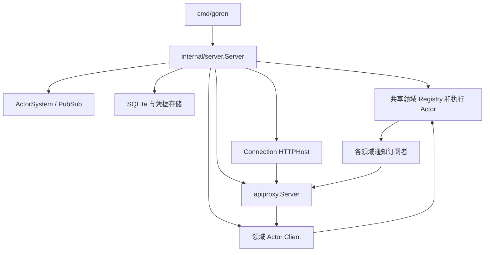

# 生产 Server 装配与验收计划

本方案落实删除 Plugin、API 使用领域接口、Registry 统一管理组件生命周期的已确认方向。进程组合根迁入 `internal/server`；`internal/assembly` 的 Catalog、Factory、Plugin 树及旧调用点整体删除，不留转发层。实施证据统一记入 [集成问题记录](40-integration-findings.md) 与 [项目进度](../08-implementation-progress.md)。当前本文是待实施计划，不能据此宣称进程可启动。

## 职责与接口

`cmd/goren` 解析 CLI、进程环境和退出信号，构造具名 Config 调用 Server。保留现有 listen/version/data-dir/session-db/workspace-db 参数。凭据路径仅为引用，不将密钥写入 Config 或日志。

`internal/server.Server` 负责 ActorSystem、存储句柄、共享 Actor 地址、API 和 HTTP 的取得与释放；不持有 AgentLoop、Session 日志等业务对象。对象仅单向持有资源；领域之间使用接口、框架地址和具名消息，没有互相嵌套的 owner。各方法按 `server_` 公共前缀分文件；配置、平台适配与资源初始化按实际职责聚合，禁止再创建 Factory Catalog。

拟定入口：New(Config, Environment) 验证静态配置；Start(context.Context) 完成资源初始化后绑定监听；Address() 返回实际监听地址；Close(context.Context) 执行关闭。启动失败必须执行已获得资源的逆序清理并返回错误；失败清理不能清除 Session 持久化事实。已开始关闭的对象不再次启动，新进程实例重新构造 Server。

Environment 仅提供凭据环境读取、路径策略及诊断，不作为服务定位器。Config 包含 HTTP、Session/Workspace/Query 存储、LLM、Prompt、Title、Compaction 的 owner-defined typed config；需要的可选项沿用当前业务默认值，不复制领域验证规则。

## 启动顺序与资源契约

| 阶段 | 取得资源与连接 | 完成条件 |
| --- | --- | --- |
| 1 | 校验所有静态配置，打开 SQLite 与 Credentials 存储 | 失败时无网络准入；关闭已打开存储 |
| 2 | 启动带 PubSub 的 ActorSystem | ActorSystem 成功启动 |
| 3 | 初始化 Credentials、LLM 配置及 provider 注册、Prompt、Tools、Commands、Projection、Session Registry、Agent Registry | 请求返回有效业务回复；需要延迟回复的 Grain 在首次请求前配置重入 |
| 4 | 启动 LLM workers/router、Query owner 与 Collector、Workspace owner、Title/工具组件生命周期 owner | 能正常调用；组件路由由 Agent Registry 模板引用 |
| 5 | 构造领域客户端、Session Reader 与 API Server，连接 Session/Agent/Workspace 订阅以及问答和审批 Provider | 所有要求的订阅确认后才能准入；不把未接线事件当作已实现 |
| 6 | 构造 HTTPHost，绑定监听并启动服务 | Host/API 可被真实 HTTP/WebSocket 调用 |

Session Agent 创建仍经 Agent Registry：Session 初始化、Prompt 与 LLM 初始化、AgentLoop、Commands 和组件准入。进程 Server 不另存每 Agent 生命周期表；系统关闭也必须查询 Registry 并走其关闭协议。

LLM 资源初始化分开执行已有的领域契约：initializeModels 安装 Catalog；initializeDeepSeek 构造 Connection、Identity、Adapter，并向同一个 LLM Grain 注册默认 provider route；随后调用 llm/actor.SpawnPool 初始化所有 workers。Credentials 在实际调用时解析，无密钥不能阻止进程启动。Provider 初始化不启动第二个 LLM Grain、不设置 Agent 配置、不发真实网络请求。注册返回 RegistrationID（包括已生效但通知失败的结果），组合根持有该注册责任；成功后调用退出必须先关闭模型调用再停止 workers 和 Registry。

此装配的验收使用本地 HTTP 服务承载真实 DeepSeek Adapter，经真实 router 发送 Generation/ReadChunk/CloseCall，检查流内容和关闭确认；它验证装配链，不冒充真实远端 Provider 验收。AgentLoop 消费、Session 提交及 API 下行仍须单独做完整链路测试。

Workspace 成员读写使用 workspace/actor.Directory；Search 使用 session/actor.Search；持久化分页使用 persistence.Reader；ProjectionCache 通过现有 owner 的查询契约接入。领域端口若缺实现，先补实现和测试，不能在组合根绕过 owner 或提供空结果。

## 关闭与失败

停止 HTTP 新请求，取消并等待下行订阅，结算 API 交互。随后经 Agent Registry 停止 Agent 执行和所有组件，等待 Session flush。停止共享订阅与 Query/Workspace 等 Actor 后关闭 ActorSystem，最后关闭其使用的存储。网络监听与 Serve goroutine 的完成结果必须可观察，不靠固定 sleep 判断退出。

需要支持取消的业务走其业务取消协议；关闭不能以发送框架停止消息代替业务完成确认。Close 超时或部分失败返回具体错误，保留尚未完成资源的关闭责任供重试；不销毁仍被运行任务使用的数据库。

图中是调用与数据流；订阅者持有具体消费入口，不持有 Server 本身。API 不反向持有进程 Server。

## 实施与验证表

真实 Agent 创建必须先通过不替换配置 owner 的集成验收：使用实际 ModelConfig、Prompt Registry、Tools Registry、Session Registry 和 SQLite，要求 Agent Registry 返回 Ready。creationFixture 仍用 configurationOwner 隔离模型和提示词配置故障，但 Tools 已改为真实 Registry。生产创建通过独立集成验收验证所有真实配置 owner。Registry 在 Session 可用后启动 Tools Runtime，完成配置应用与定义发布后才初始化 Prompt；不能通过测试夹具、默认空目录或 Prompt 忽略缺失目录绕过。

| 工作 | 当前状态 | 必须取得的证据 |
| --- | --- | --- |
| API Server 与 Connection 直接装配 | 已实现模块入口 | ab34830；真实 Echo 请求、下行取消、关闭测试 |
| Session/Title/Projection/Workspace/Search 客户端 | 已实现核心端口 | 真实 Actor 和 SQLite 集成，不只 mock 回复 |
| internal/server 与 cmd 迁移，删除 assembly | 待实现 | 默认无密钥启动、HTTP 探测、停止、重复启动持久化恢复 |
| 各领域 PubSub / Query Collector 接线 | 待完成 | 在线增量、重连基线、同 ID 重建、无重复/漏事件 |
| AgentLoop 生产 Turn 主驱动与 LLM/工具路由 | 待核对并完成 | prompt → 多块模型响应 → 工具 → 后续模型 → Session → API 流完整链 |
| 取消、Compaction 与关闭集成 | 待完成 | 中途取消实际停止、压缩日志顺序、Session flush、资源无泄漏 |
| 全项目验收（排除明确暂缓的 subagent） | 未通过 | 生产 build、适用测试/race/vet、协议 fixtures、记录失败根因及修复复验 |

删除旧测试只限于被删除的 Plugin 协议本身；原测试承载的持久化、HTTP、取消和压缩行为必须在新生产入口有对应验证。不得通过测试替身、跳过测试或恢复旧 Factory 使验收表看似通过。

### Tools 默认配置初始化契约

组合入口在接收 Agent 创建前向真实 Tools Registry 发送 InitializeDefaults，并检查业务回复。空工具集合必须显式登记；Runtime 不得把未初始化当作空配置。Agent 生命周期依次确认 Session、Tools 首次配置应用与定义发布、Prompt，再开放 AgentLoop。验收使用真实 Registry 与 SQLite，验证创建和关闭，错误登记后不开放入口。
