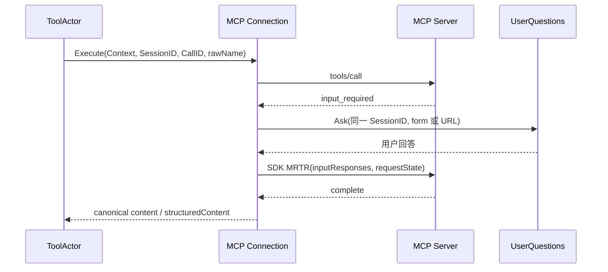

# MCP Client 基本功能

## 范围与依据

本模块采用 `mcp-go v1.0.0`，wire 固定 `2026-07-28`。参考 DSH
`47f943859bef60e4160492346772ded9b24f765a` 的
`packages/mcp/mcp-client/src/tools.ts`（工具发现、调用机制）
和 `connection.ts`（连接、通知、关闭归属）。按用户本次明确要求，只借鉴协议交互机制，
工具命名及结果展示不以 DSH 为兼容目标；旧 Plugin 装配不迁移。
本次实现 stdio、Streamable HTTP、分页、工具变化订阅、同步调用、MRTR、用户输入及取消；
不引入 MCP Server、OAuth workflow、resources、sampling、tasks 或自动重连策略。
连接异常必须可观察，调用不自动重试副作用。

## 架构与接口

`mcpclient.Connection` 是一个外部 Server 的 I/O 生命周期 owner，拥有 SDK session、订阅和在途调用。
`Open(ctx, Config, UserQuestions)` 启动传输、确认版本、等待订阅 acknowledgement、读取完整工具目录。
`Schemas` 返回完整快照，`Changes` 合并工具列表变化通知，`Done` 表示订阅结束或连接关闭；
`Refresh` 原子替换完整分页目录，失败保留上一目录；`Cause` 返回连接异常。
`Provider(name)` 返回独立 Tool 实现的构造器，显式保存 public/raw name 映射，不反解析名称。
`Close(ctx)` 的生命周期由 composition 持有；先取消并关闭传输 I/O，再等待订阅及所有调用退出，
避免等待仍阻塞在 pipe.Write 的工作。
SDK stdio 的管道写入本身不响应 Context；取消后短暂等待仍未结束时关闭该连接并排空写入，
避免只返回取消却遗留写入 goroutine。正常 caller cancellation 仍发送 notifications/cancelled。
每个 ToolActor 仍拥有 Tool 实现，借用连接，不关闭共享连接。连接不保留 Agent、ToolActor 或 Runtime 对象。
`subscription` 独立保存 ack、已接受 filter、subscription ID 和合并变化 channel；
SDK 回调只持有该状态，不绑定 Connection 方法，防止 Connection → SDK → 回调 → Connection 循环。

Tools 的既有静态 `Providers` 表无法表示后续 `tools/list_changed` 新增的名字。
增加 consumer-owned `tool.ProviderSource.Provider(name)` 查询端口，ToolActor 扩展在启动时安装不可变来源列表；
查询仅选择构造器，不传递 Actor 身份、不执行 I/O、不形成另一份运行时地址注册表。
MCP 目录仍通过既有 Tools Registry `RegisterSource` 整批发布；新 Turn 由现有 Runtime 配置流程应用。
Server 组合持有连接与刷新任务，关闭先停止刷新，再排空 Agent，最后关闭连接。

## 协议决策

- 默认执行 `server/discover` 并检查 supportedVersions 包含精确版本。可显式 SkipDiscover；
  SDK facade 所需的本地初始化结果仅启用每请求 metadata，不代表远端确认；随后完整 tools/list
  必须成功且返回现代 complete 结果。所有网络请求固定版本，禁止发送 legacy initialize。
- SDK 的 MRTR 保持唯一实现；保留既有 input_required 缺 content 的局部 parser 适配。
- 每个网络 round 有独立 timeout，subscriptions/listen 无总网络 timeout；整个工具及用户等待有独立上限。
- 必须收到 subscription acknowledgement 后才能发布目录。Server 实际接受的 filter 可以为空；
  此时使用首次完整目录，仍监控订阅流存活。正常 EOF/complete 也视为连接异常，
  不把“没有 error”误判为健康。取消 stdio 请求发送同 request ID 的 notifications/cancelled；
  HTTP 通过取消请求 Context 关闭对应 response/SSE stream。
- 分页拒绝重复 cursor、重复 raw/public name 和超过上限的目录；候选全部验证后才替换。
- 所有 elicitation 仅通过本地发起 tools/call 的 Context 携带 SessionID/CallID；无身份拒绝，
  无 Provider、delegated 或不再 live 的调用 decline，不借用其他 Agent。
- Form 先询问提供/拒绝，再映射 flat primitive schema 到现有 Question，校验后才 accept。
  不支持或索取 secret 的 schema decline。URL 仅允许 HTTPS 或 loopback HTTP，拒绝 userinfo；
  使用既有 Question.detail 展示完整 URL 与 host，由用户自行打开并明确继续，不预取。
  这保留 pinned UserQuestions wire，不增加旧桥接提案中的 ExternalLink 字段。
- 返回 canonical content/structuredContent，原始未知 content 保留；isError 进入 Tools failure。

## 验收

真实本地 stdio 子进程与 httptest HTTP/SSE 验证 metadata、可选发现、旧版拒绝、分页、订阅确认/结束、
取消通知与 response stream 关闭。并发不同 Agent 的 form/URL MRTR 验证准确路由、requestState 和结果；
覆盖 decline/cancel、无 Provider、非法答案及超时。协议 fixtures 验证 MCP wire，
不生成 DSH 工具命名或结果投影 golden。
Server 测试验证发现工具通过真实 ToolActor 执行及工具变化整批发布。
## 实现与验证记录（2026-09-10）

已实现 `mcpclient`、`tool.ProviderSource`、ToolActor 来源绑定、Server 启动/关闭/目录刷新与
CLI `-mcp-server`。具体配置示例与操作方式见 [模块说明](../../mcpclient/README.zh-CN.md)。

- `TestHTTPConnectionPaginationMRTRRoutingAndStreamLifetime`：真实 HTTP JSON / SSE，
  可选 discover、分页、不同 Agent 并发 form/URL、调用取消关闭 response stream、正常订阅结果也判定异常。
- `TestStdioConnectionMRTRAndCallerCancellation`：真实子进程、分页、form/URL MRTR、
  精确 request ID 的 notifications/cancelled 和幂等关闭。
- `TestConnectionShutdownCancelsPendingUserQuestion`：关闭取消并排空正在等待用户的调用。
- `TestStdioCancellationClosesBlockedPipeWriter`：子进程确认收到请求首字节后停止读取，
  caller cancellation 关闭阻塞管道并结算请求，避免把未开始的请求取消误认为成功验证。
- `TestRefreshRetainsCompleteCatalogOnInvalidPages`：重复工具、重复 cursor、非法 schema 和旧格式结果不替换上一目录。
- `elicitor_test.go`：准确 Agent、拒绝、取消、无 Provider、delegated/stale caller、非法答案复填、
  primitive 类型校验，以及不支持的 form / URL 在提问前拒绝。
- `TestTypeScriptProtocolFixtureMRTR`：由 `testdata/protocol.ts` 生成的 MCP wire golden 验证
  多个 inputRequests、requestState 和 Context 保留；不验证 DSH 命名/投影。重生成命令：
  `node mcpclient/testdata/protocol.ts`。Go 测试使用提交的 JSON，不需要 Node runtime。
- `TestHTTPMCPToolActorElicitationAndCatalogChanges`：真实 Server / AgentLoop / ToolActor / Gateway，
  form 回答续调及下一 Turn 执行新发现的工具。

全仓 `go test -count=1 ./...`、`go test -race -count=1 ./...`、`go vet ./...`、`go build ./...` 未通过：
未迁完的 subagent 仍引用已移除的 plugin / plugin/factory，且既有架构检查仍报告历史符号、文件命名及对象边界问题。
这些不是 MCP 局部测试通过的证明范围；本次没有为它们补回旧架构适配器。
MCP 包测试及 race、Server MCP 端到端测试及 race、相关包 vet/build 已通过；
变更文档相对链接和 `git diff --check` 已通过。局部命名审计没有新增 MCP 或接线文件的同名绑定问题，
不表示全仓历史命名审计已通过。没有运行外部真实 MCP 服务验收；外部协议验证使用本地可控 fixtures。
## Web HTTP 连接增量

Web 必须能够在服务启动后输入 `serverName` 与 HTTP(S) `url`，连接 MCP Server；仅启动配置不满足验收。新增 Goren 自有 `mcp.connect`、`mcp.list`、`mcp.disconnect` RPC，沿用 `/api` 的严格 envelope、关联与信任边界，不声明 DSH 管理接口兼容。Web 不接受 stdio、命令、环境变量、认证头或秘密配置；连接仅在当前进程存活，不增加持久化、重连、OAuth 或配置编辑。

进程私有 `mcpManager` 统一拥有启动配置和 Web 创建的连接、完整工具源发布、变更监听、失败撤下和关闭。它作为一个稳定 `tool.ProviderSource` 在启动时安装，内部连接集合可变，查找不得执行 I/O。管理变更串行化，Provider 查询只读锁，不被网络请求长时间阻塞。连接成功表示握手、订阅、分页目录和 Registry 发布均已完成；失败必须释放所获资源。重复名称拒绝覆盖。断连先撤下目录，再取消活动调用并关闭连接；订阅结束暴露 failed 状态，不自动重连。

API Proxy 的 consumer-owned Directory 只依赖管理操作和脱离对象的状态视图。组合根通过 GoAkt Grain identity 发送本地管理命令；管理 Grain 不进入 Tool call / elicitation 路径。禁止 `Catalog → Manager → UserQuestions → Interaction Gateway → Catalog` 指针环：API 仅持有 Actor 地址，不直接持有 Manager。Manager 的 UserQuestions 在 API 构造完成后绑定，网络 admission 之前完成全部接线；不存在 Plugin 桥或额外 Runtime/地址表。

接线：Web MCP 对话框 → `/api/mcp.connect` → API Directory → GoAkt 管理 Grain → mcpManager → mcp-go Connection；Tools Registry → Agent 下一轮工具快照 → ToolActor → 稳定 ProviderSource → 对应 Connection。form/URL elicitation 仍使用原始 Invocation 的 SessionID/CallID，经原有 UserQuestions 返回准确 Agent。

验收必须覆盖：无启动 MCP 配置时通过 HTTP API 动态连接、真实 Agent 工具执行与问题应答、目录变更、断开/异常撤下；Web 输入地址并显示连接状态/工具数，连接失败可见；严格拒绝管理 payload 的未知字段和 stdio 注入；前端测试与构建。全仓既有 Actor 迁移失败单独报告，不把局部测试称为全仓通过。

已完成接线与验证：

- `TestWebHTTPMCPConnectionAndAgentInvocation`：在创建 Agent 后通过 `/api/mcp.connect` 动态连接，表单 MRTR、工具结果进入模型、变更后下一轮新工具、重复名称拒绝、订阅终止后 failed 与目录撤下、显式断开。
- `apiproxy/mcp/api_test.go`：未知字段/stdio 注入拒绝和秘密错误不泄露。
- `MCPDialog.test.tsx`：连接、工具数、断开、失败重试、父组件更新不取消在途请求、卸载取消；全部 Web 39 项测试与生产构建通过。
- 浏览器使用本地真实 Server 与独立 MCP/模型 HTTP fixtures，实际输入 URL 连接、发送 prompt、依次回答 consent 与 form，Agent 返回 done、持久化 turn/end，再在界面断开。该检查不依赖真实供应商密钥。
- `go test -race -count=1 ./mcpclient ./apiproxy/... ./tools/tool/... ./internal/server ./cmd/goren ./web` 通过；相关包 vet/build 通过。全仓迁移阻碍仍按上文说明，不扩展为修复 subagent/旧 Plugin 的任务。

管理 RPC 的整次操作期限为 35 秒；断开/退出中调用取消沿既有 Connection 传播。
Web 只在对话框打开时轮询状态，关闭取消未完成的 HTTP 请求；不存储服务器地址或连接配置。
